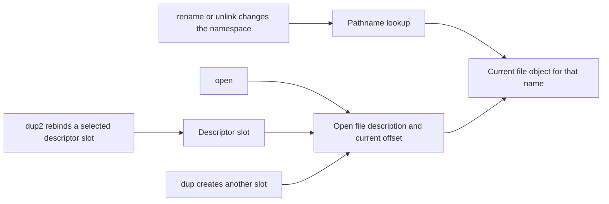

# Distinguish POSIX path, descriptor and open-file identity

**Scope:** PLAN §5.3 and [#326](https://github.com/aivibeflow/LLMLang/issues/326). A local file, an alias and a replacement in a private Linux fixture at `0eee720778e4aedde114cb43faf75be969d1c80e` on `research/all`.

## Question and model

The [POSIX runtime proposal](POSIX-RUNTIME-ARCHITECTURE.md) separates portable runtime contracts from target implementations. A pathname can be replaced while open descriptors retain an object. An integer descriptor can also be explicitly rebound. A typed facade needs distinct contracts for namespace lookup, a live descriptor slot, and the open file description that owns shared I/O state.

The probe creates a regular file containing `ABC` and a hard link to the same object. It opens the file twice and duplicates one descriptor. It then creates a new file containing `XYZ`, renames that file over the original name, and eventually unlinks both names. The final control calls `dup2` to replace a descriptor slot while another descriptor remains open on the original object. It compares file identity using equality of device and inode within the fixture. The comparison does not assume that these numbers are permanent across close and later reuse.



The POSIX descriptions of [open](https://pubs.opengroup.org/onlinepubs/9799919799/functions/open.html), [dup and dup2](https://pubs.opengroup.org/onlinepubs/9799919799/functions/dup.html), [rename](https://pubs.opengroup.org/onlinepubs/9799919799/functions/rename.html), and [unlink](https://pubs.opengroup.org/onlinepubs/9799919799/functions/unlink.html) motivate the observations. This study checks one Linux/overlayfs behavior profile.

## Observations

All eight runs agree with the [expected observation table](POSIX-FILE-IDENTITY-01/run.py), with 21 checks per run.

| Control | Observed outcome |
| --- | --- |
| First read, duplicate read, independent-open read | `A`, `B`, and `A`. The duplicate shares the current offset. The separately opened description has its own offset. |
| Positional read through duplicate | `pread` at zero returns `A`. The shared offset remains two, and the independent offset remains one. |
| Replace the pathname by rename | Opening the replaced name returns `X`; opening the hard link returns `A`. The old object still has one link and is distinct from the replacement. |
| Remove each last pathname | New lookup fails with `ENOENT`. Both open objects report link count zero, while the existing descriptions continue to return `C` and `Y`. |
| Rebind the original integer slot with `dup2` | Reading that slot returns `Z`, advancing the replacement's shared offset to EOF. The surviving duplicate and independent descriptor remain on the original object. |

A typed contract can bind path lookup to a namespace snapshot if it needs stable pathname resolution. It can track live descriptor ownership and lifetime with an explicit handle generation or validated equivalent. A numeric descriptor alone cannot identify the original open description after rebinding. An object identity also cannot determine offset sharing, because different opens of the same file can have different offsets. A direct POSIX facade exposes these distinctions to caller verification. A higher-level facade can hide them only if its API documents which observations remain available.

The [evidence ledger](POSIX-FILE-IDENTITY-01/evidence.json) preserves all 168 observations, exact source digests and compiler details. The result covers regular local files, same-directory replacement and serial calls in one process. Remote filesystems, concurrency with lookup or descriptor reuse, storage durability, descriptor passing and portability across implementations remain open.

## Reproduce

Use CPython 3.12.14, Debian GCC 14.2.0-19 and the recorded Linux x86-64, glibc 2.41 and overlayfs profile. The [probe](POSIX-FILE-IDENTITY-01/probe.c) uses new temporary directories, builds C17 at O0 and O2, and controls filenames and bytes explicitly.

```sh
set -eu
fixture=research/runtime-and-systems/RT-10/POSIX-FILE-IDENTITY-01
out=$(mktemp)
python3 -B "$fixture/run.py" --cc /usr/bin/cc > "$out"
cmp "$out" "$fixture/evidence.json"
```

The counts enumerate the named schedules. Mermaid source was inspected directly.
