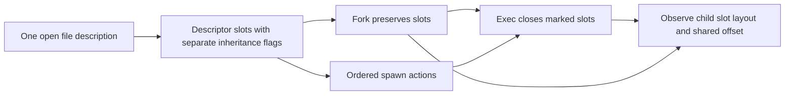

# RT-10 — POSIX startup descriptor inheritance and spawn actions

- **Date** — 2026-11-25
- **Tracking** — [PLAN §5.3](../../../PLAN.md#53-posix-architecture-and-conformance) · [#326](https://github.com/aivibeflow/LLMLang/issues/326)
- **Status** — Reproduced in one Linux and glibc profile

## Question and method

Which descriptor state should a typed startup API promise to the new program? The probe opens one private file and duplicates its open file description into fixed test descriptors. One slot has `FD_CLOEXEC`, one permits default inheritance, and two slots are initially absent. Before each case the parent resets the shared file offset. The child reports each slot's descriptor flags and reads one byte from each open slot. The parent waits and observes its own offset. Case selection uses ordinary `fork`, `execv`, and `posix_spawn` with a controlled executable. [File and descriptor identity](RT-10-POSIX-FILE-IDENTITY-2026-11-25.md) · [POSIX runtime architecture](POSIX-RUNTIME-ARCHITECTURE.md)



## Observations

| Startup case | Open child slots and bytes | Parent offset or outcome |
|---|---|---|
| Fork only | Slot 80 reads A and marked slot 81 reads B | Offset 2 |
| Fork then exec | Slot 80 reads A | Offset 1 |
| Same-slot raw `dup2` then exec | Slot 80 reads A | Offset 1 |
| Spawn with default actions | Slot 80 reads A | Offset 1 |
| Spawn maps slot 81 to slot 82, then closes 81 and 80 | Slot 82 reads A | Offset 1 |
| Spawn closes slot 81 before using it as the mapping source | No child observation | `EBADF` |
| Spawn maps slot 81 to itself and closes slot 80 | Slot 81 reads A with the flag cleared | Offset 1 |
| Spawn maps absent slot 83 | No child observation | `EBADF` |

All 64 case outcomes match across two GCC optimization profiles and four repetitions per profile. The same-slot raw `dup2` preserves the flag. The same-slot spawn file action clears it on the tested implementation. Spawn actions execute in their specified order, which explains the successful map-then-close case and the close-before-map refusal. The glibc refusals return `EBADF` directly and leave the harness's child identifier unchanged. [Evidence ledger](POSIX-SPAWN-DESCRIPTORS-01/evidence.json)

## Implications and limits

A candidate process-start interface can declare ordered descriptor remapping and the child-visible slot set. Validate that ownership and lifetime refer to the selected slots and shared open file description. Treat a spawn file action and a direct syscall wrapper as operations with explicitly checked contracts, even when their names correspond.

The Linux x86-64 fixture uses glibc 2.41 and single-threaded setup. Other implementations may report startup failure differently. The model leaves concurrent descriptor creation and inheritance, signals, arbitrary descriptor action lists, process cancellation and portable error conversion open. It exercises one local process-start observation boundary within the larger POSIX vertical slice.

## Reproduction

Run from the repository root on Linux x86-64 with CPython 3.12.14, GCC 14.2.0 (Debian 14.2.0-19) and glibc 2.41. The probe and its input file are built and run in a temporary directory. [Native probe](POSIX-SPAWN-DESCRIPTORS-01/probe.c) · [Runner](POSIX-SPAWN-DESCRIPTORS-01/run.py)

```sh
set -eu
dir=research/runtime-and-systems/RT-10/POSIX-SPAWN-DESCRIPTORS-01
observed=$(mktemp)
trap 'rm -f "$observed"' EXIT
python3 -B "$dir/run.py" --cc cc > "$observed"
cmp "$dir/evidence.json" "$observed"
```
