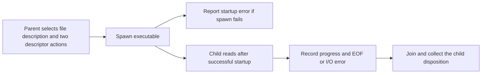

# RT-10 — A POSIX vertical slice for process startup and file input

The initial candidate slice maps an explicitly selected regular-file description into a spawned child, reads it in bounded chunks, and returns a typed operation result with a separate process disposition. This composes the existing [descriptor startup](RT-10-POSIX-SPAWN-DESCRIPTORS-2026-11-25.md) and [file identity](RT-10-POSIX-FILE-IDENTITY-2026-11-25.md) evidence. The branch baseline is `4a39dae720a56c76616e1a30683da81b960f808c`. [POSIX compatibility issue](https://github.com/aivibeflow/LLMLang/issues/326)

The parent opens the source with close-on-exec and maps it to a chosen child descriptor using spawn actions. It separately maps a small report pipe. A distinct close-on-exec canary tests that the child receives only the intended extra descriptors from the fixture. The child reads regular-file data in two-byte requests, reporting each count and ending on EOF or a read error. The parent records the spawn result, any joined exit status, the child report and the offset of its retained file description.



| Case | Spawn outcome | Child I/O and process outcome |
|---|---|---|
| Regular file at offset 1 | Success | Reads `bcdef` with counts 2, 2, 1, 0, exits 0. Parent offset becomes 6. |
| Empty file | Success | Reads EOF immediately, exits 0 |
| Write-only description mapped as input | Success | Child reports read `EBADF`, exits 12 |
| Input descriptor omitted | Success | Child reports read `EBADF`, exits 12 |
| Ordered actions close the source before mapping it | `EBADF` | No successful child-program start or report observed |
| Executable absent | `ENOENT` | No successful child-program start or report observed |

Both libc profiles at optimization levels 0 and 2 agree across all 24 cases. The parent offset reflects the child's read through the shared open file description. The same numeric error appears both during startup and after successful startup, so the slice preserves the operation boundary that produced the error. Short progress, EOF and exit status remain distinct. [Exact outputs and linked archive identities](POSIX-STARTUP-IO-SLICE-01/evidence.json)

The candidate scope is a Linux regular executable, an explicit descriptor map, regular-file reads, a separate small report, and a joined child. It establishes a bounded starting point for the language-facing API. Filesystem namespace races, process cancellation, environment policy, asynchronous I/O, arbitrary inheritance, other kernels and general conformance claims remain open. [POSIX runtime architecture](POSIX-RUNTIME-ARCHITECTURE.md)

## Reproduction

Use x86-64 Linux 6.18.57, GCC 14.2.0 (Debian 14.2.0-19), glibc 2.41, musl 1.2.5, GNU Binutils 2.44 and CPython 3.12.14. The [cross-libc setup](RT-10-POSIX-CROSS-LIBC-2026-11-25.md#reproduction) pins the musl package. The runner verifies static artifact selection and both hash seeds produced identical receipts. The diagram was checked as Mermaid source.

```bash
fixture=research/runtime-and-systems/RT-10/POSIX-STARTUP-IO-SLICE-01
LC_ALL=C PYTHONHASHSEED=1 python3 -B "$fixture/run.py" --musl-root /path/to/extracted/musl > /tmp/llmlang-rt10-posix-startup.json
cmp "$fixture/evidence.json" /tmp/llmlang-rt10-posix-startup.json
```
