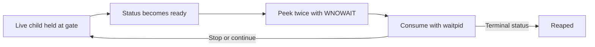

# RT-10. Typed child status and reaping across two libcs

A POSIX runtime can separate observation of a child status from consumption of that status. This experiment compares `waitid` with `WNOWAIT` and `waitpid`, using the same C source statically linked against glibc 2.41 and musl 1.2.5. A pipe gate holds each child until the parent has completed the current observation. [Issue #326](https://github.com/aivibeflow/LLMLang/issues/326) · [Prior cross-libc build audit](RT-10-POSIX-CROSS-LIBC-2026-11-25.md)

| State in the fixture | Typed result | Observation and consumption |
| --- | --- | --- |
| Child held at the gate | No requested status ready | `waitid` succeeds with no reporting PID. `waitpid` returns zero. |
| Child stopped | Stopped by SIGSTOP | Two peeks agree. Consuming the event leaves no pending stopped status. |
| Child resumed | Continued | Two peeks agree. Consuming the event leaves no pending continued status. |
| Child exits or is terminated | Exited with a code or terminated by a signal | Two peeks agree. A terminal `waitpid` reaps the child, and the subsequent wait returns `ECHILD`. |



Three child traces produce 26 typed observations per run. Four repetitions at both optimization levels under each libc reproduce all 416 observations. The test decodes status through the standard macros after a positive `waitpid` PID and checks `si_pid` before decoding the payload of `waitid`. A separate Python oracle defines the expected event order and payloads. The static-link audit verifies the linked archive path and records exact binary and runtime digests. [Evidence](POSIX-WAIT-STATUS-01/evidence.json)

Normal exit with code 143 and termination by SIGTERM have distinct typed results. The numeric projection `128 + SIGTERM` also yields 143 on this Linux target. A facade that exposes that scalar alone therefore loses the cause. The fixture suggests representing readiness, status kind and consumption separately. These tests use one child per trace, one parent waiter and explicit coordination. Competing waiters, status coalescing, job-control groups, PID reuse, interrupted waits and other kernels remain outside the checked scope.

## Replay

The source baseline is `8f69dcb` on `research/all`. Replay used GCC 14.2.0 and CPython 3.12.14 on x86-64 Linux 6.18.57. Obtain the musl development sysroot using the package and digest in the earlier audit. Exact binary digests depend on the toolchain and linked libraries. [Sysroot commands](RT-10-POSIX-CROSS-LIBC-2026-11-25.md#reproduce)

```sh
data=research/runtime-and-systems/RT-10/POSIX-WAIT-STATUS-01
receipt=$(mktemp)
python -B "$data/run.py" --musl-root /path/to/extracted/musl > "$receipt"
cmp "$data/evidence.json" "$receipt"
rm "$receipt"
```
