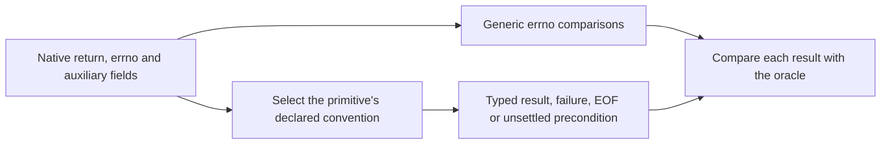

# RT-10 — Native error domains at the primitive boundary

- **Date** — 2026-11-25
- **Tracking** — [PLAN §5.2](../../../PLAN.md#52-execution-semantics-and-runtime-architecture) · [#325](https://github.com/aivibeflow/LLMLang/issues/325)
- **Status** — Reproduced typed observations for glibc and musl on Linux

## Question and method

Can one generic error convention safely normalize several POSIX-facing primitives? The probe records the native return value, saved `errno` and selected auxiliary observation immediately after each call. It varies the incoming `errno` between two unrelated values. Calls exercise missing files and descriptors, direct pthread, clock and process-start statuses, numeric address parsing, integer conversion and end of directory. Address parsing is limited to numeric input and uses no network lookup. [POSIX runtime architecture](POSIX-RUNTIME-ARCHITECTURE.md) · [Cross-libc setup](RT-10-POSIX-CROSS-LIBC-2026-11-25.md)

The comparison evaluates a typed rule for each primitive, a generic negative-result rule using `errno`, and a rule that interprets nonzero `errno` as failure regardless of the call. GCC links both libc profiles statically and the harness confirms the actual selected `libc.a`.



## Results

| Primitive family | Typed interpretation |
|---|---|
| `open` and `read` | The failure sentinel directs the adapter to the saved `errno`. |
| `pthread_mutex_trylock`, `clock_nanosleep`, and `posix_spawn` | The returned status supplies the function error. |
| `getaddrinfo` with numeric-only parsing | The returned `EAI_NONAME` belongs to the name-resolution domain. |
| `strtol` | Clearing `errno` separates an exact maximum value from range overflow. The end pointer distinguishes partial input. |
| `readdir` | At end of directory, clearing `errno` allows EOF to be distinguished from a failed enumeration. An uncleared precondition yields an unsettled observation. |

All 336 typed observations match the oracle across two libc profiles, O0 and O2, and three repetitions. The generic negative-result rule disagrees on 216 observations and the generic `errno` rule on 240. With the tested invalid numeric address, glibc retains the incoming `errno` and musl leaves `EINVAL`. Both return the same `EAI_NONAME` status. At the integer boundary, exact maximum and overflow return identical raw integer values. The sentinel requires the declared call protocol to recover the correct status. [Evidence ledger](PRIMITIVE-ERROR-DOMAINS-01/evidence.json)

## Limits

A primitive contract should name its result and error channels, any required preparation and which secondary observations participate in interpretation. This fixture covers the listed controlled calls and error cases on one kernel and architecture. It leaves portable failure details, cancellation, asynchronous signal effects, other integer widths and production foreign-call policy open.

## Reproduction

Run from the repository root with Linux x86-64, CPython 3.12.14, GCC 14.2.0 (Debian 14.2.0-19), GNU binutils 2.44, glibc 2.41 development files and the musl 1.2.5 development sysroot from the earlier cross-libc comparison. [Native probe](PRIMITIVE-ERROR-DOMAINS-01/probe.c) · [Runner](PRIMITIVE-ERROR-DOMAINS-01/run.py) · [Musl sysroot setup](RT-10-POSIX-CROSS-LIBC-2026-11-25.md)

```sh
set -eu
dir=research/runtime-and-systems/RT-10/PRIMITIVE-ERROR-DOMAINS-01
observed=$(mktemp)
trap 'rm -f "$observed"' EXIT
python3 -B "$dir/run.py" --musl-root "$MUSL_SYSROOT" > "$observed"
cmp "$dir/evidence.json" "$observed"
```
