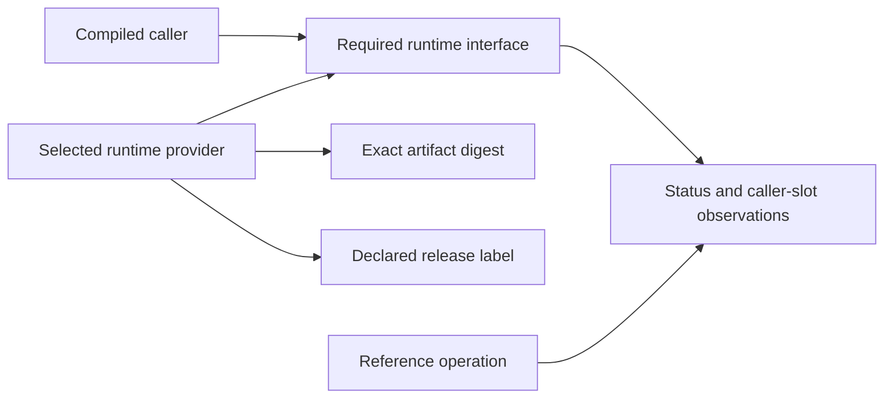

# RT-10 — Runtime version declarations and selected provider identity

- **Date** — 2026-11-25
- **Tracking** — [PLAN §5.2](../../../PLAN.md#52-execution-semantics-and-runtime-architecture) · [#325](https://github.com/aivibeflow/LLMLang/issues/325)
- **Status** — Reproduced native experiment for one runtime service and target

## Question and alternatives

A compiled caller may delegate a primitive to a native runtime provider. An interface identifier describes the contract used to interpret the call. A release label may express a maintainer's compatibility promise. An artifact digest names the bytes selected for the invocation. This experiment compares candidate bindings based on the interface alone, interface plus exact release label, and interface plus exact artifact. It also compares observable behavior with an independent source oracle. [POSIX runtime architecture](POSIX-RUNTIME-ARCHITECTURE.md) · [Language versioning](../../packages-and-ecosystem/RT-18/LANGUAGE-VERSIONING.md)

The fixture compiles five trusted C shared objects with the same SONAME and exported entry names and copies one object byte for byte into a separate directory. The operation takes an integer and an initialized caller slot. Out-of-domain input returns an error and preserves the slot. Interface 1 requires floor division by four on the allowed values. The probe uses explicit local paths and calls the metadata functions independently of the operation. It then observes each interface-1 candidate even when a compared policy would refuse that candidate. Interface 2 is left uncalled through the interface-1 operation signature.

## Results

| Provider | Interface 1 | Same label as baseline | Same bytes | Differing operation observations |
|---|---|---|---|---:|
| Baseline | Yes | Yes | Yes | 0 |
| Byte-identical copy in another directory | Yes | Yes | Yes | 0 |
| Build metadata changed | Yes | Yes | No | 0 |
| Different rounding rule | Yes | Yes | No | 24 |
| Label changed from 1.0.0 to 1.1.0 | Yes | No | No | 0 |
| Intentionally unsupported interface | No | Yes | No | No call |

Each compatible-interface candidate runs the full domain of 32 values plus four rejected input controls. Across 180 native invocations, the behavior change alters the result exactly for the 24 allowed values with a nonzero remainder. All candidates with the supported interface preserve the slot on rejected input. The metadata and release-label changes return the original observations despite changing the artifacts. [Evidence ledger](RUNTIME-VERSION-IDENTITY-01/evidence.json)



## Implications and limits

Use the declared interface to interpret the call, and associate exact implementation evidence with the selected artifact and target profile. Release labels can inform a separate version-compatibility policy. The experiment gives a counterexample to deciding exact reuse or semantic equivalence by a label. An artifact change invalidates an exact-byte claim even when the observed service behavior is preserved. A separately checked compatibility claim could cover that change for its declared observations.

The five providers are generated locally, and their paths and contents remain stable throughout observation. The fixture hashes files on those paths and supplies the explicit locations to the loader. Production runtime binding still needs verified load-time identity, transitive provider evidence, runtime-state compatibility, version-range policy and a mechanism to uphold the claims under concurrent changes. The experiment takes no position on compatibility across build profiles or operating systems.

## Reproduction

Run from the repository root on x86-64 Linux with GCC 14.2.0 (Debian 14.2.0-19) and the matching linking environment. The runner builds in a temporary directory and records the five artifact digests, tool fingerprint, source hashes, admission outcomes and all operation observations. [Runner](RUNTIME-VERSION-IDENTITY-01/run.py) · [Native provider](RUNTIME-VERSION-IDENTITY-01/provider.c)

```sh
set -eu
dir=research/runtime-and-systems/RT-10/RUNTIME-VERSION-IDENTITY-01
observed=$(mktemp)
trap 'rm -f "$observed"' EXIT
python3 "$dir/run.py" --cc cc > "$observed"
cmp "$dir/evidence.json" "$observed"
```
