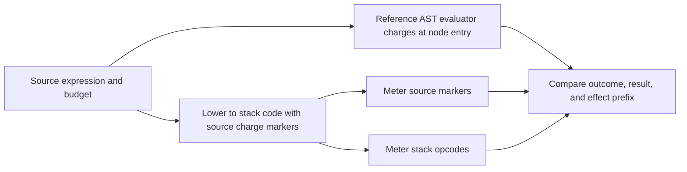

# RT-10 — Source fuel and stack VM execution

If fuel exhaustion is observable, can a VM meter instructions while preserving the reference evaluator's behavior? This fixture compares a direct tree evaluator with a separate lowering and stack machine over the same acyclic expressions. The branch baseline is `097b6776bc2631464ca9dc8cf62182e1b23a5a97`. [Recursion, termination and fuel](../../language-design/RT-03/RESEARCH-SCENARIO-36-RECURSION-TERMINATION-AND-FUEL.md)

The source evaluator spends one unit on entry to a literal, effect, addition, or conditional. It evaluates arguments from left to right and evaluates only the selected branch. An effect appends a label and returns a value. The stack compiler emits a charge marker before the instructions for each expression. One VM profile meters those markers. The other meters executable opcodes individually, excluding markers and final halt. The same lowering supplies both VM runs. [Evaluator, lowering and VM](STACK-VM-FUEL-01/run.py)



Across 405 trees and 13 input budgets, source-step metering matches every result, effect prefix, terminal state and remaining budget. Opcode metering differs on result, effect prefix or terminal state in 1,280 of 5,265 cases. That includes 898 terminal differences and 580 effect-prefix differences. The two categories overlap. [Counts, example code and exact observations](STACK-VM-FUEL-01/evidence.json)

With budget 1, a conditional consumes the source node charge and stops before evaluating its test. The opcode profile instead executes the test's effect before stopping. The later branch is unselected in both executions at that cut. At budget 3, the source completes the selected branch and returns its value. The example shows why equal behavior with enough fuel cannot establish equal partial behavior under every budget.

For this profile, a stack VM can preserve source fuel by retaining explicit charging boundaries. Its opcode count can still be measured separately as a VM cost metric. The experiment covers compiler-generated forward branches, integer fixtures, and a deterministic trace. It leaves external I/O, recursion, adaptive optimization, validation of external bytecode, resource release and any production VM decision open. [Runtime architecture issue](https://github.com/aivibeflow/LLMLang/issues/325)

## Reproduction

CPython 3.12.14 produced identical evidence with hash seeds 1 and 2. The diagram was checked as Mermaid source.

```bash
fixture=research/runtime-and-systems/RT-10/STACK-VM-FUEL-01
LC_ALL=C PYTHONHASHSEED=1 python3 -B "$fixture/run.py" > /tmp/llmlang-rt10-stack-vm-fuel.json
cmp "$fixture/evidence.json" /tmp/llmlang-rt10-stack-vm-fuel.json
```
