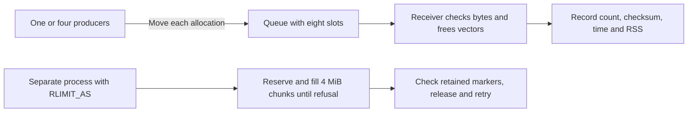
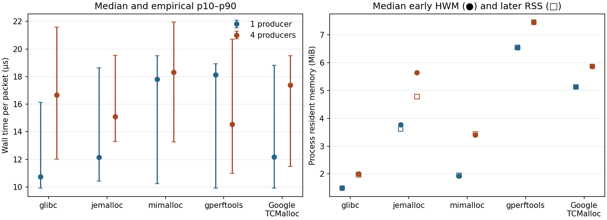

# RT-25 concurrent ownership transfer and address-space limits

Five Linux allocator builds completed 100 fresh Rust processes that transfer allocation ownership across threads. All delivered the expected payloads and checksums. In a separate address-space control, all ten capped processes reported a recoverable allocation refusal and could reserve another chunk after releasing the retained vectors.

## Workload

The same optimized Rust executable uses `System` throughout. Each process resolves `malloc`, `calloc`, `realloc`, `free` and `posix_memalign` and checks the exact canonical provider path before measuring. One or four producers each send 1,024 vectors of seven sizes between 24 and 65,536 bytes through a single queue with eight slots. The receiver checks each ticket, vector length and payload byte before freeing the allocation. An independent Python oracle checks the aggregate count, total bytes and weighted checksum in every process. The one-producer totals were 1,024 vectors, 15,161,344 bytes and checksum 7,861,725,308. The four-producer totals were 4,096 vectors, 60,651,856 bytes and checksum 125,339,911,956.



## Measured observations

Each of ten blocks shuffled all ten workload profiles with seed 2526. Processes ran on logical CPUs 3 and 4 on the same AMD EPYC 9V74 host with Linux 6.18.57. The containing cgroup accumulated 66 CPU quota periods and zero throttling events during churn. Its activity includes other processes in that group. Wall time includes work creation, data fills, queue waits, full byte checks, allocation, release and thread joins. The per-packet figure divides total elapsed wall time by processed packets. It measures end-to-end throughput, with the four-producer profile doing four times as many operations on two CPUs.

| Provider | 1 producer, median µs/packet | 1 producer, early HWM/later RSS (MiB) | 4 producers, median µs/packet | 4 producers, early HWM/later RSS (MiB) | Retained 4 MiB chunks at 96/192 MiB |
| --- | ---: | ---: | ---: | ---: | ---: |
| glibc | 10.72 | 1.49/1.49 | 16.67 | 2.00/1.97 | 23/47 |
| jemalloc | 12.16 | 3.78/3.62 | 15.10 | 5.65/4.78 | 15/36 |
| mimalloc | 17.80 | 1.92/1.95 | 18.30 | 3.41/3.43 | 14/35 |
| gperftools TCMalloc minimal | 18.12 | 6.55/6.55 | 14.54 | 7.46/7.46 | 19/43 |
| Google TCMalloc | 12.18 | 5.13/5.13 | 17.37 | 5.87/5.87 | 18/42 |



All five empirical p10–p90 intervals overlap within each producer profile. Glibc had the smallest median resident-set observations at both producer counts. `VmHWM` was sampled after workers joined and `VmRSS` was sampled at least 20 ms later. The early HWM covers the process through its observation time and later readings may exceed it. The process figures include allocator initialization, code and thread state.

The single-threaded pressure control applies a Linux process virtual-address limit before startup. Each successful reservation is touched, retained and checked at both end bytes. The number of retained chunks reflects address mappings, allocator reserves and overhead as well as the payload. All five providers honored the API's fallible allocation boundary in the observed cases and all retried successfully after release. Physical pressure, concurrent pressure, representative workloads and component allocator selection remain open.

## Reproduce

Use CPython 3.12.14 and Rust 1.85.1 at `4eb161250e340c8f48f66e2b929ef4a5bed7c181`. Use Debian glibc 2.41-12+deb13u4, jemalloc 5.3.0-3, mimalloc 2.0.9+ds-2 and gperftools 2.16-1. The modern Google library uses upstream revision `afcf25e3c76f099ca410b994c3621312d438ed10`. The build inputs are documented alongside the graph studies. [Debian provider packages](RT-25-FOUR-PROVIDER-ALLOCATOR-REPLAY-2026-11-25.md) · [Google TCMalloc build](RT-25-MODERN-GOOGLE-TCMALLOC-2026-11-25.md)

```sh
study=research/runtime-and-systems/RT-25/ALLOCATOR-CONCURRENT-01
LC_ALL=C PYTHONHASHSEED=37 python "$study/run.py" \
  --rustc /path/to/rustc --cpu 3 4 --trials 10 --seed 2526 \
  --glibc /path/to/libc.so.6 --jemalloc /path/to/libjemalloc.so.2 \
  --mimalloc /path/to/libmimalloc.so.2 --gperftools /path/to/libtcmalloc_minimal.so.4 \
  --google /path/to/libllmlang_tcmalloc.so --output /tmp/rt25-concurrent.json
LC_ALL=C MPLBACKEND=Agg python "$study/chart.py" "$study/evidence.json" /tmp/rt25-concurrent.png
```

The ledger records every observation, shuffled position, empirical percentile, two pressure cases per provider and SHA-256 for each ELF and measurement source. The archived ledger digest is `8a11be14863689ffd5a1acf300cbcab508e9299842595c9c436b7018bffc2eba`. Rendering it with Matplotlib 3.10.8 produced PNG digest `9b5deffb94cb7cdbd7924f6f454113d40f8f7c2b4df2f968a8c513a4c40ab0f7`. [Raw ledger](ALLOCATOR-CONCURRENT-01/evidence.json)
