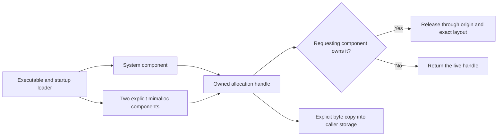

# RT-25 allocator selection within one executable

A Linux Rust executable used a named mimalloc adapter alongside `System` with either glibc or jemalloc selected at process startup. Each build and startup combination completed 270 ownership cases. Across four combinations, all 720 wrong-component requests returned the live allocation to its caller for correct release.

## Selection boundaries

| Scope | Mechanism | Allocation and ownership |
| --- | --- | --- |
| Executable build | Choose a Rust global allocator in the final linked binary and resolve linked dependencies | The global applies to ordinary Rust allocations in that executable. Native library entry points and statically linked allocator copies require their own compatibility checks. |
| Process startup | Use the target default provider or pinned ELF interposition | In the measured profiles all five checked C allocation symbols resolve to glibc or jemalloc. `System` uses the process provider for these allocations, and provenance stays with each live allocation. |
| Component adapter | Call named allocation and free functions through a retained adapter | The selected component allocates only its explicit buffers through that adapter. Each handle retains its creating component, allocation layout, and the lifetime of the named provider. |

The executable keeps its Rust global allocator declaration fixed across both loader profiles. It verifies the same five process symbols before opening mimalloc, after opening it with `RTLD_LOCAL`, and after completing the cases. It also checks that the named allocation and free functions both resolve to the intended mimalloc ELF. Build-time replacement in a shipping binary, static linkage and additional targets require separate evidence.



## Ownership evidence

The fixture uses a System component and two separately identified components sharing one mimalloc adapter. It crosses all nine origin and requesting-component pairs, six buffer sizes from 1 to 8,192 bytes and five alignments through 4,096 bytes. All cases verify alignment and check the copied payload after release. A rejected request also checks the still-live bytes and releases through the original owner. Identity matters even when both components use the same allocator implementation.

| Rust build | Process provider | Cases | Rejected foreign requests | Checksum |
| --- | --- | ---: | ---: | ---: |
| Debug | glibc | 270 | 180 | 85,046,823 |
| Debug | jemalloc | 270 | 180 | 85,046,823 |
| Optimized | glibc | 270 | 180 | 85,046,823 |
| Optimized | jemalloc | 270 | 180 | 85,046,823 |

A compile control tries to retire an allocator library while a borrowing allocation remains live. Rust rejects the move with E0505. A startup control claims jemalloc while loading glibc and fails at the provider check before making a component allocation. The measured scope is single-threaded explicit buffers and explicit copies. A production ABI needs to specify owner token or origin-provided release, unload ordering and behavior across each target and linker mode. Representative workload cost and the supported production policy remain open. [Existing Rust–C transfer study](RT-25-FFI-BUFFER-OWNERSHIP-2026-11-25.md)

## Reproduce

Run on Linux x86-64 with CPython 3.12.14, Rust 1.85.1 at `4eb161250e340c8f48f66e2b929ef4a5bed7c181`, and Debian glibc 2.41-12+deb13u4, jemalloc 5.3.0-3 and mimalloc 2.0.9+ds-2. The output ledger pins the exact provider and source digests. Runs with Python hash seeds 37 and 71 produced the same SHA-256 `fc1594590154f8f96a4b2e65848d27eeabdd5b1709c2abafc1f4dc887e8e850a`. [Evidence ledger](COMPONENT-ALLOCATOR-01/evidence.json) · [Provider package sources](RT-25-FOUR-PROVIDER-ALLOCATOR-REPLAY-2026-11-25.md)

```sh
study=research/runtime-and-systems/RT-25/COMPONENT-ALLOCATOR-01
LC_ALL=C PYTHONHASHSEED=37 python "$study/run.py" \
  --rustc /path/to/rustc --glibc /path/to/libc.so.6 \
  --jemalloc /path/to/libjemalloc.so.2 --mimalloc /path/to/libmimalloc.so.2 \
  --output /tmp/rt25-component-allocator.json
```
