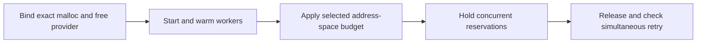
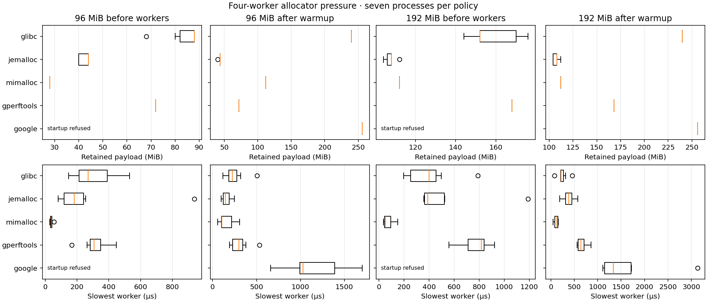

# RT-25 Concurrent allocator pressure and selection scopes

The allocator study distinguishes the runtime's allocator, the process's public allocation symbols and the provider that owns each component buffer. A new Linux experiment compares five providers under concurrent virtual-address pressure. The existing workload and FFI evidence supply a separate basis for comparing the supported selection scopes.



The runner uses two or four native threads, 96 or 192 MiB `RLIMIT_AS`, and a fixed maximum of sixteen 4 MiB chunks per worker. The cap is applied either before worker creation or after per-thread warmup. Both placements occur after the allocator library loads. The sampler reads the process's virtual extent at cap activation. It touches and checks the first and last bytes of every held allocation, synchronizes release, and attempts one allocation again in every worker. The experiment measures reserved payload under a virtual-address budget, with no inference about total resident payload or physical pressure.

## Results

The first run retains 280 fresh processes across five providers, two thread counts, two caps and two activation points. It records 28 worker-start refusals, all in the same modern Google TCMalloc early-cap groups. Its virtual extent already exceeded the chosen cap at activation. The 252 started processes record 756 worker outcomes. Of these, 557 stop on a fallible allocation refusal and 199 reach the workload quota. The final retry succeeds for 724 workers. The second run reproduces the 28 startup refusals and the provider groups with payload above the nominal cap. Retry counts differ by one.

| Four workers, 96 MiB | Median retained MiB, cap before workers | Median retained MiB, cap after warmup |
|---|---:|---:|
| glibc | 88 | 240 |
| jemalloc | 44 | 44 |
| mimalloc 2.0.9 | 28 | 112 |
| gperftools TCMalloc minimal | 72 | 72 |
| Modern Google TCMalloc | Worker startup refused | 256 |

All 49 processes with total retained payload above the nominal cap applied it after warmup and started above that cap in virtual extent. This behavior demonstrates that lowering a process virtual-address limit after reservation leaves earlier mappings available. A task payload quota needs explicit admission and accounting. Worker-start failures, allocation failures and quota stops are distinct. Timing depends on how many chunks a worker processes before stopping, so the distributions describe this protocol rather than a general allocator speed ranking.



## Selection scope comparison

| Scope | Supported bounded comparison |
|---|---|
| Per executable or Rust runtime | A named static allocator and the system default can both be measured independently. The native link and runtime closure must identify the selected allocator. |
| Process-wide public allocation | Shared interposition and a static override can bind public symbols in the observed Linux fixture. Hidden allocation paths and other OS/linker behavior require their own evidence. |
| Per component | Explicit matching provider, allocation and release capabilities preserve ownership with multiple allocators. The static mimalloc study checks correct alignment with 3.7.1 and detects the separately pinned legacy control. |

The candidate can preserve system allocation as an available configuration and expose named allocator or component selection where exact provenance and ownership can be established. The experiments establish feasibility for scoped Linux configurations. Representative package and Toolchain workloads, physical pressure and selection of production defaults or supported target combinations remain human-gated. [Graph-study comparison](RT-25-FOUR-PROVIDER-ALLOCATOR-REPLAY-2026-11-25.md) · [Modern TCMalloc](RT-25-MODERN-GOOGLE-TCMALLOC-2026-11-25.md) · [Static allocator integration](RT-25-STATIC-ALLOCATOR-SELECTION-2026-11-25.md) · [Component ownership](RT-25-COMPONENT-ALLOCATOR-OWNERSHIP-2026-11-25.md) · [Rust/C allocation pairing](RT-25-FFI-BUFFER-OWNERSHIP-2026-11-25.md)

## Replay

Use GCC 14.2.0, Linux x86-64, CPython 3.12.14 and matched library digests from the [earlier pressure study](RT-25-ALLOCATOR-CONCURRENT-AND-ADDRESS-LIMIT-2026-11-25.md). The [raw samples](CONCURRENT-ALLOCATOR-PRESSURE-01/samples.json) record the exact source, compiler, provider and CPU pins. Matplotlib 3.10.8 renders those samples.

```sh
p=research/runtime-and-systems/RT-25/CONCURRENT-ALLOCATOR-PRESSURE-01
LC_ALL=C PYTHONHASHSEED=37 python -B "$p/check.py" \
  --glibc /path/to/libc.so.6 --jemalloc /path/to/libjemalloc.so.2 --mimalloc /path/to/libmimalloc.so.2.0 \
  --gperftools /path/to/libtcmalloc_minimal.so.4.5.18 --google /path/to/libllmlang_tcmalloc.so
LC_ALL=C MPLBACKEND=Agg MPLCONFIGDIR=/tmp python -B "$p/plot.py"
```
