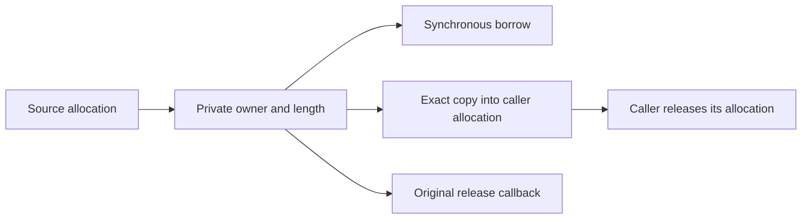

# RT-25. Owner-routed Rust and C buffers

Can two allocator domains retain separate allocation ownership when they exchange data through a C ABI? The fixture loads a Rust `cdylib` using `System` with glibc and a second shared object exposing named mimalloc calls. The C coordinator retains each allocation's pointer, length and owner callback. It offers synchronous read-only borrows and copies into caller-owned buffers. An owner check rejects a mismatched release before calling either allocator. [Issue #332](https://github.com/aivibeflow/LLMLang/issues/332) · [Allocator compatibility study](RT-25-MEMORY-ALLOCATOR-COMPATIBILITY-AND-BENCHMARKING.md)

| Operation | ABI rule exercised |
| --- | --- |
| Borrow | The provider keeps ownership and the allocation live throughout the synchronous call. Rust reads a pointer and length and returns a digest. |
| Copy | The destination belongs to the caller. An insufficient capacity leaves all destination bytes unchanged. A successful copy survives modification and release of the source. |
| Release | The original owner consumes the live allocation exactly once. A foreign owner leaves the allocation live, and a second release is refused while the closed descriptor remains in scope. |
| Module lifetime | The C coordinator releases both domains' buffers before unloading mimalloc. |



The experiment checks eight buffer sizes from 1 to 65,536 bytes, four byte patterns and both allocator directions. All 64 scenarios pass in each of two builds, paired at `-O0` and `-O3`. They yield 128 rejected foreign releases, 128 rejected short copies, and 256 valid owner releases across both build profiles. Both profiles produce identical output digests. `dladdr` resolves the Rust libc symbol to glibc and the C allocation and release functions to the same separate mimalloc shared object. The process runs without `LD_PRELOAD`. [Per-case evidence](FFI-OWNERSHIP-01/evidence.csv)

A process-wide allocator selection and a named component allocator have different integration points. This experiment exercises coexistence through named functions and private owner metadata. The raw Rust exports require a valid allocation, live borrow and exact length from the coordinator. Concurrent release, long-lived borrows, intentional misuse of raw pointers, unloaded providers, allocation failures after startup, static linkage, platform-specific ABI, and LLMLang runtime integration remain outside the evidence. The results support owner-routed release for the tested ABI without deciding an allocator.

## Replay

Source baseline `156c2bc` on `research/all`. Replay used Debian 13 x86-64, glibc 2.41, GCC 14.2.0 and Rust 1.85.1. The mimalloc Debian package SHA-256 is `a20035605a532be3186f0f48607c7106fe2a5551066c29de663c965692c446c4`. [Debian mimalloc package](https://deb.debian.org/debian/pool/main/m/mimalloc/libmimalloc2.0_2.0.9+ds-2_amd64.deb)

```sh
data=research/runtime-and-systems/RT-25/FFI-OWNERSHIP-01
result=$(mktemp)
bash "$data/replay.sh" /path/to/libmimalloc.so.2 "$result"
cmp "$data/evidence.csv" "$result"
rm "$result"
```
