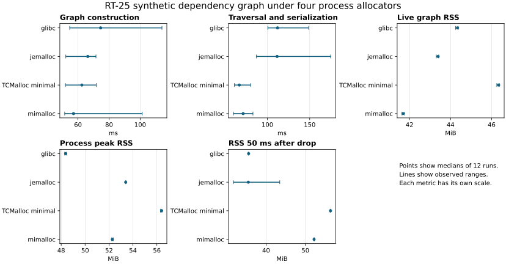

# RT-25 — Four allocator profiles on the pinned Rust dependency graph

**Scope:** PLAN §0.2 and [#285](https://github.com/aivibeflow/LLMLang/issues/285), with bounded evidence for the RT-25 workload in PLAN §7.1. This is a fresh run on the source tree at `9b710959a056ab0222812a6061eab08c65129fec`. The figures describe this run.

## Question and method

The [original glibc/jemalloc graph study](RT-25-DEPENDENCY-GRAPH-ALLOCATOR-BENCHMARK.md) found overlapping time ranges and a lower live but higher peak resident set for jemalloc. The [workload-fit recheck](RT-25-WORKLOAD-FIT-RECHECK-2026-11-24.md) left TCMalloc and mimalloc outside the comparison. This replay asks whether those providers can run the same unmodified Rust workload under verified Linux interposition and which time and memory trade-offs appear in the resulting observations.

The [existing Rust System probe](../PROTOTYPES/ALLOCATOR-COMPAT-01/probe.rs) confirms that the five dynamically resolved C allocation symbols are bound to the same provider. The replay checks the loaded library's hash. For each provider the probe exercises zeroing, alignment, pattern preservation, growth and shrinkage across four threads and 3,200 allocation sequences, plus one deliberately impossible C resize with preserved old storage. This measures a process-wide dynamic configuration. Named per-component allocation would require a separate ownership and deallocation contract across component and foreign boundaries.

The [existing graph program](../PROTOTYPES/ALLOCATOR-BENCH-01/graph.rs) builds 200,000 nodes and 995,740 reverse edges, walks from four roots and serializes visited nodes into temporary text buffers. The runner compiles once with Rust 1.85.1 and `-C opt-level=3`. It uses 12 blocks of four fresh child processes, all pinned to CPU 0, with one child per provider in each block. Four prescribed orders balance run position and immediately preceding provider within a block, repeated three times. The runner removes allocator tuning variables and checks the bound `malloc` in each graph process. All 48 observations returned the archived checksum `4c66d60dbdbdf118`. All four compatibility runs also passed.


The compatibility probe is outside the timed graph phases. Time includes the graph program's build or traversal-and-serialization section. Resident set size (RSS) is absolute process memory resident at the sample point, including startup and allocator overhead. The peak is the high-water value from Linux procfs. The post-drop value is sampled 50 ms after both graph structures are dropped.

## Results

The table reports medians with observed minima and maxima. Each cell represents 12 processes. The sampled ranges express repeat-run variation in this environment.

| Measurement | glibc 2.41 | jemalloc 5.3.0 | TCMalloc minimal 2.16 | mimalloc 2.0.9 |
| --- | ---: | ---: | ---: | ---: |
| Build, ms | 74.6 (54.7–114.0) | 66.3 (52.2–71.6) | 62.5 (51.9–71.8) | 57.1 (51.5–101.3) |
| Traverse and serialize, ms | 112.0 (100.6–148.8) | 111.5 (87.1–174.7) | 66.9 (61.1–80.3) | 71.4 (59.8–83.0) |
| Live graph RSS, MiB | 44.3 (44.2–44.4) | 43.4 (43.3–43.4) | 46.3 (46.3–46.4) | 41.7 (41.6–41.8) |
| Peak RSS, MiB | 48.4 (48.3–48.4) | 53.4 (53.4–53.4) | 56.4 (56.3–56.4) | 52.3 (52.2–52.4) |
| RSS 50 ms after drop, MiB | 35.6 (35.5–35.6) | 35.5 (31.7–43.5) | 56.4 (56.3–56.4) | 52.2 (52.2–52.3) |



Mimalloc has the lowest observed live RSS. Glibc has the lowest peak RSS. TCMalloc minimal and mimalloc both have lower traversal-and-serialization times in this series, with observed ranges below those of glibc and jemalloc. Their sampled post-drop RSS also remains higher. The construction ranges overlap. The earlier glibc/jemalloc live-versus-peak trade-off recurs. Equal-looking range endpoints in the table reflect rounding to one decimal. Exact values are in the [raw ledger](ALLOCATOR-REPLAY-01/evidence.json).

This synthetic graph counts neither long-term reclamation nor fragmentation. There are no confidence intervals or claims of a stable performance difference across different hosts. The container had a two-CPU quota and each child was pinned to one logical CPU. The host was shared, with no control over neighboring load or frequency. The workload uses one fixed graph size and serial traversal. Representative LLMLang traces, sustained reclamation, parallel graph workloads, cross-library storage ownership, other allocator builds, other targets and independent review remain open. No allocator or integration strategy is selected.

## Reproduction

Run from the repository root with CPython 3.12.14, Rust 1.85.1 at `4eb161250e340c8f48f66e2b929ef4a5bed7c181` (LLVM 19.1.7), Debian GCC 14.2.0-19, GNU Binutils 2.44 and util-linux 2.41.5. The measured host used Linux 6.18.57 on AMD EPYC 9V74. The glibc and jemalloc packages were Debian `2.41-12+deb13u4` and `5.3.0-3`. The two additional providers came from these Debian packages.

| Package | Download SHA-256 |
| --- | --- |
| [libtcmalloc-minimal4t64 2.16-1 amd64](https://deb.debian.org/debian/pool/main/g/google-perftools/libtcmalloc-minimal4t64_2.16-1_amd64.deb) | `98fcefd2ae81bf1c332b84829e84b994b34b58f339416166b40682030d4a44e0` |
| [libmimalloc2.0 2.0.9+ds-2 amd64](https://deb.debian.org/debian/pool/main/m/mimalloc/libmimalloc2.0_2.0.9+ds-2_amd64.deb) | `a20035605a532be3186f0f48607c7106fe2a5551066c29de663c965692c446c4` |

Extract the packages with `dpkg-deb -x PACKAGE DESTINATION`. Point the runner at the extracted SONAME links. The glibc path must identify the process's default library. Set `RUSTC` to the pinned compiler executable and `ALLOCATOR_LIBS` to the extraction's `usr/lib/x86_64-linux-gnu` directory.

```sh
fixture=research/runtime-and-systems/RT-25/ALLOCATOR-REPLAY-01
python3 -B "$fixture/run.py" --rustc "$RUSTC" \
  --glibc /lib/x86_64-linux-gnu/libc.so.6 \
  --jemalloc /lib/x86_64-linux-gnu/libjemalloc.so.2 \
  --tcmalloc "$ALLOCATOR_LIBS/libtcmalloc_minimal.so.4" \
  --mimalloc "$ALLOCATOR_LIBS/libmimalloc.so.2" \
  --output /tmp/llmlang-allocator-replay.json
python3 -B "$fixture/chart.py" /tmp/llmlang-allocator-replay.json \
  /tmp/llmlang-allocator-comparison.svg
```

The checksum and probe outcomes are discrete checks. Durations and memory samples will vary on replay. The [runner](ALLOCATOR-REPLAY-01/run.py) binds the Rust source and bound libraries by SHA-256. The [chart script](ALLOCATOR-REPLAY-01/chart.py) rendered the committed ledger with Matplotlib 3.10.8. Mermaid source was inspected directly.
