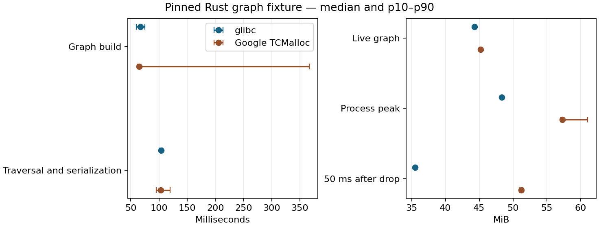

# RT-25 modern Google TCMalloc integration with Rust System

The earlier four-provider experiment used gperftools TCMalloc minimal. This one builds Google TCMalloc at `afcf25e3c76f099ca410b994c3621312d438ed10`, verifies a process-wide allocator binding, and runs the same Rust compatibility and dependency-graph fixtures against a glibc baseline. The comparison covers one Linux x86-64 profile. [Earlier four-provider experiment](RT-25-FOUR-PROVIDER-ALLOCATOR-REPLAY-2026-11-25.md) · [Pinned upstream tree](https://github.com/google/tcmalloc/tree/afcf25e3c76f099ca410b994c3621312d438ed10)


## Build and ABI boundary

The exact upstream source archive hashes to `18e05f20fa4bf1d0e5729daf4eeb477628f486445bcedfde219f2cc6c0e6c6f6`. Bazel 9.0.0 with the host trust store reaches registry resolution and rejects conflicting Abseil compatibility levels. Bazel 9.3.0 resolves that graph, but GCC 14.2.0 reports visibility-attribute diagnostics and a class-memory-access diagnostic as errors. The working profile uses local Bazel 9.3.0 with two warning demotions limited to TCMalloc translation units, an exact dependency lock and a thin shared-library wrapper. The source archive remains unchanged. The lock replay builds the same target and preserves the ELF hash on the recorded workspace. [Build attempts and digests](MODERN-TCMALLOC-01/build-evidence.json) · [Dependency lock](MODERN-TCMALLOC-01/MODULE.bazel.lock) · [Build script](MODERN-TCMALLOC-01/build.sh)

The ELF exports `malloc`, `calloc`, `realloc`, `free` and `posix_memalign`. The native Rust probe resolves all five to that exact file via `dladdr` under `LD_PRELOAD`. Both providers pass 3,200 Rust allocation sequences across four threads, including zeroing, alignment, growth, shrinking and pattern preservation. Both preserve the original C allocation after a deliberately impossible resize. A separate process calling the wrapper's property reports inactive per-CPU caches. The timed graph processes check their bound allocator, with their internal cache mode outside the recorded evidence. [Runtime evidence](MODERN-TCMALLOC-01/evidence.json)

## Comparative graph observations

Twelve randomized pairs use fresh processes on logical CPU 4 of AMD EPYC 9V74, Linux 6.18.57, Rust 1.85.1 and glibc 2.41. No cgroup CPU period was throttled. Each of the 24 graphs has 200,000 nodes and matches checksum `4c66d60dbdbdf118`. The table reports median and p10–p90.

| Quantity | glibc | Modern Google TCMalloc |
| --- | ---: | ---: |
| Graph construction, ms | 67.02 (60.12–74.71) | 64.60 (61.25–366.70) |
| Traversal and serialization, ms | 103.52 (100.16–106.15) | 103.28 (95.45–119.74) |
| Live graph RSS, MiB | 44.30 (44.25–44.36) | 45.18 (45.10–45.27) |
| Process peak RSS, MiB | 48.35 (48.30–48.40) | 57.32 (57.10–61.05) |
| RSS 50 ms after drop, MiB | 35.52 (35.47–35.58) | 51.25 (50.91–51.44) |



Traversal ranges overlap. Google TCMalloc has larger peak and post-drop RSS in the recorded series, and the upper construction quantiles diverge. The data leave the cause of construction-time outliers unresolved. The compatibility result covers one process-wide shared-library route and the tested ownership pairs. Static linkage, custom Rust `GlobalAlloc`, isolated component heaps, representative service and packaging workloads, memory-pressure behavior, forced per-CPU mode and other targets remain open. [Rust workload](../PROTOTYPES/ALLOCATOR-BENCH-01/graph.rs) · [Compatibility probe](../PROTOTYPES/ALLOCATOR-COMPAT-01/probe.rs)

## Reproduction

Use GCC 14.2.0, Bazel 9.3.0, GNU Binutils 2.44, Rust 1.85.1 at `4eb161250e340c8f48f66e2b929ef4a5bed7c181`, CPython 3.12.14 and Matplotlib 3.10.8. The Bazel binary SHA-256 is `d302d22ed77ee5658b87857249baa579db84300ecebe0a1e9a357b5b20f80eb8`. Unpack the pinned upstream source in a disposable directory. Use the appropriate trusted Java CA store for the registry and upstream dependency downloads. Choose an available CPU. Timings vary across runs.

```sh
study=research/runtime-and-systems/RT-25/MODERN-TCMALLOC-01
build=$(mktemp -d)
source_dir=/path/to/unpacked-source
"$study/build.sh" "$source_dir" /path/to/bazel-9.3.0 "$build/bazel-root" \
  /etc/ssl/certs/java/cacerts
LC_ALL=C PYTHONHASHSEED=37 PYTHONDONTWRITEBYTECODE=1 python "$study/run.py" \
  --rustc /path/to/rustc-1.85.1 --cpu 4 --trials 12 --seed 2525 \
  --library "$source_dir/bazel-bin/llmlang_probe/libllmlang_tcmalloc.so" \
  --output "$build/evidence.json"
LC_ALL=C MPLBACKEND=Agg MPLCONFIGDIR="$build/plot-cache" python "$study/chart.py" \
  --input "$build/evidence.json" --output "$build/comparison.png"
```

[Source archive](https://codeload.github.com/google/tcmalloc/tar.gz/afcf25e3c76f099ca410b994c3621312d438ed10) · [Bazel release artifact](https://releases.bazel.build/9.3.0/release/bazel-9.3.0-linux-x86_64)
