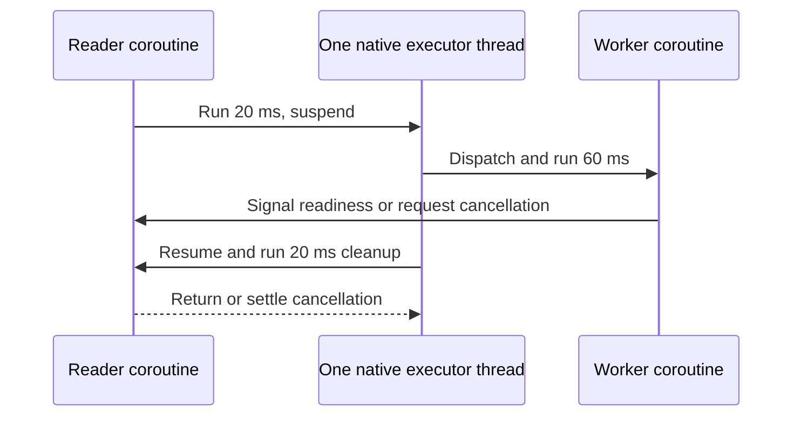
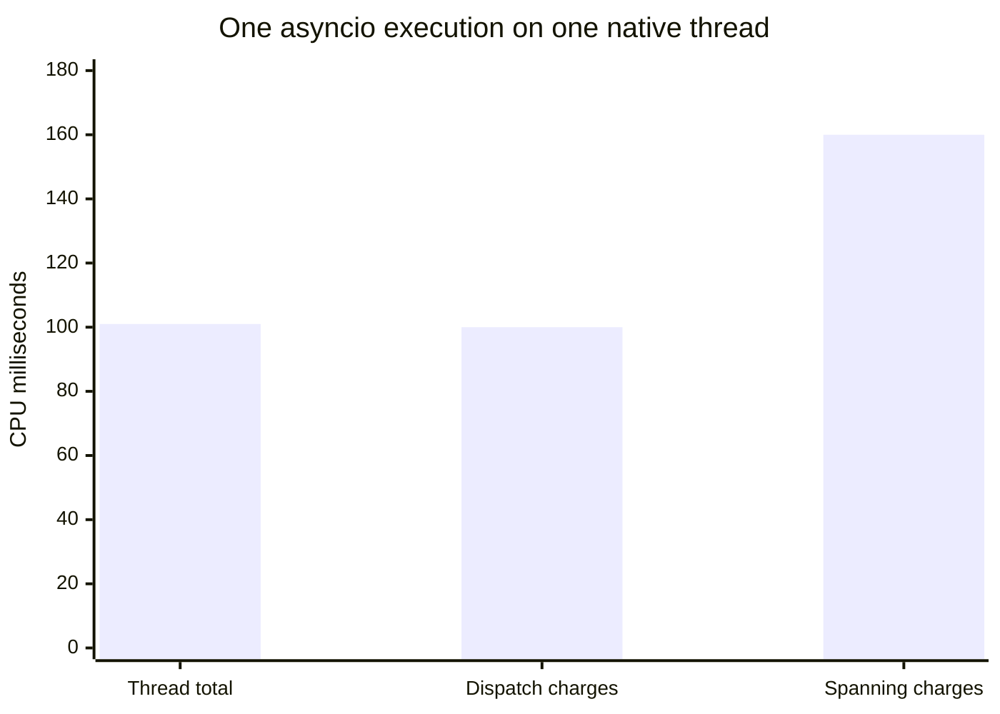

# RT-26 — Attribute CPU across coroutine suspension and cleanup

**Evidence** — Two native CPython asyncio cases with thread CPU, explicit work clocks and disjoint dispatch observations.

## Question and measurement

Can a runtime charge each coroutine by sampling its native thread's CPU clock at coroutine entry and exit? On a shared executor thread, one coroutine can suspend while another executes. The study compares the full-call interval with charging only each coroutine's dispatch segments. It also checks a cancellation path where the suspended coroutine resumes to run cleanup before termination. [Hierarchical resource accounting](RT-26-HIERARCHICAL-RESOURCE-ACCOUNTING-AND-ENFORCEMENT.md) · [Cancellation and settlement](RT-26-CANCELLATION-ACCOUNTING.md)

The reader consumes 20 ms of actual thread CPU, suspends on an event, and spends 20 ms in cleanup on its next activation. The worker consumes 60 ms between the reader's two activations. In one case it signals normal readiness. In the other it requests cancellation. Both tracked frames execute on the same native thread. An independent work measurement surrounds each busy region. CPython's profile callback records each of the fixture coroutines' three dispatch segments, using its call/return events to delimit execution around suspension.



The span from the reader's entry to its exit contains the entire worker interval. Dispatch accounting assigns that interval only to the worker. The cancellation path charges the reader's cleanup segment to the reader before settling its outcome.

## Observations

| Retained sample | Entire thread | Reader spanning clock | Worker spanning clock | Reader dispatch charge | Worker dispatch charge |
| --- | ---: | ---: | ---: | ---: | ---: |
| Normal completion | 101.461 ms | 100.325 ms | 60.081 ms | 40.146 ms | 60.090 ms |
| Cancellation | 101.033 ms | 100.281 ms | 60.035 ms | 40.103 ms | 60.043 ms |



The chart uses the normal case rounded to whole milliseconds. Summed spanning charges include the worker twice. The summed dispatch charges stay within the thread total and each segment covers the independently timed busy region. The difference between thread total and dispatch charges includes event-loop and instrumentation work outside the monitored frames. The retained sample has zero voluntary native context switches and either 11 or 12 involuntary switches across the complete thread interval. The coroutine trace still has exactly three dispatch segments in both cases. Native context-switch counters describe a separate scheduler boundary.

This supports charging coroutine CPU at explicit execution boundaries in an LLMLang task scheduler. It also leaves a policy choice for charging scheduler overhead and work performed by an awaited service. The tested CPython profile callback is a fixture observer. Production overhead, migration across threads, attribution of extension calls and external work, and hardware counters require separate validation. Timings in the retained sample are explanatory measurements with no latency estimate.

## Reproduction

Use CPython 3.12.14 and Linux 6.18.57 x86-64:

```sh
study=research/runtime-and-systems/RT-26/COROUTINE-CPU-01
python3 -B "$study/run.py" --output /tmp/llmlang-coroutine-cpu.json \
  --raw /tmp/llmlang-coroutine-cpu-sample.json
cmp "$study/evidence.json" /tmp/llmlang-coroutine-cpu.json
python3 -B "$study/plot.py" "$study/sample.json"
python3 -B -m unittest discover -s research/runtime-and-systems/PROTOTYPES/BUDGET-CANCELLATION-01
```

The [harness](COROUTINE-CPU-01/run.py) checks dispatch ordering, worker and cleanup CPU, and normal and cancelled outcomes. The [outcome ledger](COROUTINE-CPU-01/evidence.json) records exact categorical checks. The [retained sample](COROUTINE-CPU-01/sample.json) records measured nanoseconds and OS context switches. The [chart generator](COROUTINE-CPU-01/plot.py) uses that sample.
