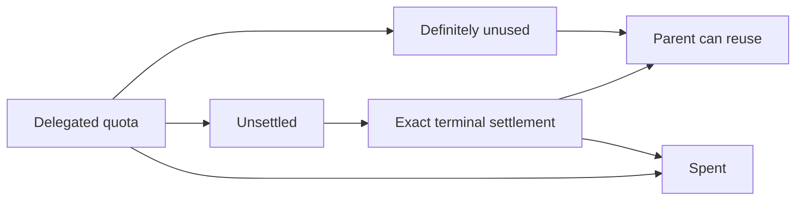

# RT-26 — Reclaim a delegated quota without erasing unsettled usage

How much cumulative budget can a parent reuse after its child stops accepting requests? This study adds reclamation and delayed settlement to the [cooperative reservation model](RT-26-COOPERATIVE-BUDGET-RESERVATION.md). The branch baseline is `1a70d1f01fa95299589a3d4051cd93ace0d70ceb`. [Hierarchical resource accounting](RT-26-HIERARCHICAL-RESOURCE-ACCOUNTING-AND-ENFORCEMENT.md)

One parent and one child share a fixed cumulative limit. The model classifies the child's delegated amount as definitely unused, unsettled, or already spent. Reclamation transfers only definitely unused units back to the parent. Unsettled units stay reserved while actual usage may be anywhere from zero to that amount. An exact terminal observation classifies those units as spent or releases the unused remainder. The model assumes the child cannot start new work after reclamation and transitions are serialized.



The Lean kernel checks that unused-only reclamation conserves the total and is idempotent. It checks exact settlement when actual usage fits the outstanding reservation. If a parent request fits the reclaimed availability, the sum of the request, prior spent amount and any later confirmed reservation usage stays within the total. A checked counterexample shows how returning the whole grant can oversubscribe it even before uncertain usage is resolved. [Lean declarations](DELEGATED-QUOTA-01/Quota.lean) · [Printed axioms](DELEGATED-QUOTA-01/axioms.txt)

The finite comparison uses total limits 1 through 12. It enumerates 1,819 initial states, 19,291 parent requests under uncertainty, and 68,067 exact settlement combinations. Whole-grant return admits 8,736 parent requests that can exceed the limit. Unused-only reclaim admits none. After exact settlement the resulting gate agrees with actual accounted usage on every tested combination. [Finite observations](DELEGATED-QUOTA-01/evidence.json)

With a total of 5, the parent initially has 1. The child's 4 units consist of 2 spent, 1 unsettled and 1 definitely unused. The parent can reuse 2 after reclaiming the unused unit. A terminal report of zero additional usage raises that amount to 3. An additional confirmed unit leaves it at 2. Returning all four delegated units would instead make 5 available despite the prior usage of 2.

The result concerns one serialized cumulative quota. Time windows, live-resource budgets, cancellation protocols for real workers, attribution across nested descendants, trusted settlement and distributed authority remain open. [Runtime architecture issue](https://github.com/aivibeflow/LLMLang/issues/325)

## Reproduction

Lean v4.36.0 at commit `611c117bfaf7b7ae1cfcf246ce6fba31e8f509e9` accepted the source with warnings treated as errors. One theorem is axiom-free, two use `propext`, and two use `propext` and `Quot.sound`. CPython 3.12.14 produced identical receipts under hash seeds 1 and 2. The diagram was checked as Mermaid source.

```bash
fixture=research/runtime-and-systems/RT-26/DELEGATED-QUOTA-01
lean -DwarningAsError=true "$fixture/Quota.lean" > /tmp/llmlang-rt26-quota-axioms.txt
cmp "$fixture/axioms.txt" /tmp/llmlang-rt26-quota-axioms.txt
LC_ALL=C PYTHONHASHSEED=1 python3 -B "$fixture/run.py" > /tmp/llmlang-rt26-delegated-quota.json
cmp "$fixture/evidence.json" /tmp/llmlang-rt26-delegated-quota.json
```
