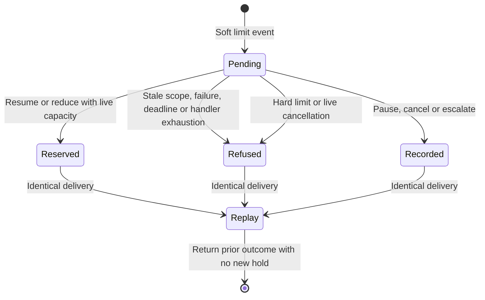

# RT-26 Bounded limit handler settlement

**Issue** [#325](https://github.com/aivibeflow/LLMLang/issues/325)

A soft resource limit can trigger a policy decision while other work continues to reserve the same resource. By the time the policy returns, the task may be cancelled, the hard limit may have changed, or the decision may have already been applied. This deterministic model compares those cases and shows which checks belong at settlement. [Resource limits and handlers](RT-26-HIERARCHICAL-RESOURCE-ACCOUNTING-AND-ENFORCEMENT.md#5-limit-exceeded-handlers-and-policy-decisions)

## Model and alternatives

An event carries an instance ID, task scope, scope generation, requested reservation, observed held amount, observed limits and deadline. A hold is a live reservation, measured in integer tokens. The soft limit triggers the event. The hard limit bounds the sum of currently held tokens and any new reservation. The model has one shared pool. It serializes each settlement transition and gives the handler a separate allowance of two abstract steps. The deadline is abstract tick 3.

The supported proposals are resume, reduce the requested reservation, pause, cancel, escalate, and failure. Pausing or escalating returns a record without reserving. Cancellation marks the scope but retains all current holds. A reduced request must fit strictly between zero and the original amount. Handler failure, deadline expiry, and handler allowance exhaustion end the event with no new hold. The allowance-exhaustion case returns a terminal resource-policy outcome directly. It creates no recursive handler event.

The permissive comparison applies a returned resume or reduction without checking current hard capacity or cancellation. The fresh-check comparison checks those two facts and grants if they hold. The exact-once model adds matching scope and generation and an event-scoped record of the applied proposal and outcome. Identical delivery of a recorded decision returns the historical outcome with no new hold. A different proposal for the same event and a receipt belonging to a different event are refused. The model always receives the correct prior receipt or an explicitly constructed mismatch. Production needs atomic ownership of that receipt lookup and the settlement itself.



The state diagram shows the exact-once route for one event. Controls separately check inconsistent delivery and distinguish otherwise identical events by ID. The model's receipt denotes a past settlement, so delivering it again carries no permission to reserve on the current state.

## Bounded evidence

The [ledger](LIMIT-HANDLER-SETTLEMENT-01/evidence.json) records 15 targeted controls, an exhaustive 84-schedule comparison, exact states and outcomes, and the runner digest. The schedules start at four held tokens, with hard capacities of four through nine. Rechecking occurs after a peer may have increased the hold up to capacity, with or without an intervening cancellation or duplicate delivery. Every policy receives the same two-token request in these schedules.

| Policy | Above hard limit out of 84 | Reserves in cancelled scope out of 84 | Duplicate hold out of 84 |
| --- | ---: | ---: | ---: |
| Apply returned proposal | 58 | 42 | 42 |
| Fresh hard-limit and cancellation check | 0 | 0 | 3 |
| Fresh checks with event and generation binding | 0 | 0 | 0 |

Counts can overlap. The maximum overshoot of the permissive model is four tokens when two deliveries each reserve two against a full pool. The fresh-check model allows a duplicate when both reservations fit. In the exact-once model, a separate event with identical request fields can still reserve if capacity remains. A receipt from the first event cannot settle it. An identifier change alone also blocks reuse under the exact binding. The targeted controls cover a rejected stale generation despite equal limits, degradation after a peer charge, retained holds on cancellation, handler failure, deadline expiry and exhaustion. The finite schedule is deterministic and measures neither wall-clock latency nor production overshoot.

These results favor checking live limits at the point of reservation and binding each applied decision to a distinct event. A separate handler allowance and terminal exhaustion result bound this fixture's policy path. The fixture omits actual scheduling, race-free receipt storage, authorization, idempotent external work, task-tree quota transfer, resource release and non-cooperating enforcement. The reported zero overshoot is an exact result for the serialized model. Runtime and OS integration must establish its premises separately. [Cancellation accounting](RT-26-CANCELLATION-ACCOUNTING.md)

## Reproduction

Use CPython 3.12.14 at repository root. This work starts from `2bf61c4bc5aafa02e8489292da27ed1ff424e825`. Hash seeds 1 and 2 produced byte-identical ledgers. Local links and the Mermaid source structure were checked. GitHub visual rendering was not manually verified.

```sh
study=research/runtime-and-systems/RT-26/LIMIT-HANDLER-SETTLEMENT-01
PYTHONHASHSEED=1 python -B "$study/run.py" >/tmp/llmlang-limit-handler.json
cmp "$study/evidence.json" /tmp/llmlang-limit-handler.json
```
