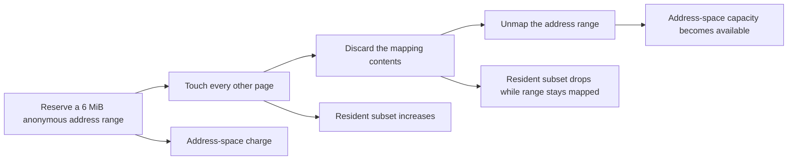

# RT-26 — Linux address-space limits and resident mapping pages

- **Evidence** — Native child-process experiment with anonymous mappings.
- **LLMLang baseline** — `4108a433b6d60d30e3a0378c17e4e9e5390047c1`.
- **Tracking** — [PLAN §5.2](../../../PLAN.md#52-execution-semantics-and-runtime-architecture) · [RT-26 resource accounting](RT-26-HIERARCHICAL-RESOURCE-ACCOUNTING-AND-ENFORCEMENT.md).

## Question and accounting units

Which memory quantity does Linux `RLIMIT_AS` enforce, and can two locally limited workers share one runtime budget? The experiment uses private anonymous mappings, reads the child process's initial virtual size from procfs, and admits 8 MiB of additional address space. A 6 MiB mapping is created without touching its pages. The Linux `mincore` interface reports which pages of that mapping are resident at the sampling point. Huge pages are disabled for the fixture. [Linux address-space limit](https://man7.org/linux/man-pages/man2/getrlimit.2.html) · [Linux residency query](https://man7.org/linux/man-pages/man2/mincore.2.html)



The trace compares the local address-space guard with a resident-page observation for the same region. The two counters change at different points.

## Results

The page size is 4,096 bytes. The first mapping spans 1,536 pages. The worker attempts an additional 4 MiB twice while keeping the first address range alive.

| State of the 6 MiB range | Resident pages | Another 4 MiB under the 8 MiB allowance |
| --- | ---: | --- |
| Newly mapped, untouched | 0 | No attempt in this state |
| Every second page written | 768 | `ENOMEM` |
| After `MADV_DONTNEED` | 0 | `ENOMEM` |
| After unmapping | Range released | Succeeds, with zero initial resident pages |

Reading the first byte after discarding the contents produced zero for the admitted private anonymous mapping. The discard is an observable change to content. It is suitable only where that change is permitted. [Linux memory advice](https://man7.org/linux/man-pages/man2/madvise.2.html)

Two separate workers each hold a 6 MiB untouched mapping at a shared barrier. Both stay within their own 8 MiB allowance. Together they hold 12 MiB of virtual mappings, four MiB above a hypothetical shared 8 MiB allowance, and both report zero resident pages for those mappings. The combined figure sums admitted virtual lengths. It does not attribute process-wide physical memory or shared pages. [Recorded observations](LINUX-MAPPING-BUDGET-01/evidence.json)

## Implementation consequence

A runtime may use a local address-space limit for a narrow worker profile. Its API should distinguish reserving virtual space, touching physical pages, preserving contents and releasing the mapping. A group allowance also needs a group admission rule. Resident samples describe the pages present at a point in time and have a different enforcement and attribution boundary.

This is a Linux process experiment over the selected anonymous mappings. It does not establish process-wide RSS or private physical charge, overcommit policy, behaviour under swapping or memory pressure, cgroup configuration, accounting for shared memory, nested task groups, or other operating systems.

## Reproduction

Use CPython 3.12.14 on Linux x86-64 with kernel 6.18.57, accessible procfs and an inherited address-space limit that permits the fixture. The worker lowers its limit. Five runs yielded the same records from three child processes each. [Replay](LINUX-MAPPING-BUDGET-01/run.py)

```sh
study=research/runtime-and-systems/RT-26/LINUX-MAPPING-BUDGET-01
python3 -B "$study/run.py" --output /tmp/llmlang-mapping-budget.json
cmp "$study/evidence.json" /tmp/llmlang-mapping-budget.json
```
