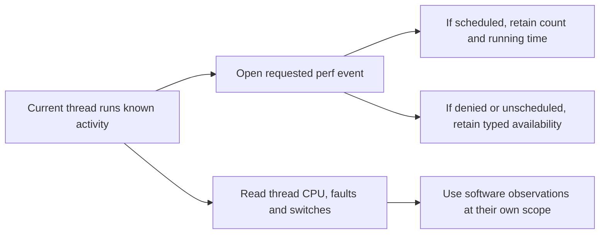

# RT-26 — Check Linux performance-counter availability

**Evidence** — Five native self-thread perf events and an independent software-counter control.

## Question and method

Can a hosted runtime use kernel perf events to charge a task for CPU time, page faults, switches, cycles or instructions in the current measurement environment? The coroutine study separates task execution segments from the native thread's lifetime. This comparison checks which native observations can augment the scheduler's task ledger. [Coroutine CPU attribution](https://github.com/aivibeflow/LLMLang/pull/555) · [Hierarchical resource accounting](RT-26-HIERARCHICAL-RESOURCE-ACCOUNTING-AND-ENFORCEMENT.md)

The C probe opens events for its own current thread. Every event requests user-space counting, with kernel and hypervisor excluded. The probe uses neither a system-wide counter nor another task's descriptor. On successful access it requests a count together with enabled and scheduled nanoseconds. The software control independently measures the same thread with `CLOCK_THREAD_CPUTIME_ID` and `getrusage(RUSAGE_THREAD)`. It first-touches one byte on each of 64 private pages and runs until at least 20 ms of thread CPU has elapsed.



## Observed availability

| Requested observation | Linux perf result | Software control in this fixture |
| --- | --- | --- |
| CPU cycles | `EPERM` | No cycle observation |
| Retired instructions | `EPERM` | No instruction observation |
| Task CPU clock | `EPERM` | `CLOCK_THREAD_CPUTIME_ID` records at least 20 ms |
| Context switches | `EPERM` | `getrusage` supplies native thread counters |
| Minor faults | `EPERM` | `getrusage` records at least 64 new minor faults |

The kernel exposed `perf_event_paranoid=2`. All five requests were denied despite their self-thread user-space scope. The observed error identifies an availability failure. The relative roles of container policy and kernel authorization remain unmeasured. The retained software sample records 20,000,277 ns and 65 minor faults. The extra fault may reflect measurement or runtime activity beyond the deliberately touched pages. It also records zero voluntary and two involuntary native switches in that sample.

A hosted implementation can keep a typed distinction between a measured zero, a permitted event that received no scheduled time, and an unavailable event. Software CPU, faults and switches remain meaningful as their own observations. Hardware-cost contracts need a deployment with verified event availability plus rules for PMU identity, multiplexing and task migration. The experiment leaves hardware measurements, time-running correction and cross-platform comparability open. [Linux perf event interface](https://man7.org/linux/man-pages/man2/perf_event_open.2.html)

## Reproduction

Use GCC 14.2.0 and CPython 3.12.14 on Linux 6.18.57 x86-64:

```sh
study=research/runtime-and-systems/RT-26/LINUX-PERF-COUNTERS-01
python3 -B "$study/run.py" --output /tmp/llmlang-perf-events.json \
  --raw /tmp/llmlang-perf-sample.json
cmp "$study/evidence.json" /tmp/llmlang-perf-events.json
```

The [C probe](LINUX-PERF-COUNTERS-01/probe.c) uses Linux's system call and the independent library counters. The [runner](LINUX-PERF-COUNTERS-01/run.py) preserves the availability outcome and checks the software-control lower bounds. The [exact ledger](LINUX-PERF-COUNTERS-01/evidence.json) records the measured environment, and the [retained sample](LINUX-PERF-COUNTERS-01/sample.json) keeps one run's raw observations. Another environment can produce a different availability ledger.
