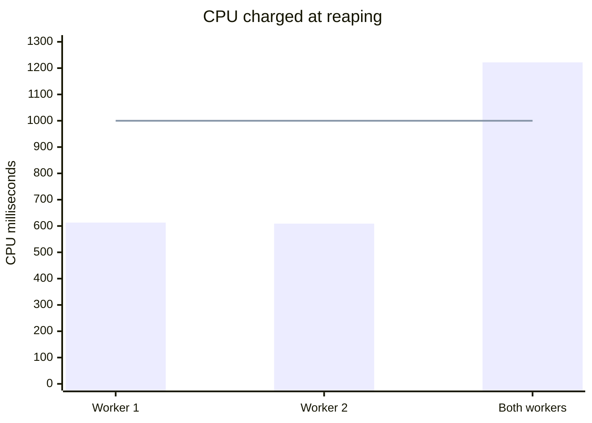

# RT-26 — Compare Linux CPU limits and hierarchical charging

**Evidence** — Native process CPU limits, signal outcomes and two-child reaping on Linux x86-64.

## Question and method

Can a process-local CPU limit enforce a budget shared across multiple task descendants? What evidence can remain available when a process terminates because it exhausted its limit? The RT-26 reservation model needs an observation and settlement boundary for native execution. This comparison tests what Linux `RLIMIT_CPU`, `wait4` and `getrusage(RUSAGE_CHILDREN)` provide on one controlled workload. [Hierarchical resource accounting](RT-26-HIERARCHICAL-RESOURCE-ACCOUNTING-AND-ENFORCEMENT.md) · [Cooperative reservation](RT-26-COOPERATIVE-BUDGET-RESERVATION.md)

The first worker has a one-second soft CPU limit and two-second hard limit. Its signal handler reports `SIGXCPU` and exits. The second worker has equal one-second soft and hard limits and the same handler. Both run a CPU-bound loop. A parent observes the child process exit and the user-plus-system CPU recorded by `wait4`. In a separate case two workers each target 0.6 CPU seconds beneath their independent one-second soft limits. A pipe admits both workers. The hypothetical shared task budget is also one CPU second. The parent compares recorded CPU for each reaped worker with its accumulated children counter.

## Observations

| Condition | Observed terminal result | Retained sample CPU |
| --- | --- | ---: |
| Soft 1 s, hard 2 s | `SIGXCPU` reported and handler exits with code 23 | 1,037,181 µs |
| Soft 1 s, hard 1 s | Kernel terminates with `SIGKILL`; handler reports no soft signal | 1,034,807 µs |
| Two workers, 1 s soft and 2 s hard each | Both exit normally under their own limit | 612,810 and 609,296 µs |
| Sum after reaping those workers | Both were admitted and exceed a 1 s shared ceiling | 1,222,106 µs from `wait4`; 1,222,107 µs from the children-counter delta |

The bar chart uses the retained sample rounded to milliseconds. The line is the one-second limit used for the group comparison.



A soft-limit signal lets a process respond in this configuration. The equal hard limit can terminate the process without running that handler. The parent still observes a CPU charge on termination. That observation does not authenticate an operation-specific completion record or establish that files and other resources were settled. The aggregate children counter agrees with the sum of `wait4` charges within the stated two-microsecond conversion tolerance. It reports usage after reaping and cannot enforce cumulative admission in advance.

The five repeats compare event classifications and inequality checks. The sample times vary with kernel accounting and scheduling. They establish neither a latency bound nor a reliable sub-second limit framing. An implementation that needs a cumulative hierarchical CPU ceiling needs independent group enforcement or cooperative reservation and charging. A portable implementation also needs to specify how it observes active workers and settles external processes or process trees. Cgroups, thread groups, percent-of-core rate limits and multi-tenant performance are outside the measured scope. [Linux process limits](https://man7.org/linux/man-pages/man2/getrlimit.2.html) · [Linux wait4](https://man7.org/linux/man-pages/man2/wait4.2.html) · [Linux getrusage](https://man7.org/linux/man-pages/man2/getrusage.2.html)

## Reproduction

Use CPython 3.12.14 on Linux 6.18.57 x86-64. The launcher sets limits inside isolated fixture processes and terminates only its own fixture group on timeout.

```sh
study=research/runtime-and-systems/RT-26/LINUX-CPU-BUDGET-01
python3 -B "$study/run.py" --output /tmp/llmlang-cpu-budget.json \
  --raw /tmp/llmlang-cpu-budget-sample.json
cmp "$study/evidence.json" /tmp/llmlang-cpu-budget.json
python3 -B "$study/plot.py" "$study/sample.json" "$study/evidence.json"
python3 -B -m unittest discover -s research/runtime-and-systems/PROTOTYPES/BUDGET-RESERVATION-01
```

The [harness](LINUX-CPU-BUDGET-01/run.py) checks terminal results, recorded CPU and the group comparison. The exact [outcome ledger](LINUX-CPU-BUDGET-01/evidence.json) is reproducible across fresh cases. The retained [timing sample](LINUX-CPU-BUDGET-01/sample.json) is observational and supplies the [chart generator](LINUX-CPU-BUDGET-01/plot.py).
