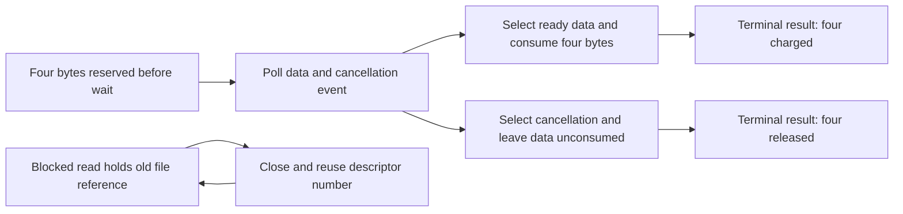

# RT-26 — Settle a blocked Linux read after cancellation

**Evidence** — Six native Linux pipe and eventfd cases in fresh child processes.

## Question and alternatives

Can a task release its read reservation after another thread closes its numeric file descriptor? How does an explicitly cancellable wait settle when data and cancellation become ready together? The existing cooperative resource model separates cancellation acknowledgment from terminal settlement. This experiment checks that distinction at a Linux read boundary. [Hierarchical cancellation model](RT-26-CANCELLATION-ACCOUNTING.md) · [Linux file budget settlement](RT-26-LINUX-FILE-BUDGET-SETTLEMENT-2026-11-24.md)

In the first control one thread starts a blocking read on a pipe. A controller observes the actual read syscall through Linux procfs. It closes the file descriptor entry, observes the blocked syscall again, and assigns the released number to another pipe with readable data. The second control closes the last write end instead. In the cooperative model, a worker waits in `poll` on a nonblocking data pipe and an `eventfd` dedicated to cancellation. It consumes the selected source and reports a terminal outcome. The experiment treats bytes consumed by this invocation as usage against a four-byte reservation.



The two-ready controls fill both sources before the poll starts, so the reported policy choice does not depend on scheduling. The single-ready controls first confirm that the worker is blocked in the kernel. Tests do not convert a time delay into evidence of a blocked operation.

## Observations

| Case | Terminal outcome | Bytes charged / released | What remains pending |
| --- | --- | ---: | --- |
| Close and reuse the read descriptor | Reads four bytes from the original pipe after the original writer sends them | 4 / 0 | All four bytes on the replacement descriptor |
| Close the last writer | EOF | 0 / 4 | Nothing from the original pipe |
| Poll, data only | Reads four bytes | 4 / 0 | Nothing |
| Poll, cancellation only | Cancelled | 0 / 4 | Nothing |
| Poll, both ready, cancellation first | Cancelled | 0 / 4 | Four unread bytes |
| Poll, both ready, data first | Reads four bytes | 4 / 0 | Unconsumed cancellation event |

After the controller closed the read descriptor, a fresh descriptor query returned `EBADF`. The original read stayed in the kernel after the numeric descriptor had been assigned to a different readable pipe. Its eventual result came from the original pipe. This demonstrates that the descriptor table entry and an already-started operation have different lifetimes on the tested Linux system. Closing the last writer instead produced normal end of stream and supplied no cancellation outcome.

The cooperative wait makes cancellation an observed input to the read's execution policy. If both sources are ready, a deterministic priority specifies which input is consumed and which remains pending. A settlement policy can then charge actual bytes after the operation publishes its terminal result. This experiment uses one worker per event, one pipe read, and no partially written data. It leaves concurrent consumers, socket-specific shutdown, synchronous foreign calls, portable wake mechanisms, and latency and overhead measurement open. [Linux close semantics](https://man7.org/linux/man-pages/man2/close.2.html) · [Linux eventfd](https://man7.org/linux/man-pages/man2/eventfd.2.html)

## Reproduction

Use CPython 3.12.14 on Linux 6.18.57 x86-64 with procfs. The harness checks the syscall class through `/proc/self/task/<tid>/syscall`.

```sh
study=research/runtime-and-systems/RT-26/LINUX-IO-CANCEL-01
python3 -B "$study/run.py" --output /tmp/llmlang-linux-read-cancellation.json
cmp "$study/evidence.json" /tmp/llmlang-linux-read-cancellation.json
python3 -B -m unittest discover -s research/runtime-and-systems/PROTOTYPES/BUDGET-CANCELLATION-01
python3 -B -m unittest discover -s research/runtime-and-systems/PROTOTYPES/BUDGET-RESERVATION-01
```

The [harness](LINUX-IO-CANCEL-01/run.py) checks exact outcomes and controlled readiness. The [ledger](LINUX-IO-CANCEL-01/evidence.json) includes reserved, spent and released bytes and which source remained ready.
