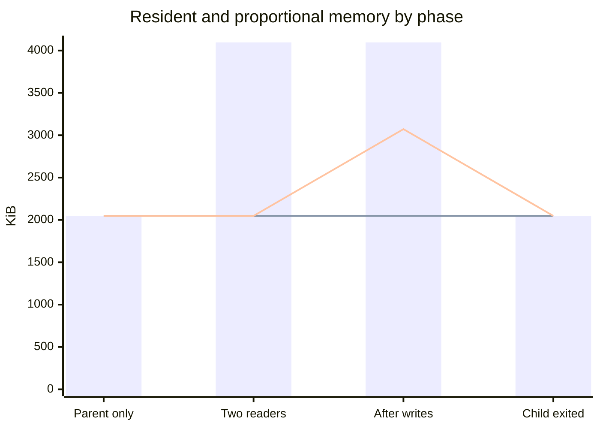

# RT-26 — Attribute Linux shared and copy-on-write pages

**Evidence** — Two controlled Linux mapping profiles across four synchronized process states.

## Question and measurements

Can per-process resident memory be summed to implement a shared memory budget? Does that sum detect pages that actually get copied when a child writes after `fork`? The preceding study distinguished virtual address admission from residency. This comparison isolates one 2 MiB mapping and follows it as both parent and child access its pages. [Address space and residency](RT-26-LINUX-MAPPING-RESIDENCY-2026-11-24.md) · [Hierarchical resource accounting](RT-26-HIERARCHICAL-RESOURCE-ACCOUNTING-AND-ENFORCEMENT.md)

One case maps a named memfd with `MAP_SHARED`. The other uses `MAP_PRIVATE`. The parent initializes every 4 KiB page before forking. The child reads every page and then writes every other page. Pipe messages let the controller sample only after each action while the child waits. The mapping disables transparent huge pages for the experiment. The harness reads the selected mapping's `smaps` rows in each process. RSS counts a shared page once per resident mapping. PSS apportions the page among its mappings. The sum in this fixture covers both participants and their one common named region. [Linux procfs fields](https://docs.kernel.org/filesystems/proc.html#the-proc-pid-smaps-file)

## Observations



The bars are the summed RSS, which is identical for both profiles. The flat line is summed PSS for `MAP_SHARED`. The line that rises after writes is summed PSS for `MAP_PRIVATE`. The table gives all values in KiB.

| Synchronized state | Summed RSS, both profiles | Summed PSS, shared | Summed PSS, private |
| --- | ---: | ---: | ---: |
| Parent initializes 512 pages | 2,048 | 2,048 | 2,048 |
| Both processes have accessed every page | 4,096 | 2,048 | 2,048 |
| Child writes 256 pages | 4,096 | 2,048 | 3,072 |
| Child exits | 2,048 | 2,048 | 2,048 |

When both processes first access the mapping, RSS charges twice for the same data while PSS stays at 2 MiB. The 256 writes in the shared mapping are visible to the parent and leave the PSS sum unchanged. The 256 writes in the private mapping are invisible to the parent, keep both RSS counters unchanged, and increase the PSS sum by 1 MiB. In the private case the parent and child each report 1,024 KiB shared dirty and 1,024 KiB private dirty after the writes. With only the parent present, Linux labels the dirty resident pages of even the shared mapping as private dirty. That counter reflects current mapping counts as well as the contents.

For a managed task tree, virtual mapping size, per-process residency and proportional attribution answer different questions. A reservation intended to bound worst-case private copies can exceed the current shared attribution. Charging current physical usage requires a policy for owners outside the task group, active owners changing between samples and page-level settlement. The exact figures here concern one region without outside mappers. The study does not measure cgroup enforcement, full-process memory, sampling overhead or portable resource accounting.

## Reproduction

Use CPython 3.12.14 on Linux 6.18.57 x86-64 with 4 KiB pages, memfd, and procfs:

```sh
study=research/runtime-and-systems/RT-26/LINUX-SHARED-MEMORY-01
python3 -B "$study/run.py" --output /tmp/llmlang-shared-memory.json
cmp "$study/evidence.json" /tmp/llmlang-shared-memory.json
python3 -B "$study/plot.py" "$study/evidence.json"
python3 -B -m unittest discover -s research/runtime-and-systems/PROTOTYPES/BUDGET-RESERVATION-01
```

The [harness](LINUX-SHARED-MEMORY-01/run.py) checks the phase boundaries and observed mapping bytes. The [ledger](LINUX-SHARED-MEMORY-01/evidence.json) preserves both per-process measurements and sums. The [chart generator](LINUX-SHARED-MEMORY-01/plot.py) reproduces the Mermaid data and series.
