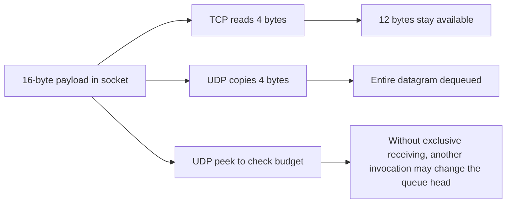

# RT-26 — Charge delivered and dequeued bytes at a Linux socket

**Evidence** — Five TCP and UDP loopback cases at a four-byte receive boundary.

## Question and method

Which bytes should a task budget charge when a read buffer is smaller than the queued payload? Can the runtime inspect the next datagram's length before admitting a receive? The previous RT-26 work settled native pipe bytes on the actual read outcome. Stream and message transport expose different consumption boundaries. [Linux read cancellation](RT-26-LINUX-READ-CANCELLATION-2026-11-24.md) · [Hierarchical resource accounting](RT-26-HIERARCHICAL-RESOURCE-ACCOUNTING-AND-ENFORCEMENT.md)

The harness binds fresh IPv4 sockets to loopback. It sends a known 16-byte payload and provides four bytes of receive capacity. TCP returns a prefix and later delivers the tail. The UDP receive uses the Linux `recvmsg` behavior. Its output flag marks truncation, and supplying `MSG_TRUNC` as an input flag requests the full datagram length. A separate control peeks at the full UDP length without consuming it. The competing-consumer case shares one native socket queue through a duplicated descriptor and places a receive exactly between inspection and consumption.



## Results

| Native case | Bytes copied into first buffer | Socket observation |
| --- | ---: | --- |
| TCP, split read | 4 | The remaining 12 bytes are subsequently readable, then EOF. |
| UDP, ordinary receive | 4 | `MSG_TRUNC` is reported and the 16-byte datagram is removed. |
| UDP, full-length reporting | 4 | Linux reports a length of 16 and `MSG_TRUNC`; the queue is empty. |
| UDP, peek then refuse | 0 | The announced length is 16 and the entire message stays queued. |
| UDP, intervening receiver | 4 on the original invocation | It peeks 4, another receive removes that message, and the original invocation removes the next 16-byte datagram. |

Four bytes copied is the same application-delivery charge in the split-stream and truncated-message cases. It represents a different change to the socket queue. The message-length metadata supports a separate dequeue charge. It cannot identify how much wire traffic was received or how much memory the OS spent on headers and queues.

The peek experiment supports a pre-admission check when the receiving operation controls queue access through consumption. A check on a shared socket saw four bytes within the proposed budget and still dequeued 16 after the other invocation intervened. A runtime that must bound full datagram consumption therefore needs an enforceable receiver scope, or an API with a stronger admission/receive contract. A policy that bounds only user-visible copied bytes has a different obligation. This experiment leaves shared network throughput, device counters, socket queue memory, concurrent external readers and portability beyond Linux open. [Linux receive flags](https://man7.org/linux/man-pages/man2/recvmsg.2.html)

## Reproduction

Use CPython 3.12.14 on Linux 6.18.57 x86-64. All endpoints are newly allocated loopback sockets. The queue-empty checks set the Python socket to nonblocking mode for the immediate probe and restore its prior timeout.

```sh
study=research/runtime-and-systems/RT-26/LINUX-SOCKET-BUDGET-01
python3 -B "$study/run.py" --output /tmp/llmlang-socket-budget.json
cmp "$study/evidence.json" /tmp/llmlang-socket-budget.json
python3 -B -m unittest discover -s research/runtime-and-systems/PROTOTYPES/BUDGET-RESERVATION-01
python3 -B -m unittest discover -s research/runtime-and-systems/PROTOTYPES/BUDGET-CANCELLATION-01
```

The [harness](LINUX-SOCKET-BUDGET-01/run.py) asserts payload bytes, returned lengths, flags, successful later reads and the intervening receive. The [ledger](LINUX-SOCKET-BUDGET-01/evidence.json) preserves all five outcomes.
