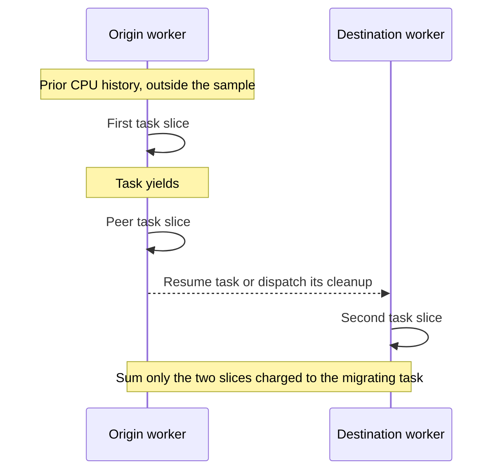

# RT-26 — CPU accounting for native tasks that migrate between workers

Summing CPU charges for each dispatch measured the same task across two pthread workers. A sample taken on its original worker missed CPU used on the destination worker and could also charge another task. Subtracting timestamps from different worker CPU clocks produced a negative number in all three migration cases.

## Method

Two persistent Linux pthread workers accept dispatch requests from a coordinator. One task runs a 30 ms CPU slice and then yields. Its second slice runs for 25 ms on the original or destination worker. The cancellation case dispatches 12 ms of cleanup on the destination worker. A peer can run 40 ms on the origin worker while the first task is suspended. A synchronization handshake acknowledges each slice before the next dispatch, so the measured schedules are independent of wake-up timing.

Each worker samples `CLOCK_THREAD_CPUTIME_ID` around its own slice. The coordinator obtains both worker clocks through `pthread_getcpuclockid` and measures an origin-worker span, a cross-clock subtraction, total worker CPU and process CPU. An 80 ms warm-up on the origin worker establishes deliberately different clock histories before the measurements start.



## Results

| Case | Task dispatch sum (ms) | Peer (ms) | Origin span (ms) | Cross-clock subtraction (ms) | Process (ms) |
| --- | ---: | ---: | ---: | ---: | ---: |
| migrate-alone | 55.0 | 0.0 | 30.0 | -55.0 | 55.1 |
| migrate-cancel | 42.0 | 40.0 | 70.0 | -68.0 | 82.1 |
| migrate-with-peer | 55.0 | 40.0 | 70.0 | -55.0 | 95.1 |
| stay-with-peer | 55.0 | 40.0 | 95.0 | 95.0 | 95.1 |

The table shows one optimized run, rounded to 0.1 ms. The runner compares both O0 and O3 to the requested slice times and allows up to 6 ms for clocks and coordinator work. The intermediate peer changes the observed origin bias from an undercount without the peer to an overcount with it. In the cancellation control the final cleanup slice is part of the same task's CPU charge after migration. The process and summed workers account for the whole fixture within the declared tolerance, including the peer. Their totals describe a different scope from a single task.

## Implementation boundary

Dispatch-boundary CPU sampling is a candidate for task charging across workers. Associate cleanup with the owning task until its terminal outcome, and compare CPU timestamps only within the same worker clock. The experiment uses bounded sequential dispatches and reports clock-accounting behavior. Multi-worker overlapping task slices, preemption, runtime overhead at production slice sizes, enforcement, kernel scheduling portability, and representative latency remain open.

## Reproduce

Use CPython 3.12.14, GCC 14.2.0 and Linux x86-64 from the repository root. The stable ledger comes from the checked outcomes. The optional sample records raw nanoseconds and may vary between runs.

```sh
fixture=research/runtime-and-systems/RT-26/MIGRATING-CPU-01
output=$(mktemp)
sample=$(mktemp)
python3 "$fixture/run.py" --output "$output" --sample "$sample"
cmp "$fixture/evidence.json" "$output"
python3 "$fixture/chart.py" --sample "$sample"
```

[Native probe](MIGRATING-CPU-01/probe.c) · [Runner](MIGRATING-CPU-01/run.py) · [Evidence ledger](MIGRATING-CPU-01/evidence.json) · [Raw timing sample](MIGRATING-CPU-01/sample.json)
