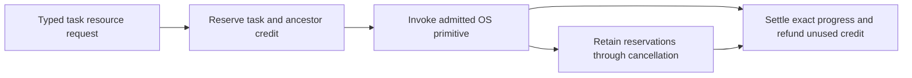
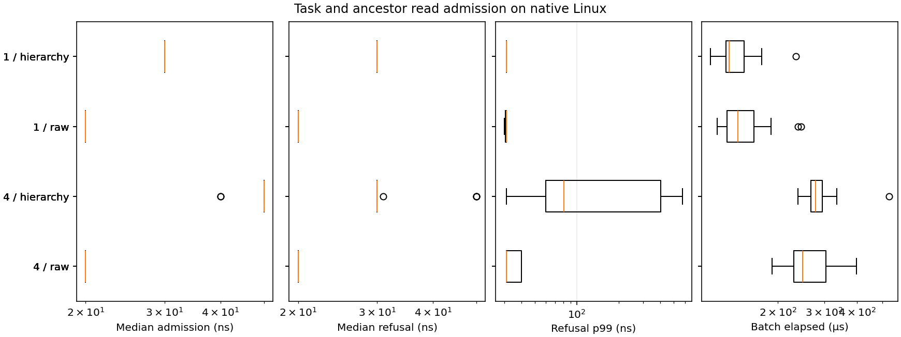

# RT-26 Native read admission and hierarchical resource enforcement

A task can enforce byte quotas precisely at an admitted I/O boundary. The runtime should distinguish quota reservation, actual progress, cancellation and terminal settlement. A parent and child check must share an admission boundary wherever the effects consume both budgets.



## Native experiment

One or four Linux threads make fixed-width reads against the same 128-byte temporary file. The checked route serializes the child and parent reservations before each `pread`. The reference route runs a fixed schedule that admits the same total reads without hierarchy bookkeeping. The admitted sets can differ between routes. All 72 processes verify exact bytes, half of their requests read and the other half skip I/O. Across both routes, the experiment retains 92,160 admission decisions. A separate native short-read control refunds eight unused credits and refuses further work when the child allowance is too small, even with parent capacity.

| Threads and route | Admission median ns | Refusal median ns | Refusal p99 ns | Batch elapsed µs |
|---|---:|---:|---:|---:|
| 1, hierarchy | 30.00 | 30.00 | 31.00 | 130.80 |
| 1, fixed schedule | 20.00 | 20.00 | 31.00 | 141.04 |
| 4, hierarchy | 50.00 | 30.00 | 80.38 | 277.73 |
| 4, fixed schedule | 20.00 | 20.00 | 31.00 | 248.81 |

Entries are medians of 18 independent process observations per route. The request samples include the monotonic clock measurement path and end when the user-space admission check returns. Batch elapsed includes barrier release, reads and join. The four-thread checked refusal p99 ranges from 40.70 to 523.70 ns between the p10 and p90 of process estimates. This tail describes a shared Linux runner and gives no target real-time bound. Repeating the workload verified the same complete byte and decision totals with different timings.



## Language, runtime and OS boundary

| Quantity or mechanism | Scoped contract |
|---|---|
| Memory | Select virtual reservation, resident bytes or explicitly shared charge as distinct quantities. Reject before extending an admitted bound. Linux process caps retain prior mappings and differ from task payload quotas. [Mapping residency](RT-26-LINUX-MAPPING-RESIDENCY-2026-11-24.md) · [Concurrent allocator pressure](../RT-25/RT-25-CONCURRENT-PRESSURE-AND-SELECTION-SCOPES-2026-11-25.md) |
| CPU and scheduling | Aggregate dispatch-attributed CPU deltas and task-owned dispatch/suspension counts. Capture kernel scheduling and CPU timers under exact scope. [Task switches](RT-26-TASK-SWITCH-ACCOUNTING-2026-11-25.md) · [CPU timer scope](RT-26-CPU-TIMER-SCOPE-2026-11-25.md) |
| Disk and network | Preserve logical progress, backing-storage charges, dequeued network bytes and transport counters as distinct observations. [Disk accounting](RT-26-NATIVE-DISK-ACCOUNTING-2026-11-25.md) · [TCP transport](RT-26-TCP-TRANSPORT-ACCOUNTING-2026-11-25.md) |
| Quotas, rates and limit handlers | Reserve ancestor and child credit before effects, use exact settlement, reclaim only unused delegation and bind durable handler decisions to the original request. [Quota reclamation](RT-26-DELEGATED-QUOTA-RECLAMATION-2026-11-25.md) · [Timer refill](RT-26-TIMER-REFILL-2026-11-25.md) · [Durable limit handlers](RT-26-DURABLE-LIMIT-HANDLERS-2026-11-25.md) |
| Hardware and software counters | Expose exact scope or explicit unavailability. Hardware-counter measurement and platform-specific timing need an authorized target. [Performance-counter boundary](RT-26-LINUX-PERFORMANCE-COUNTER-BOUNDARY-2026-11-24.md) |

The portable API can name typed units, scopes, reservation, terminal progress and conditional unavailable states. Its OS adapters establish actual meanings, scheduling and enforcement bounds independently. Native results establish the scoped Linux implementation effects. Strong cross-platform latency, PMU measurement and representative real-time workload criteria remain human-gated.

Use GCC 14.2.0, CPython 3.12.14 and Linux x86-64. The [raw samples](NATIVE-READ-ADMISSION-01/samples.json) record logical CPU affinity, source and executable digests. Re-render with Matplotlib 3.10.8.

```sh
p=research/runtime-and-systems/RT-26/NATIVE-READ-ADMISSION-01
LC_ALL=C PYTHONHASHSEED=37 python -B "$p/check.py" > /tmp/llmlang-native-read-admission.json
LC_ALL=C MPLBACKEND=Agg MPLCONFIGDIR=/tmp python -B "$p/plot.py"
```
