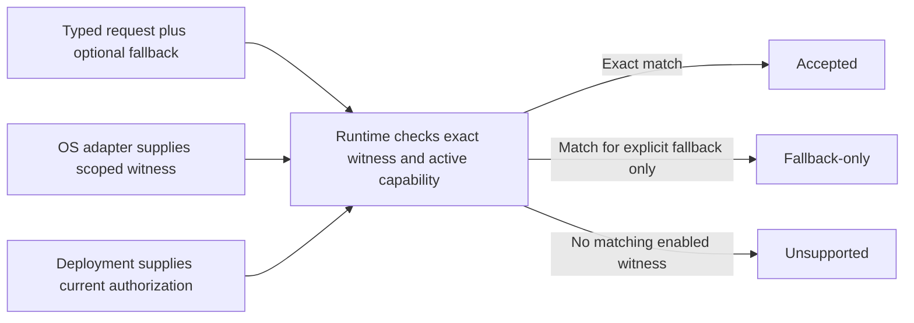

# RT-26 resource authority across language, runtime and deployment

A typed request can carry its exact resource, scope, covered effects and guarantee across targets. In this candidate, a grant requires a matching, enabled authority record in the current provider epoch. When an exact grant is unavailable, an explicitly named alternative can return its own authority record with a distinct outcome.

## Candidate boundary

| Layer | Defines or supplies | Checked boundary |
| --- | --- | --- |
| Language and typed APIs | Metric with unit and accounting event, scope, effect domain, requested mode and explicit fallback | The program can distinguish granted, fallback-only and unsupported outcomes. |
| Runtime | Task identity and generation, reservation, settlement and evidence for brokered effects | A cooperative grant covers effects that pass through the named broker. |
| OS adapter | Target-specific observation or enforcement witness, provider identity, epoch and coverage | A native process mapping limit covers virtual address space under the adapter's assumptions. A sampling witness supplies an observation. |
| Deployment | Authorization and lifecycle of scoped capabilities | A grant requires a current capability for the same witness. A replacement platform or revoked capability requires a new check. |



The fixture makes mode matching exact. A portable interface could define explicit projections from one mode to another, with evidence describing the resulting scope and metric. Deployment may grant a smaller resource budget than requested only through a separate negotiation result. This model checks the capability boundary before numeric admission and does not define quotas, latency or real-time overshoot bounds.

## Rechecked evidence

| Pinned native witness | Observation | Admission implication |
| --- | --- | --- |
| Linux performance counters | User-space cycles return EPERM in this profile. Native thread CPU time passes its control. | CPU time is an explicit fallback with its own accounting unit. |
| Linux process mapping | Discarded mapping has zero resident pages while a second mapping still fails with ENOMEM. | A virtual-address limit and a resident memory limit require distinct metric records. |
| Linux process CPU limits | Both workers stayed within their local limits and together exceeded the comparison group limit. | Process controls require additional group authority to supply a task-tree bound. |
| Linux UDP settlement | A short read delivers 4 bytes and consumes a 16-byte datagram. | Application bytes and dequeued bytes have separate records. The fixture supplies no wire-byte grant. |
| Linux file budget | Per-file limits exceed the 4,096-byte group total by 2,048 bytes. The broker settles 3,072 live bytes and leaves 1,024 available. | The broker covers its logical file lengths and mediated writes. Arbitrary files or physical disk I/O need their own evidence. |

[Native performance counters](RT-26-LINUX-PERFORMANCE-COUNTER-BOUNDARY-2026-11-24.md) · [Mapping residency](RT-26-LINUX-MAPPING-RESIDENCY-2026-11-24.md) · [Process CPU](RT-26-LINUX-PROCESS-CPU-BUDGET-2026-11-24.md) · [Socket settlement](RT-26-LINUX-SOCKET-BYTE-SETTLEMENT-2026-11-24.md) · [File budget](RT-26-LINUX-FILE-BUDGET-SETTLEMENT-2026-11-24.md)

## Finite comparison

The runner checks five SHA-256-pinned ledgers and the witness observations above, then compares 1,620 distinct requests against five candidate witnesses in both authorization states. Across 16,200 comparisons, the five enabled exact matches are the only grants. Removing the metric, scope, effect-domain, mode, epoch or capability check admits respectively 40, 15, 20, 10, 10 or 5 extra cases. An additional control requests a hard guarantee over the file broker's scope, even though the inventory contains a separate hard mapping witness. It returns unsupported. An unavailable cycle limit returns fallback-only when explicitly paired with enabled thread CPU observation and returns unsupported when that alternative is revoked.

The result checks semantic admission over a finite model with Linux witnesses. Production adapter attestation, concurrent revocation, numeric enforcement bounds, measurement overhead and other target profiles remain open.

## Reproduce

CPython 3.12.14 produced identical evidence with hash seeds 37 and 71. The evidence digest is `9ab27c8c8675debba90418ea92ca2917f4a6ffaa77044870e0e509d2dd20047f`. [Replay inputs and evidence](RESOURCE-AUTHORITY-01/evidence.json)

```sh
LC_ALL=C PYTHONHASHSEED=37 python research/runtime-and-systems/RT-26/RESOURCE-AUTHORITY-01/check.py > /tmp/rt26-authority.json
```
