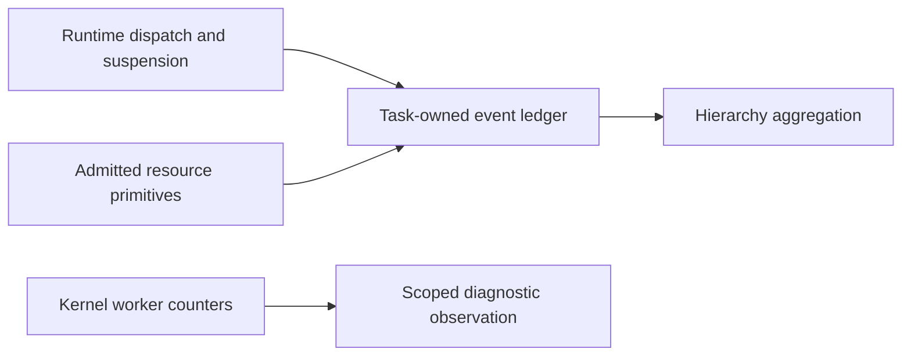

# RT-26 Task-switch accounting and charge boundaries

A coroutine can suspend several times while remaining the only runnable task. The kernel can also suspend a worker thread when no coroutine is dispatched. A resource contract should expose coroutine dispatch, suspension and changes of logical task owner as distinct events. Native thread counters retain their kernel scope. A candidate runtime accounts for each event at its origin and folds additive task-owned quantities once into ancestor scopes.



## Checked switch semantics

The runner drives actual CPython coroutine objects on one Linux worker thread. It interleaves sibling operations, varies body and cleanup suspension counts, and injects cancellation after the first suspension in half the cases. All 36 schedules match independently derived dispatch, suspension, logical owner-change and ancestor counts. A cancellation with three cleanup suspensions and an immediately completing peer records six dispatches, four suspensions and two logical owner changes. Kernel RUSAGE_THREAD records an increase in voluntary switches during the independent blocking-sleep control, which dispatches zero coroutines. A plain dispatch quota accounts for precisely the chosen runtime events; owner changes or a kernel context-switch count alone would miss some of that work.

## Resource and hierarchy contract

| Quantity | Candidate charge and enforcement point | Verified boundary |
|---|---|---|
| Memory | Admit exact virtual mapping bytes, hold reservations through settlement, label residency and sharing policies distinctly | [Mapping residency](RT-26-LINUX-MAPPING-RESIDENCY-2026-11-24.md) · [Shared memory](RT-26-LINUX-SHARED-MEMORY-ATTRIBUTION-2026-11-24.md) |
| CPU | Sum same-thread clock deltas per dispatch, include cleanup, reconcile uninstrumented work as a separate worker quantity | [Migration](RT-26-MIGRATING-TASK-CPU-2026-11-24.md) · [Coroutine CPU](RT-26-COROUTINE-CPU-ATTRIBUTION-2026-11-24.md) |
| Disk | Reserve against admitted operation, settle on exact logical progress, retain kernel storage charge and cancelled writes as separate counters | [Disk accounting](RT-26-NATIVE-DISK-ACCOUNTING-2026-11-25.md) · [File budget settlement](RT-26-LINUX-FILE-BUDGET-SETTLEMENT-2026-11-24.md) |
| Network | Scope admission to the socket operation and explicit stream or datagram policy. Track delivered and dequeued bytes separately | [Socket settlement](RT-26-LINUX-SOCKET-BYTE-SETTLEMENT-2026-11-24.md) |
| Runtime switches | Attribute dispatch and suspension to the dispatched task. Charge an owner change to the newly dispatched task under this fixture's policy | Current runner |
| Hardware and software events | Bind available event readings to exact target and measurement scope. Use explicit unavailable status when measurement is denied | [Linux performance counters](RT-26-LINUX-PERFORMANCE-COUNTER-BOUNDARY-2026-11-24.md) |
| Ancestor budgets | Reserve before effect, keep the reservation until typed settlement, return only unused delegated credit | [Durable limits](RT-26-DURABLE-LIMIT-HANDLERS-2026-11-25.md) · [Quota reclamation](RT-26-DELEGATED-QUOTA-RECLAMATION-2026-11-25.md) |

The candidate preserves task attribution through cleanup and keeps runtime and OS event units distinguishable. It does not establish overhead, deadlines or accurate physical-memory and wire attribution across targets. Hardware and software perf events were unavailable in the archived environment. Native PMU and real-time acceptance require an authorized representative runtime and target.

## Replay

CPython 3.12.14 on Linux reproduced the [ledger](TASK-SWITCH-ACCOUNTING-01/evidence.json) under two hash seeds.

```sh
LC_ALL=C PYTHONHASHSEED=37 python -B research/runtime-and-systems/RT-26/TASK-SWITCH-ACCOUNTING-01/check.py
```
