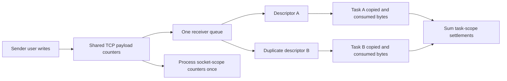

# TCP transport, receive queues and task byte accounting

[Runtime research issue #325](https://github.com/aivibeflow/LLMLang/issues/325) · [Prior TCP and UDP settlement study](RT-26-LINUX-SOCKET-BYTE-SETTLEMENT-2026-11-24.md)

A socket can count the same transport bytes through several descriptors, while different tasks copy or consume different portions of its receive queue. LLMLang needs a concrete metric for each budget. Charging a task from a shared socket counter can attribute that task's peer activity to it.

The experiment opens a fresh IPv4 loopback connection per run and duplicates the receiving descriptor. Linux `SO_COOKIE` confirms both descriptors refer to the same receiver socket and distinguishes the sender. After each send the probe waits until the newly written data is acknowledged and visible in the receive queue. At each subsequent boundary it samples the Linux `TCP_INFO` byte counters, both `FIONREAD` values and the exact result bytes from the named task's call. `MSG_PEEK` copies a prefix without consuming it.



The [independent oracle](TCP-TRANSPORT-ACCOUNTING-01/run.py) models a byte queue. A send adds bytes, a peek copies a prefix, and a normal receive copies and removes a prefix. It compares every native phase, including the actual bytes returned by the C probe. The sender never closes before the final observation, and retransmitted-byte deltas are zero in these loopback cases.

| Measurement | Observation per compiler profile |
| --- | ---: |
| Fresh connections | 32 |
| Exact phase observations | 256 |
| Bytes consumed once | 1,104 |
| Total bytes copied to tasks, including peeks | 1,504 |
| Sum of identical received-byte deltas through both descriptors | 2,208 |
| Retransmitted bytes observed | 0 |

Both compiler profiles match across 64 native runs and 512 observed phases. In one case, the first write is eight bytes. After the receiver acknowledges arrival, each descriptor reports an eight-byte queue and eight transport bytes before either task has consumed data. Task B peeks all eight bytes. Its copied count advances while both queue and transport counts stay fixed. Task A consumes seven bytes and the shared queue falls to one. Both transport views still report eight bytes. The final drain leaves no queued bytes.

A task budget for newly removed data can settle from the observed consuming syscall and its exact invocation owner. A budget for copied data includes peeks. A metric for transported TCP payload is socket-scoped and needs distinct accounting for the socket rather than each descriptor. Counter availability, returned structure length, scope and units are part of the native profile. This experiment leaves packet and interface bytes, retransmission accounting under loss, multiple peers sharing a network interface, concurrent external readers, cancellation races and portability open. [Linux TCP instrumentation](https://man7.org/linux/man-pages/man7/tcp.7.html) · [Linux receive flags](https://man7.org/linux/man-pages/man2/recvmsg.2.html)

## Reproduce

Linux x86-64 kernel `6.18.57`, GCC `14.2.0`, glibc `2.41`, Linux UAPI headers from `linux-libc-dev 6.12.117-1`, CPython `3.12.14`. The C probe uses 32 parameter combinations, four receive boundaries plus the final drain, two payload writes and an initial baseline. The [observations](TCP-TRANSPORT-ACCOUNTING-01/observations.json) preserve all phase counters and bytes once, after the two compiler profiles agree. The accounting table reports exact totals with no timing or physical device claim.

```sh
study=research/runtime-and-systems/RT-26/TCP-TRANSPORT-ACCOUNTING-01
python3 -B "$study/run.py" --out /tmp/rt26-tcp-transport.json
cmp "$study/observations.json" /tmp/rt26-tcp-transport.json
```
