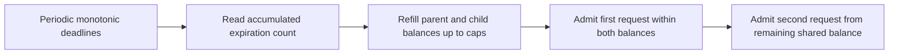

# RT-26. Delayed timer observations and hierarchical rate accounting

A rate limiter needs to account for elapsed periods when one wakeup delivers several timer expirations. This experiment connects Linux periodic timer observations to a two-child token bucket. Each period contributes one token to the shared parent and to each child, up to their individual capacities. A child's admitted units consume both its own tokens and the shared parent's tokens. [Issue #325](https://github.com/aivibeflow/LLMLang/issues/325) · [RT-26 resource accounting](RT-26-HIERARCHICAL-RESOURCE-ACCOUNTING-AND-ENFORCEMENT.md)

The native probe creates a fresh monotonic `timerfd` for each observation, uses a 20 ms absolute periodic schedule, and reads it after the first, third or sixth deadline. Samples of the monotonic clock immediately before and after the read bound the number of elapsed periods. The three accounting variants credit one token per callback, credit every expiration without capping the accumulated balance, or credit the expiration count and cap each balance before serialized admission.



## Results

The 18 timer observations contain exactly 1, 3 and 6 expirations in their three groups, six per group. All counts fall within their sampled monotonic-clock windows. With an empty three-token parent and two- and three-token children, the exact accounting grants a total of one, three and three units for those groups. The one-callback rule undercredits both delayed groups. Uncapped refill admits a different per-child split in the three-period group and admits six units in the six-period group. Each shortcut differs from the reference in 12 of the 18 observed cases. [Raw timer windows](TIMER-REFILL-01/timers.csv)

An independent replay adds and spends individual tokens in 104,976 order-labelled cases. The capped formula matches throughout. Collapsing counts to one callback changes 17,652 results, and uncapped refill changes 29,880. Lean checks the capacity bound, the equivalence of batched and split refill without intervening spending, and the parent bound after both serialized admissions. The proof works over natural numbers. [Finite model ledger](TIMER-REFILL-01/model.json) · [Lean axiom output](TIMER-REFILL-01/axioms.txt)

The native timer checks establish counting behavior on one Linux kernel. The finite replay and proof assume serialized refill and spending. Enforcement latency, cancellation, clock suspend semantics, parallel admission, fairness, overflow in bounded counters and cross-platform timers remain open. The recorded timing windows verify each sampled count and yield no scheduling guarantee.

## Replay

Source baseline `69f4675` on `research/all`. Replay used Linux 6.18.57 on x86-64, GCC 14.2.0, CPython 3.12.14 and Lean 4.36.0. A replay may read a larger count if the host runs the process late. The checking program validates timing windows and the exact model for the counts actually observed.

```sh
data=research/runtime-and-systems/RT-26/TIMER-REFILL-01
tmp=$(mktemp -d)
lean "$data/Refill.lean" > "$tmp/axioms.txt"
cmp "$data/axioms.txt" "$tmp/axioms.txt"
gcc -std=c17 -Wall -Wextra -Werror -O2 "$data/probe.c" -o "$tmp/probe"
timeout 10 taskset -c 0 "$tmp/probe" > "$tmp/timers.csv"
python -B "$data/check.py" "$tmp/timers.csv" "$tmp/model.json"
cmp "$data/model.json" "$tmp/model.json"
```
