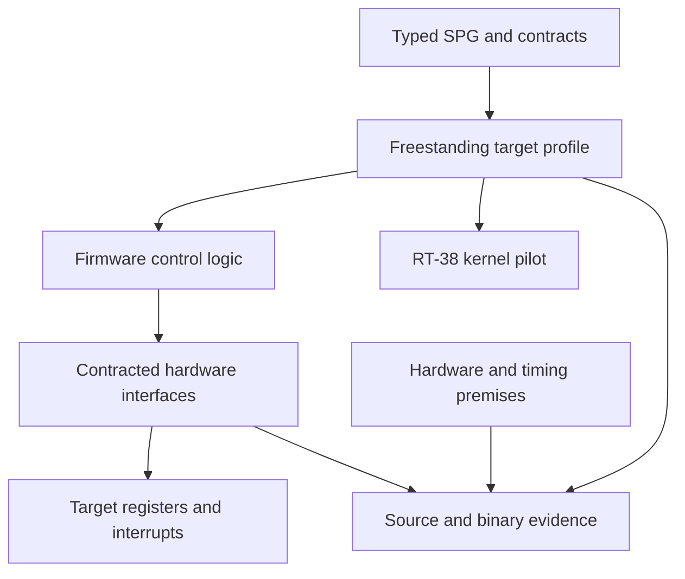
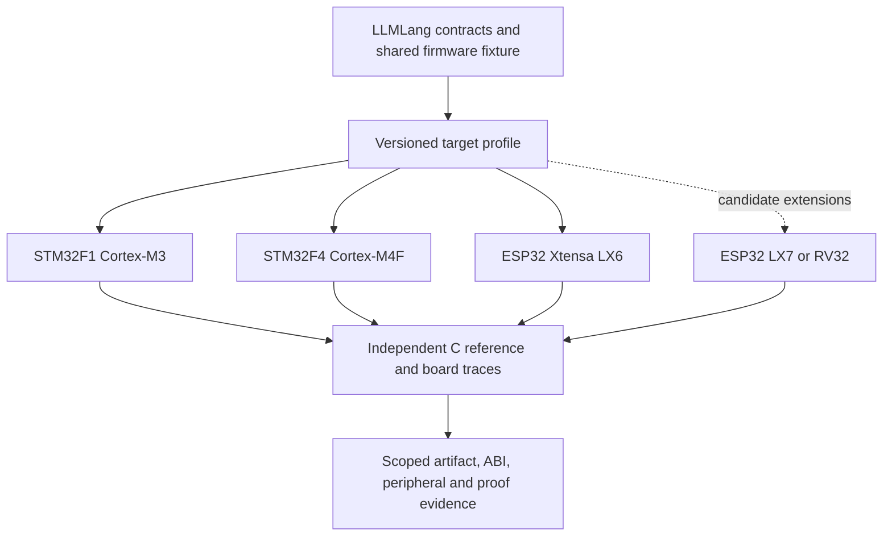

# RT-37 — Freestanding, embedded and real-time firmware

The tracked-archive replay checks twelve ledgers across Cortex-M3 firmware, linked interrupt effects and conditional embedded models. [Cortex cohort replay](../../research-management/RT-00/RT-00-CORTEX-COHORT-REPLAY-2026-11-25.md)

The manufacturer part manual supplies scoped LM3S6965 register rules and separates debugger, edge latch and physical claims. [Part register evidence](RT-37-LM3S6965-PART-REGISTER-2026-11-25.md)

The GPIO edge test distinguishes a retained raw latch, masked delivery and pending-state clearance on two emulated ports. [GPIO edge acknowledgment](RT-37-GPIO-EDGE-ACK-2026-11-25.md)

**Status:** Bounded Cortex-M3 startup, runtime closure, timer/GPIO and stack slices checked in QEMU. Broader firmware and timing profile open.

**Priority:** P0 shared profile feasibility; P1 firmware/real-time pilot and advanced targets.  
**Date:** 2026-11-24  
**Tracking:** [Issue #440](https://github.com/aivibeflow/LLMLang/issues/440)  
**Baseline:** `bd774c1af4496652169e8d939b6e3dd0b2e6eede`

## 1. Objective and scope

Investigate whether LLMLang can produce firmware that executes without a host OS, and whether functional, temporal, memory and hardware protocol guarantees can be checked compositionally. A freestanding executable may have explicit startup and support routines but must not silently depend on POSIX, libc, a scheduler, garbage collection or a heap. This is a shared foundation for [RT-38 kernels](../RT-38/README.md). A real-time profile is an orthogonal constraint, not a synonym for bare metal.

Hypotheses: H1 a target-gated subset can preserve core semantics without hidden hosted dependencies; H2 typed peripheral protocols and effect/capability contracts can expose illegal operations; H3 target-specific cost/stack models can establish useful resource bounds for restricted programs. Falsify these by exhibiting a required semantic operation that cannot be lowered in the profile, an accepted invalid hardware trace, or an unsound resource bound.

The profile governs available operations; hardware interfaces declare effects and premises; evidence must distinguish source proof, lowering and target observations.

## 2. Research work packages

| ID | Question / deliverable |
|---|---|
| EMB-01 | Hosted versus freestanding profile, target manifest, startup/reset, initialization, termination/panic and explicit runtime closure |
| EMB-02 | Static-only versus explicit bounded allocator; stack bounds, alignment, fixed-width integers, bit operations, fixed-point arithmetic and overflow |
| EMB-03 | Physical addresses, register layouts, MMIO/volatile access width, ordering, barriers, read/write side effects and aliasing |
| EMB-04 | CMSIS-SVD ingestion, typed register generation, provenance and missing behavioral semantics |
| EMB-05 | GPIO, timer, ADC, PWM, SPI/I2C, flash and watchdog contracts; initialization, ownership and failure states |
| EMB-06 | Interrupt entry/return, priority/nesting, shared state, critical sections and transitive no-block/no-allocation effects |
| EMB-07 | WCET (worst-case execution time) and stack bounds with pinned clock, memory, compiler and interference model; unknown if insufficient |
| EMB-08 | Static RAM/flash/heap budgets and resource-preserving lowering, inspect final link map and binary |
| EMB-09 | Period/deadline, jitter, interrupt latency, scheduling and progress; distinguish WCET from end-to-end response |
| EMB-10 | Numeric precision, fixed-point and overflow proof/measurement trade-offs |
| EMB-11 | DMA buffer ownership, cache coherence, cancellation and device access ranges |
| EMB-12 | Energy and power-state contracts with environmental and measurement assumptions |
| EMB-13 | Bare-metal versus optional RTOS integration; scheduler contracts and target-specific capabilities |
| EMB-14 | Sensor/actuator faults, watchdog/reset and safe degraded modes; distinguish model guarantees from physical safety |
| EMB-15 | Reproducible firmware image generation, emulator/board execution and target correspondence |
| EMB-16 | Independent C/Rust reference workloads and size, RAM, time, verification-cost benchmarks |

## 3. Candidate vectors and pilot

Compare static-only versus opt-in explicit allocation; minimal runtime/intrinsics versus a small foreign HAL with explicit RT-36 premises; LLVM native emission versus generated freestanding Rust, without selecting a backend. Start with a pinned Cortex-M emulator and a timer/GPIO control loop; compare a RISC-V embedded target later. A firmware image must boot without a host OS, and an independent state-machine oracle must observe timer/GPIO traces. If physical timing is required, use an identified board and calibrated measurements; emulator timing alone cannot establish WCET.

Illustrative controller obligations: invalid sensor or sampled temperature at/above threshold implies heater command zero within a bounded response interval; valid duty cycle stays in range; no allocation in interrupt context; stack/period bounds. Actual temperature safety additionally requires sensor accuracy, sampling, actuator response, physical dynamics and fault assumptions. The example is not a safety-certified controller.

Negative controls: hidden libc/OS imports or allocator calls; invalid register mode; write-one-to-clear misuse; a blocking or allocating transitive interrupt callee; stale DMA ownership; stack/deadline exceedance; optimistic bound with missing target assumptions. Retain counterexamples and UNKNOWN results.

### Target families and device profiles

The [research plan §5.4](../../../PLAN.md#54-freestanding-embedded-and-real-time-firmware-rt-37) requires three MCU families. Each needs a versioned device profile and independently scoped evidence; a generic Cortex-M or RV64 emulator is not a substitute for a specific MCU's peripherals or runtime.

| Required family | Initial candidate | CPU / ISA | SDK/runtime paths |
|---|---|---|---|
| STM32F1 | STM32F103 | Cortex-M3, ARMv7-M Thumb-2 | CMSIS and STM32CubeF1 HAL/LL; bare metal, optional FreeRTOS |
| STM32F4 | STM32F407 | Cortex-M4 with FPU, ARMv7E-M Thumb-2 | CMSIS and STM32CubeF4 HAL/LL; bare metal, optional FreeRTOS |
| ESP32 | Original ESP32 DevKit-class board | Xtensa LX6 32-bit, single/dual core by SoC | ESP-IDF/FreeRTOS integration; separately assess minimal bare-metal closure |
| ESP32 extension candidates | ESP32-S2/S3; ESP32-C3/C6 | Xtensa LX7; RV32 RISC-V, respectively | Separate pinned SoC, compiler/ABI, SDK, boot and runtime profiles |

The first three rows are required research families; extension chips and initial exact device/board selections remain candidates. Generic RV64 remains a separate research target and is not the ESP32 RISC-V ISA.

Compare vendor HAL/SDK import and LLMLang static-library export against direct MMIO or minimal-runtime approaches. Vendor integration can reuse drivers and boot infrastructure, but requires explicit contracts and trust premises; direct hardware access reduces dependencies while increasing device-specific implementation and proof work. Compare direct LLVM emission and generated freestanding Rust/C adapters only for toolchains that actually support the pinned target.

For STM32F1/F4, pin the device SVD/header, reference manual, startup/vector table, clock tree and linker map; for F4 distinguish floating-point ABI, FPU context and interrupt behavior. For ESP32 pin the Xtensa ABI (including call convention), bootloader, ROM interfaces, flash image layout, SDK configuration, scheduler and single/dual-core assumptions; radio/closed binary dependencies and RTOS behavior must remain explicit external premises. RV32 extension profiles need their own ABI and instruction-set validation.

The proposed validation flow shares source-level obligations but requires target-specific build, board and ABI evidence. Candidate extensions do not inherit validation from the original ESP32.

Use a common GPIO/timer/UART workload, static C ABI import/export fixture, independent C reference traces, negative controls for incorrect ABI/layout, invalid MMIO and hidden runtime dependencies, and flash/RAM/stack measurements. Compare emulation with calibrated physical hardware; pin exact board and silicon revision before claiming device conformance or timing. Preserve the existing generic Cortex-M3 pilot and do not mark any requested MCU family as validated based on it.

Manufacturer references: [STM32F1](https://www.st.com/en/microcontrollers-microprocessors/stm32f1-series.html), [STM32F4](https://www.st.com/en/microcontrollers-microprocessors/stm32f4-series.html), [Espressif chip comparison](https://docs.espressif.com/projects/esp-idf/en/v5.0/esp32/hw-reference/chip-series-comparison.html), [Espressif board selection](https://docs.espressif.com/projects/esp-techpedia/en/latest/esp-friends/get-started/board-selection.html). See [bidirectional FFI §6.6](../../../PLAN.md#66-cross-platform-native-interoperability-and-bidirectional-ffi-cross-cutting) for shared library interoperability and evidence rules.

## 4. Dependencies, evidence and exit criteria

- [Core semantics](../../language-design/RT-03/CORE-LANGUAGE-SEMANTICS.md), [RT-04](../../language-design/RT-04/RT-04-TYPE-EFFECT-OWNERSHIP-AND-CAPABILITY-ALTERNATIVES.md), [layout/ABI](../../compiler-and-translation/RT-09/RT-09-STRUCTURAL-TYPE-IDENTITY-LAYOUT-AND-C-ABI-PROPOSAL.md), [atomic lowering](../../compiler-and-translation/RT-13/RESEARCH-SCENARIO-116-ATOMIC-BACKEND-LOWERING-OBLIGATIONS.md), [LLVM](../../compiler-and-translation/RT-13/LLVM-BACKEND-ARCHITECTURE.md) and [POSIX boundary](../RT-10/POSIX-RUNTIME-ARCHITECTURE.md) provide candidate foundations; POSIX is not a required execution dependency.
- [Public interfaces](../../semantic-representation/RT-05/PUBLIC-INTERFACES-AND-CONTRACT-REFINEMENT.md), [RT-34 resources](../../formal-verification/RT-34/RT-34-AUTOMATIC-COMPLEXITY-INFERENCE.md), [RT-36 assumptions](../../formal-verification/RT-36/RT-36-FORMAL-VERIFICATION-ASSUMPTIONS-AND-TRUST.md) and RT-07/08/13/16/32/33 constrain proof/evidence, target preservation and authority. Asymptotic complexity alone is not a concrete timing bound.
- Pin target, compiler/linker versions, source/SPG revisions, memory map, device model, clock/interrupt model, proof checker, assumptions and commands. Compare independent reference traces and negative controls; preserve link maps, binary imports, traces, measurements and proof/evidence scope.
- Exit: documented comparative profile and unsupported operations; reproducible bootable firmware pilot with explicit runtime closure and independent tests; checked obligations in a declared fragment and separately scoped timing/resource evidence; unresolved gaps and draft-change proposals recorded. No automatic normative adoption.

The [Cortex-M3 runtime-closure study](RT-37-CORTEX-M3-FREESTANDING-CLOSURE-2026-11-24.md) boots five direct LLVM and freestanding Rust images against an independent UART oracle. Explicit startup, arithmetic and unwind choices determine closure.

The [Cortex-M3 timer and GPIO study](RT-37-CORTEX-M3-SYSTICK-GPIO-2026-11-24.md) compares interrupt delivery and polling in four images. It checks SysTick vector binding, pending-state handling, masked GPIO readback and static linked extents. Independent board tests, transitive interrupt effects and real-time claims remain open.

The [Cortex-M3 stack study](RT-37-CORTEX-M3-STACK-BOUND-2026-11-24.md) checks direct-control stack depths, paint observations and the hardware frame alignment bit across polling and interrupt profiles. The tighter interrupt bound depends on the armed wait interval. Nested interrupts and timing remain separate.

The [MMIO metadata study](RT-37-MMIO-METADATA-AND-CAPABILITIES-2026-11-24.md) compares exact SVD and header layout with protocol-aware admission. It distinguishes read-to-clear, write-one commands and GPIO masking from access direction and retains the device and capability premises.

The [volatile SysTick study](RT-37-CORTEX-M3-VOLATILE-COUNTFLAG-2026-11-24.md) checks the actual linked load count and read-to-clear behavior. Ordinary loads can coalesce even when the LLVM O0 IR retains both reads.

The [DMA lease study](RT-37-DMA-LEASE-OWNERSHIP-2026-11-24.md) checks bounded device access and synchronized handback in Lean. It shows how delayed completions break endpoint-only matching or wrapping tags and retains exact controller and cache premises.

The [transitive ISR effects study](RT-37-CORTEX-M3-TRANSITIVE-ISR-EFFECTS-2026-11-24.md) derives the call coverage of a bounded Thumb profile from the exact linked vector and functions. It rejects blocking and allocation below helpers, checks tail branches and retains unknown results where target or leaf evidence is missing.

The [bounded allocator study](RT-37-CORTEX-M3-BOUNDED-ALLOCATOR-2026-11-24.md) compares fixed slots and a checked linear cursor on the same 64-byte Cortex-M3 arena across LLVM and Rust. It separates reservation behavior, linked footprint and arithmetic failure.
