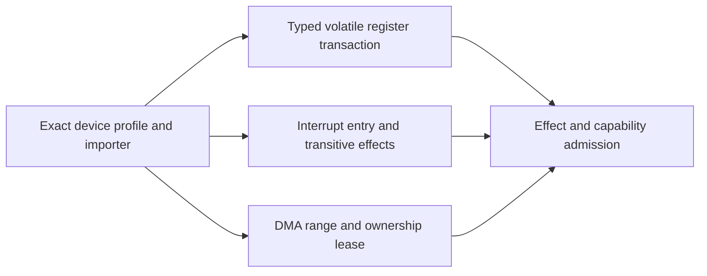

# RT-37 Composed typed device access

A candidate device operation can carry separate obligations for register access, interrupt execution and DMA ownership. Combining them requires a common exact hardware profile and separate evidence for each effect. An SVD or vendor header contributes address, width, reset and declared access information. Register semantics such as write-one-to-clear, read side effects, ordering and alias behavior need independent protocol evidence.



## Candidate contract

- A capability binds the device profile, instance, allowed register effect, access width, context and operation. A volatile operation preserves its declared memory event. For write-one-to-clear, one typed mask write implements the checked effect. A read-modify-write or set alias has different semantics. [SVD metadata and capabilities](RT-37-MMIO-METADATA-AND-CAPABILITIES-2026-11-24.md) · [Native-width volatile loads](RT-37-CORTEX-M3-VOLATILE-COUNTFLAG-2026-11-24.md) · [NVIC pending clear](RT-37-CORTEX-M3-NVIC-PENDING-CLEAR-2026-11-25.md)
- Interrupt admission pins the actual vector, exact executable artifact and transitive callees to their declared effects. A known blocking operation refuses the scoped handler. An unresolved leaf preserves unknown effects. [Transitive ISR effects](RT-37-CORTEX-M3-TRANSITIVE-ISR-EFFECTS-2026-11-24.md)
- DMA transfers ownership only for a checked descriptor range and exact live lease. Handback requires completion, quiescence and a synchronized acquire tied to that lease. A reachable completion indicator alone leaves range and ownership unresolved. [DMA lease ownership](RT-37-DMA-LEASE-OWNERSHIP-2026-11-24.md)

## Composition check

The finite fixture combines a pending-bit acknowledgement path with interrupt and DMA handback evidence. Of 2,304 inputs, one exact combination is eligible, one remains unknown because its interrupt leaf is unresolved, and 2,302 refuse. Each control relaxes one obligation group while retaining the others.

| Relaxation | False admissions | Example |
|---|---:|---|
| Accept matching access structure in place of register protocol | 2 | An ordinary read-modify-write or the set alias |
| Inspect only the root handler | 2 | A nested blocking path or an unresolved leaf |
| Accept DMA completion without full handback evidence | 15 | Completion with stale lease, invalid bounds, absent quiescence or unsynchronized acquire |

The matrix tests composition of the declared conditions. It uses the linked archived probes for the underlying register, interrupt and ownership facts. Exact physical register descriptions, memory barriers, controller-specific quiescence, cache behavior and compiler coverage remain open. The checked scope supports conditional effects and an explicit unknown result for incomplete evidence.

Two CPython 3.12.14 hash seeds produced byte-identical [evidence](COMPOSED-DEVICE-BOUNDARY-01/evidence.json).

```sh
LC_ALL=C PYTHONHASHSEED=37 python -B research/runtime-and-systems/RT-37/COMPOSED-DEVICE-BOUNDARY-01/check.py
```
