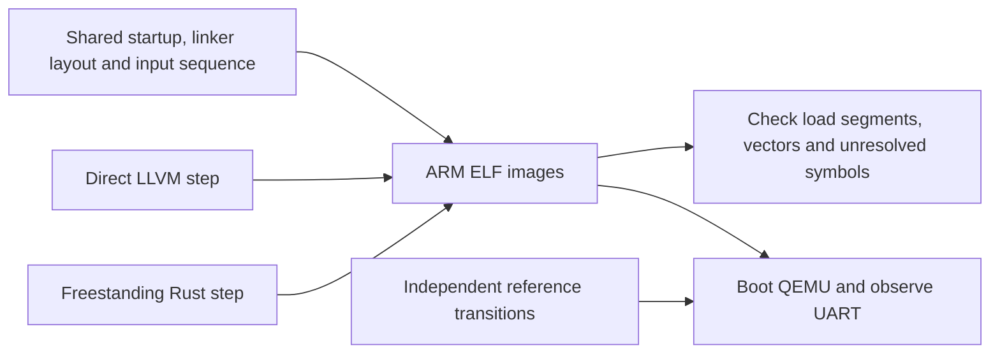

# Cortex-M3 startup and freestanding runtime closure

- **Date:** 2026-11-24
- **Research:** RT-37 EMB-01, with bounded evidence for EMB-02, EMB-08 and EMB-15
- **Baseline:** `00c170b466380e69f8c66b8600ee7f7c148f31c0` on main
- **Evidence:** Booted Cortex-M3 images, ELF closure inspection and independent functional traces

Five ARM images boot in QEMU without a host OS in the guest and reproduce the same 14-step controller trace. Direct LLVM IR and freestanding Rust both pass the explicit runtime-closure check with their chosen arithmetic and unwind policies. A sixth image boots and matches the trace while carrying an unresolved unwind symbol. The two checks discriminate different failures.

## Workload and comparisons

The shared startup defines a Cortex-M vector table and stack top, copies initialized data from flash, clears BSS and writes through memory-mapped UART0. The fixture writes a sentinel to its BSS slot before clearing it so that skipping the initialization is observable. The linked image uses flash from address zero and SRAM from `0x20000000`. After validating the two startup values it runs a stateful, fixed-width duty-cycle controller with valid, invalid and out-of-range flag inputs. The Python reference computes expected transitions independently. The Rust body is a handwritten realization of the same fixture rule.



| Realization | Flash extent | Static SRAM extent | UART steps matched |
| --- | ---: | ---: | ---: |
| LLVM O0, explicit `nounwind` | 492 B | 8 B | 14 |
| LLVM O2, explicit `nounwind` | 472 B | 8 B | 14 |
| Rust O0, explicit saturating addition | 684 B | 8 B | 14 |
| Rust O2, explicit saturating addition | 468 B | 8 B | 14 |
| Rust O2, ordinary checked addition after clamp | 468 B | 8 B | 14 |

The flash extent includes loadable bytes through the final flash address used, including the initialized-data image and alignment. The SRAM extent covers static sections. The reset vector has the Thumb bit set and the initial stack pointer matches the configured SRAM end. Each accepted ELF has a static executable header, in-range loadable segments, and no undefined symbols. Both realization paths use LLVM 19.1.7, so the comparison distinguishes the direct IR and Rust inputs to LLVM.

| Control | Observation |
| --- | --- |
| Rust O0 with ordinary checked addition after the clamp | The object-only link needs `panic_const_add_overflow`. |
| LLVM O2 with data-dependent 64-bit unsigned division | The link needs the EABI helper `__aeabi_uldivmod`. |
| LLVM O0 with implicit unwind policy | The ELF links and boots with a matching UART trace. Its symbol table still contains undefined `__aeabi_unwind_cpp_pr0`. |
| Skip BSS clearing after seeding the test location | The firmware emits the startup failure marker before processing controller input. |

A target contract must identify arithmetic operations and runtime support even when the input source uses a freestanding library profile. Size and boot results cover this workload and linker layout. Timer and GPIO behavior, RAM beyond static sections, stack bounds, allocation policies, physical board correspondence and WCET remain open.

## Reproduce

Use LLVM/LLD 19.1.7, Rust 1.85.1 (`4eb161250e340c8f48f66e2b929ef4a5bed7c181`) with `thumbv7m-none-eabi`, Python 3.12.14, and QEMU 10.0.13 on x86-64 Linux. QEMU used Debian package `1:10.0.13+ds-0+deb13u1` (main ARM emulator package SHA-256 `babb8ab3c9f5f045184bd8c20604237d28c1b5e6a578d7f400566b9f257b59e7`). The [ledger](cortex-m3-closure/results.json) records source and ELF digests, load ranges and exact UART traces. With the tools on the path:

```sh
pilot=research/runtime-and-systems/RT-37/cortex-m3-closure
replay_dir=$(mktemp -d)
python3 -B "$pilot/run.py" --qemu "$(command -v qemu-system-arm)" --output "$replay_dir/results.json"
cmp "$pilot/results.json" "$replay_dir/results.json"
```
