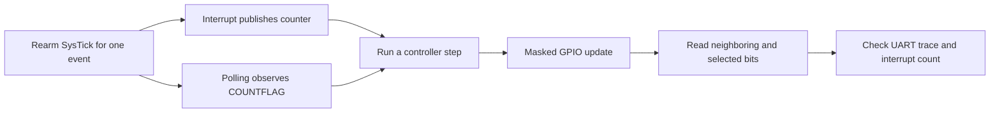

# Cortex-M3 timer delivery and GPIO updates in QEMU

- **Date:** 2026-11-24
- **Research:** RT-37 EMB-03, EMB-06 and EMB-15, with scoped evidence for EMB-05
- **Baseline:** `4b253db7152d58d3859e159fbc3f868fbfd28a77`
- **Evidence:** Four Cortex-M3 images, exact UART observations of modeled GPIO readback, and four execution controls

SysTick interrupt delivery and register polling produce identical duty and GPIO values across the 14 controller steps in each image. The interrupt path services 14 exceptions, while the polling path services zero. A contract that includes interrupt delivery distinguishes the two despite matching application outputs.

## Workload

The fixture reuses the [Cortex-M3 startup and bare-metal link](RT-37-CORTEX-M3-FREESTANDING-CLOSURE-2026-11-24.md), the same controller inputs and the existing LLVM and Rust step functions. It wires vector slot 15 to the Thumb SysTick handler. Before each controller step, both profiles reset the SysTick current counter and use reload value 1999. The interrupt profile waits on the ISR's counter. The polling profile observes the SysTick `COUNTFLAG` register and keeps interrupt delivery disabled. Both disarm the timer after one event.

An initial replay serviced a second pending exception during the same step even though the handler disabled SysTick. The revised handler clears `PENDSTCLR` and executes barriers before publishing the counter. The interrupt path also clears stale pending state before rearming the timer.

Port F bits 0 and 1 are outputs. The fixture seeds bit 0 to one and writes the duty predicate to bit 1 through its masked data address using a 32-bit access. It reads both bits back through the all-bits data address and emits the actual result over UART. The independent controller transition model supplies the expected duty, while the expected GPIO value adds the preserved bit 0 and the derived bit 1.



| Realization | Duty/GPIO steps matched | Interrupt count | Flash extent | Static SRAM extent |
| --- | ---: | ---: | ---: | ---: |
| LLVM, interrupt | 14 | 14 | 688 B | 12 B |
| Rust, interrupt | 14 | 14 | 684 B | 12 B |
| LLVM, polling | 14 | 0 | 680 B | 12 B |
| Rust, polling | 14 | 0 | 676 B | 12 B |

The initial vector and load-range checks remain active. The binary audit also binds SysTick vector slot 15 to the generated handler's tagged Thumb address. Routing the vector to the error handler emits `BVX` at the first event. Replacing the masked update with an all-bits write emits `BG02X`. The readback value `02` retains the requested high bit and loses the adjacent bit that should have remained set.

Two controls set `PENDSTSET` from the first handler invocation after disarming the timer. Clearing that pending exception yields 14 invocations. Omitting acknowledgement only for that invocation yields 15, with identical duty and GPIO observations.

## Reproduction and scope

Use the same LLVM/LLD 19.1.7, Rust 1.85.1, Python 3.12.14 and QEMU 10.0.13 versions as the startup experiment. Both image variants compile with optimization level 2. The [result ledger](cortex-m3-timer/results.json) records source and image hashes, exact load segments, vector addresses, control observations and the UART traces.

Twenty independent replays reassembled, linked and booted all eight images and reproduced the ledger byte for byte.

```sh
pilot=research/runtime-and-systems/RT-37/cortex-m3-timer
replay_dir=$(mktemp -d)
python3 -B "$pilot/run.py" --qemu "$(command -v qemu-system-arm)" --output "$replay_dir/results.json"
cmp "$pilot/results.json" "$replay_dir/results.json"
```

The checked workload uses the pinned QEMU Stellaris board model, one outstanding timer event per step, and two GPIO output bits. Physical hardware behavior, continuous periodic scheduling, nested interrupts, transitive ISR effects, stack bounds and real-time guarantees remain separate. The flash and SRAM columns describe linked extents.
