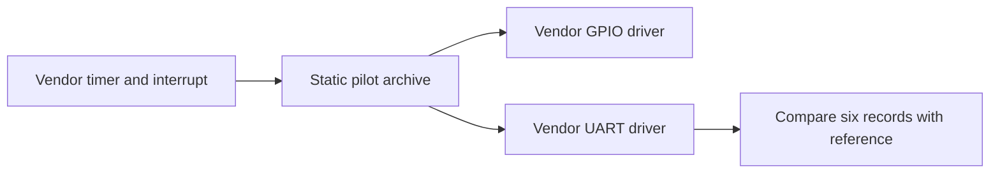

# RT-37 GPIO, timer and UART pilot across three MCU profiles

One C controller was compiled into a two-object archive and linked into native, STM32F103, STM32F407 and ESP32 callers. It accepts six sequential ticks, calls a GPIO adapter, then emits a UART record through the library's second member. A separate C program with a literal expected sequence supplies the reference. The native route also checks GPIO callback values and ten invalid requests.



| Profile | Build and functional evidence | Peripheral scope |
|---|---|---|
| STM32F103RBT6 | CMSIS startup and STM32CubeF1 LL. Renode STM32F103 UART trace matches all six records | TIM2 interrupt, USART2 and final PA5 output latch |
| STM32F407VGT6 | CMSIS startup and STM32CubeF4 LL. Renode STM32F4 UART trace matches all six records | TIM2 interrupt, USART2 and final PD12 output latch |
| ESP32 LX6 | ESP-IDF 5.5.3, stock bootloader and multicore FreeRTOS. Espressif QEMU UART trace matches all six records | GPTimer ISR notifies the task, GPIO18 driver call succeeds and UART0 carries the trace |

The STM32 integrators use reset HSI clock profiles at 8 MHz for F1 and 16 MHz for F4, distinct from the vendor PLL examples in the candidate manifests. The Renode CPU models have their own clocks and peripheral coverage. They produce functional ordering evidence, including the final emulated output latch, without establishing pad timing or RCC conformance. The F1 model reports unimplemented RCC accesses. An initial QEMU attempt on surrogate STM32 boards yielded no pilot UART trace. On ESP32 the GPIO callback checks SDK acceptance, while UART records identify the intended level. The emulated run has no external electrical observation. [Target manifests](RT-37-MCU-TARGET-MANIFESTS-2026-11-25.md)

Both STM32 link profiles reject a missing formatter archive member and an x86-64 object supplied to the ARM link. The ESP32 negative image asks its vendor GPIO driver to configure input-only pin 34 as output. QEMU shows `ESP_ERR_INVALID_ARG` and zero pilot records. Static linking catches archive and target mistakes, while the device driver decides profile-specific effects at runtime.

Physical board flashing, exact wiring, timing, electrical traces and reset behavior require the selected boards. They remain in the human-gated PLAN item.

## Replay and evidence

- [Pilot sources](MCU-GPIO-TIMER-UART-01/) · [STM32 link evidence](MCU-GPIO-TIMER-UART-01/stm32-evidence.json) · [Renode evidence](MCU-GPIO-TIMER-UART-01/arm-emulator-evidence.json) · [ESP32 evidence](MCU-GPIO-TIMER-UART-01/esp-evidence.json)
- Run the STM32 build with Debian Clang, LLD and LLVM ar 19.1.7, GNU readelf 2.44 and CPython 3.12.14. Populate the named source cache from the target manifest verifier. Under it place the two exact `stm32-f1` and `stm32-f4` component checkouts with `common/Drivers/CMSIS/Include` from their Cube release and the `device` and `hal` gitlinks from the candidate manifest. LLD 19 needs the F4 stack assignment moved below the memory declarations and the GNU section `READONLY` annotations removed. The check verifies that the vector remains at the vendor address, the named symbols resolve and no dynamic dependencies appear.
- Use the Renode 1.16.1 portable Linux archive whose SHA-256 is `1a532d4b5b82de0dd154970c401e0c7b0e498d17304b2cecc007e306c8f9617c`. The runner skips the platform's optional remote SVD diagnostic and hashes the original CPU models. [Renode release](https://github.com/renode/renode/releases/tag/v1.16.1)
- Copy `esp/`, `pilot.c`, `format.c` and `pilot.h` into a scratch parent directory. From `esp/`, build against ESP-IDF revision `2c211b236707889e8400c4dc5644dd5c4ee071e0` with its pinned submodules and vendor compiler using `idf.py --no-ccache -DIDF_TARGET=esp32 -DPILOT_INVALID_PIN=OFF build`. Use `ON` for the negative image. Merge each flash image in its build directory with `python -m esptool --chip esp32 merge-bin -o /path/to/image.bin --pad-to-size 4MB @flash_args`. Keep the positive ELF and its build metadata. Build timestamps can change full ESP32 image digests. The vendor Python constraint endpoint returned HTTP 403. The [recorded package versions](MCU-GPIO-TIMER-UART-01/esp-replay-requirements.txt) describe the actual PyPI environment, including esptool 5.7.0, CMake 4.4.5 and Ninja 1.13.2.
- Use Espressif QEMU 9.2.2 `esp_develop_9.2.2_20250817`, release archive SHA-256 `588bfaccd0f929650655d10a580f020c6ba9c131712d8fa519280081b8d126eb`. QEMU receives a temporary simulated revision-3 eFuse image. [Espressif QEMU release](https://github.com/espressif/qemu/releases/tag/esp-develop-9.2.2-20250817)

```sh
p=research/runtime-and-systems/RT-37/MCU-GPIO-TIMER-UART-01
LC_ALL=C PYTHONHASHSEED=37 python -B "$p/stm32_build.py" \
  --sources /path/to/source-cache --output /path/to/arm-builds \
  --clang /path/to/clang-19 --linker /path/to/ld.lld-19 --ar /path/to/llvm-ar-19
LC_ALL=C PYTHONHASHSEED=37 python -B "$p/arm_emulator.py" \
  --renode /path/to/renode --builds /path/to/arm-builds
LC_ALL=C PYTHONHASHSEED=37 python -B "$p/esp_check.py" \
  --qemu /path/to/qemu-system-xtensa --nm /path/to/xtensa-esp32-elf-nm \
  --build /path/to/positive-build --elf /path/to/positive.elf \
  --valid-flash /path/to/positive.bin --invalid-flash /path/to/invalid.bin
```
