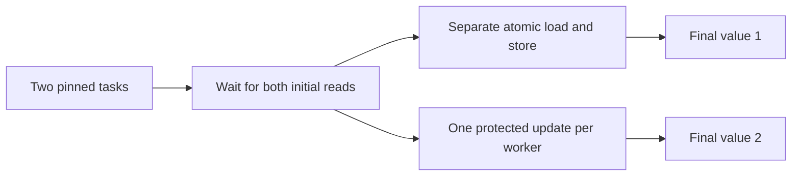

# RT-37 ESP32 scheduling, architecture and vendor dependency boundaries

Compare one ESP-IDF/FreeRTOS workload on original ESP32 with either one or two scheduler cores, and independently compile it for ESP32-C3. Two tasks read the initial counter before either can write. Separate atomic loads and stores both commit the value 1. The candidate uses one ESP-IDF critical section around each increment, which preserves both updates. This controlled schedule distinguishes synchronization policy even on one scheduler core.

| Built profile | Execution | Worker cores | Split result | Critical-section result |
|---|---|---|---:|---:|
| ESP32 LX6 dual-core | Espressif QEMU Xtensa | 0, 1 | 1 | 2 |
| ESP32 LX6 single-core setting | Espressif QEMU Xtensa | 0, 0 | 1 | 2 |
| ESP32-C3 RV32 | Espressif QEMU RISC-V | 0, 0 | 1 | 2 |



The QEMU results check affinity, task notifications, coordinated execution and the protected update under this schedule. They do not measure real hardware scheduling, bus contention, interrupt latency or timer behavior. ESP32-C3 uses a separate compiler, ELF machine and emulator target. No Xtensa result was used as evidence for C3.

## Runtime closure and radio

Two SDK-independent freestanding arithmetic slices link as separate ELF32 artifacts with no undefined named symbol or dynamic dependency. The Xtensa build passes the windowed ABI flag. The RV32 build passes RV32IMC and ILP32. Linking the arithmetic slice does not supply reset, memory initialization, interrupt handling, core startup, timers or radio. Those features in the executable scheduling comparison come from the vendor bootloader, ESP-IDF and FreeRTOS.

The dual-core no-radio image selects zero ESP32 Wi-Fi vendor archives. Adding a call to the SDK Wi-Fi initialization entry point selects 70 independent archive members from five vendor archives in the link map. The archives are exact dependency artifacts of the tested ESP-IDF revision. Their per-archive digests and member counts are in the ledger. The comparison does not run Wi-Fi initialization, exchange frames or establish a radio contract. For an RT-36 boundary, the presence of linked vendor code is a dependency fact. A device effect specification and validated assumptions about the vendor implementation remain separate.

Physical scheduler and radio verification require selected boards and a representative test environment. General LLMLang lowering and a bootable bare-metal profile remain open.

## Replay

The [firmware and checker](ESP32-SCHEDULING-PROFILES-01/) use the ESP-IDF v5.5.3 revision `2c211b236707889e8400c4dc5644dd5c4ee071e0` and gitlinks, including Wi-Fi library revision `e0befaa593277b4e80726079fbd521b4681754c2`. Use the [same Python package versions as the cross-MCU pilot](MCU-GPIO-TIMER-UART-01/esp-replay-requirements.txt), CPython 3.12.14 and GNU readelf 2.44. Use the ESP-IDF-recommended Xtensa GCC and RV32 GCC bundles and Espressif QEMU 9.2.2 for each architecture. The RV32 GCC Linux archive SHA-256 is `1d3a1b6a064686d9b77c4db7731f82e26c072e312e27969c45fe96410ecb2671`. The RV32 QEMU archive SHA-256 is `373b37a68bae3ef441ead24a7bfc950fcbfc274cbdd2b628fc6915f179eb1d8e`. [Vendor tools manifest](https://github.com/espressif/esp-idf/blob/2c211b236707889e8400c4dc5644dd5c4ee071e0/tools/tools.json)

Build from four independent scratch copies of the project with the requested target on PATH. The optional Wi-Fi binding is enabled in both CMake component evaluation phases by an environment flag. Check the resulting application images and link maps with `check.py` and compare the observations with the [raw ledger](ESP32-SCHEDULING-PROFILES-01/evidence.json). SDK-generated full image digests can vary with build metadata.

```sh
idf.py --no-ccache -DIDF_TARGET=esp32 build
idf.py --no-ccache -DIDF_TARGET=esp32 '-DSDKCONFIG_DEFAULTS=sdkconfig.defaults;sdkconfig.unicore' build
idf.py --no-ccache -DIDF_TARGET=esp32c3 build
PILOT_WIFI=1 idf.py --no-ccache -DIDF_TARGET=esp32 build

p=research/runtime-and-systems/RT-37/ESP32-SCHEDULING-PROFILES-01
LC_ALL=C PYTHONHASHSEED=37 python -B "$p/check.py" \
  --idf /path/to/esp-idf --dual /path/to/dual/build --single /path/to/single/build \
  --c3 /path/to/c3/build --wifi /path/to/wifi/build \
  --xtensa-qemu /path/to/qemu-system-xtensa --rv-qemu /path/to/qemu-system-riscv32 \
  --xtensa-gcc /path/to/xtensa-esp32-elf-gcc --rv-gcc /path/to/riscv32-esp-elf-gcc
```
