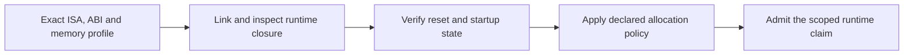

# RT-37 Execution closure and allocation profiles

A freestanding target profile needs separate evidence for the artifact, the boot path, the loaded memory ranges and the selected allocation policy. Combining these as one support claim would admit the tested bootable image with an undefined unwind symbol and the image that clears a retained word through a valid memory layout.

| Profile | Artifact and runtime scope | Evidence |
|---|---|---|
| Generic Cortex-M3, explicit freestanding startup | Five static images from direct LLVM or freestanding Rust replay the same 14 steps. Static SRAM extent and flash placement are checked. | [Freestanding closure](RT-37-CORTEX-M3-FREESTANDING-CLOSURE-2026-11-24.md) |
| Cortex-M3 retention controls | Four images keep the same section layout. Only the exact startup ranges preserve initialized, zeroed and retained words together. | [Startup retention](RT-37-CORTEX-M3-STARTUP-RETENTION-2026-11-25.md) |
| STM32F103 and STM32F407 with vendor LL/CMSIS | Each exact ABI links the vendor startup and a two-object static archive at the declared flash origin. Two model traces match six UART records each. | [Cross-MCU pilot](RT-37-CROSS-MCU-GPIO-TIMER-UART-2026-11-25.md) |
| Xtensa and RV32 SDK-independent arithmetic | Two standalone linked slices have no remaining runtime imports. Reset and complete device startup are outside their scope. | [ESP scheduling and closure](RT-37-ESP32-SCHEDULING-AND-RADIO-2026-11-25.md) |
| ESP32 and ESP32-C3 vendor execution | Three ESP-IDF/FreeRTOS images boot with the declared scheduler profiles. The optional Wi-Fi image adds five pinned vendor archives. | [ESP scheduling and closure](RT-37-ESP32-SCHEDULING-AND-RADIO-2026-11-25.md) |



A static-only profile can use preallocated state with no allocation capability. With explicit bounded allocation, both fixed slots and an aligned cursor fit the tested 64-byte arena. Four compiled images produce 2,704 reservation observations. For 17 four-byte requests, fixed slots accept four and the cursor accepts sixteen. The fixed-slot implementation is smaller in the tested images. Removing the cursor size guard admits a wrapping reservation. The candidate binds arena range, alignment, exhaustion and failure state to the selected profile. [Bounded allocator](RT-37-CORTEX-M3-BOUNDED-ALLOCATOR-2026-11-24.md)

Require a declaration and exact evidence for every implicit helper, startup write and permitted allocation operation of a claimed profile. A conditional vendor runtime can satisfy the boot obligation with explicit premises. An SDK-independent linked artifact can supply a narrower closure fact. Physical memory and retention behavior, allocation beyond the fixed arena, real-time bounds and general backend support remain separate.

The checker cross-reconciles seven committed ledgers and records their exact byte digests. It reuses verified observations and does not rerun their original toolchains. Two hash seeds produce the same [crosswalk output](TARGET-CLOSURE-CROSSWALK-01/evidence.json).

```sh
LC_ALL=C PYTHONHASHSEED=37 python -B research/runtime-and-systems/RT-37/TARGET-CLOSURE-CROSSWALK-01/check.py
```

## Version-pinned archival crosswalk check

A later clean export of `research/all` at `8ead100bc1e29699b42ccae79b75021bcf3f1755` reproduced the seven-source evidence ledger byte for byte under both hash seeds. The replay used CPython 3.12.14, Git 2.56.1 and GNU tar 1.35 on Linux 6.18.57 x86-64. The checker SHA-256 is `db24e4e1b7edf994f700755d70375fed45a7d8aab22bc2945a4fbf7100e5bd18` and the reproduced ledger SHA-256 is `ab3bbc9e94a7b7317d600778cf2357e5e7a018fb883e10b19ef9e8645bdf726f`. This pins the fresh archive comparison. The original Python execution version remains unavailable in the archived records.

```sh
set -eu
path=research/runtime-and-systems/RT-37
fixture="$path/TARGET-CLOSURE-CROSSWALK-01"
export_dir=$(mktemp -d)
git archive 8ead100bc1e29699b42ccae79b75021bcf3f1755 "$path" |
  tar -x -C "$export_dir"
for seed in 37 73; do
  LC_ALL=C PYTHONHASHSEED="$seed" python3 -B "$export_dir/$fixture/check.py" > "$export_dir/result.json"
  cmp "$export_dir/$fixture/evidence.json" "$export_dir/result.json"
done
```
