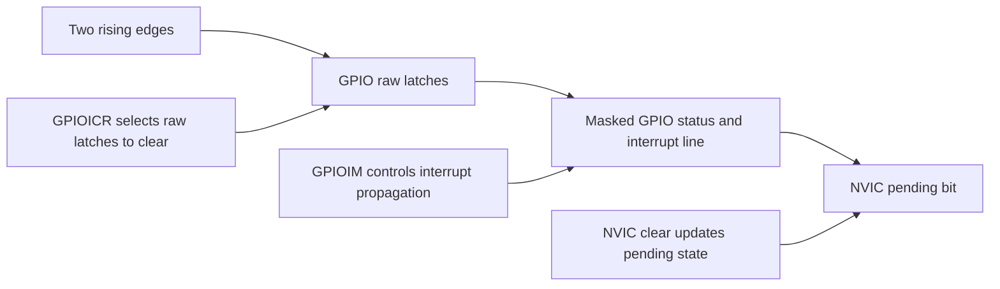

# GPIO edge acknowledgment and NVIC pending clearance on LM3S6965 QEMU

**Date** 2026-11-25 · **Plan** §5.4, EMB-03/04 · **Issue** [#440](https://github.com/aivibeflow/LLMLang/issues/440)

In the QEMU LM3S6965 model, clearing one GPIO edge latch preserves its neighbor. Clearing only the NVIC pending bit while the peripheral line remains asserted leaves the interrupt pending. Clearing the GPIO latches and then clearing NVIC pending reaches the quiescent observation. Masking the port can suppress delivery while leaving raw evidence eligible to assert the line again.

## Scope and method

The part manual defines a write-one clear for latched GPIO edges and a separate pending bit in NVIC. The earlier test exercised NVIC writes with synthetic pending bits and had no active peripheral line. This test drives individual GPIO inputs and examines the separate raw, masked and controller pending state. [Part-specific register rules](RT-37-LM3S6965-PART-REGISTER-2026-11-25.md) · [Earlier NVIC pending-bit test](RT-37-CORTEX-M3-NVIC-PENDING-CLEAR-2026-11-25.md) · [TI manual](https://www.ti.com/lit/ds/symlink/lm3s6965.pdf)

The harness starts a new exact QEMU process for each configuration. Its CPU remains halted. A local qtest channel writes aligned MMIO words and drives two input pins from low to high. It sets pins 0 and 1 as inputs and enables rising-edge capture. It then observes GPIO raw interrupt status, GPIO masked interrupt status and the NVIC pending bit for that port in that order. Port A maps to bit 0 and port F to bit 30 in the checked model. Each schedule independently selects pin 0 or pin 1.



## Results

The test covers sixteen configurations and 68 before/after tuples, each with three register observations. Both ports and selected pins exhibit the same policy-level behavior.

| Operation sequence | Observed result |
|---|---|
| Write the selected GPIO clear bit | The peer latch remains set. Its masked status maintains the NVIC assertion. |
| Clear the NVIC pending bit with a peripheral latch still asserted | The GPIO state is unchanged and the controller still reports pending. |
| Clear the second GPIO latch, then clear NVIC pending | The raw and masked GPIO statuses reach zero first. Explicit controller clear then reaches zero pending. |
| Mask the port, clear pending, and unmask one pin | Raw edges survive masking. NVIC can clear while the line is masked. Unmasking an already latched edge sets pending again. |
| Write zero or a wider literal mask to GPIO clear | Zero preserves both edges. The wider mask clears both and violates a pin-local operation contract. |
| Keep a cleared pin high, then drive a fresh rising edge | Reasserting the same high input leaves the latch clear. Low followed by high sets the selected latch and pending bit again. |

A typed device operation can therefore distinguish acknowledging a named edge, masking its propagation and clearing controller pending. A request to clear one pin can carry that pin mask and preserve its peer. An operation that promises complete idle status must state the relevant peripheral sources and account for new activity before the controller check. The evidence is significant for DEP-246 and DEP-247, where register semantics and interrupt admission depend on separate observation scopes. [Dependency map](../../research-management/RESEARCH-DEPENDENCY-MAP.md)

## Reproduce and limits

Use CPython 3.12.14 and the exact QEMU 10.0.13 executable recorded in the ledger. Run from the repository root with the pinned research commit available. The harness records the full observation tuples and emulator hash. Two complete runs at different Python hash seeds match byte-for-byte.

```sh
fixture=research/runtime-and-systems/RT-37/GPIO-EDGE-ACK-01
python "$fixture/run.py" --qemu /path/to/qemu-system-arm --out /tmp/llmlang-gpio-edge-ack.json
cmp "$fixture/evidence.json" /tmp/llmlang-gpio-edge-ack.json
```

[QEMU schedule harness](GPIO-EDGE-ACK-01/run.py) · [Exact model and observation ledger](GPIO-EDGE-ACK-01/evidence.json)

The qtest schedule drives emulated signals and checks deterministic register reads. It supplies no guest ISR, physical wiring, timing, re-entrancy, active-interrupt state, simultaneous hardware edge observation, electrical filtering or silicon errata coverage. Those remain conditions for transferring the claim to an actual board and firmware implementation.
