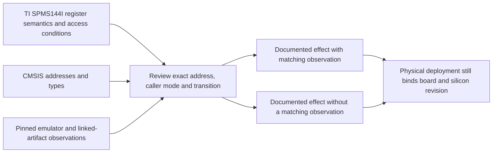

# LM3S6965 manufacturer register rules and emulator observations

**Date** 2026-11-25 · **Plan** §5.4, EMB-03/04 · **Issue** [#440](https://github.com/aivibeflow/LLMLang/issues/440)

Texas Instruments' part-specific LM3S6965 data sheet supplies an authoritative textual contract for selected registers in the existing Cortex-M3 fixtures. The contract explains the recorded SysTick, NVIC and GPIO data-mask observations. It also identifies two unobserved boundaries for this cohort, debugger-originated reads and GPIO edge acknowledgment. Physical timing and actual device behavior remain open.

## Source and interpretation

The reviewed document is *Stellaris LM3S6965 Microcontroller Data Sheet*, Rev. I, document SPMS144I, dated July 15, 2014. The register and figure numbers below identify the source precisely. The GPIO section was checked in a text rendering of the same manufacturer document. The shell runner could not acquire the original PDF bytes over the network, so the vendor input is pinned by document identifier, edition and printed page. The executable check pins the selected research inputs by exact Git blob and SHA-256. It rechecks the stated rules against existing reproduced observations. [TI product and revision entry](https://www.ti.com/product/LM3S6965) · [TI data sheet](https://www.ti.com/lit/ds/symlink/lm3s6965.pdf) · [Same Rev. I text rendering](https://manuals.plus/m/121119e2bfb6f088dcf38936a386227e6536754e5ae695d7d2f5ece03fe899d4) · [Exact Cortex-M3 replay](../../research-management/RT-00/RT-00-CORTEX-COHORT-REPLAY-2026-11-25.md)



| Register and printed pages | Part-specific effect | Checked scope |
|---|---|---|
| `STCTRL` at `0xE000E010`, p. 106 | The CPU read observes then clears bit 16. A debugger read through DAP follows an additional MasterType condition. | Three two-load emulator images agree on `B10!`. The fixture does not access the register from DAP. |
| `STCURRENT` at `0xE000E018`, p. 109 | Writing any value clears the current counter and the flag in `STCTRL`. | The control writes `0x1234`, requires an immediate zero current value and observes `B00!` with the counter stopped. |
| `PEND0` and `UNPEND0` at `0xE000E200` and `0xE000E280`, pp. 114 and 116 | The aliases read pending state. Writing one sets or clears the matching pending bit according to the alias. Clearing pending leaves the separate active state unchanged. | Eight observations cover two selected bits and four write strategies. Active state and interfering peripheral requests remain outside the fixture. |
| GPIO Port F `GPIODATA`, pp. 293–294 and 300 | The address supplies the eight-bit mask through bits 9:2. Reads zero masked-out bits. Writes update selected configured outputs and preserve their neighbors. | The pin-1 alias is `0x40025008`. The four timer images preserve the neighboring output. A full-port control clears it. |
| GPIO Port F `GPIOICR`, p. 308 | Write one to clear the selected edge-detection latch. Zero leaves it unchanged. | The operation is supported by the manual. The cited UART and NVIC fixture controls do not observe GPIO edge-latch acknowledgment. |

The same register width can describe several distinct effects. For example, applying a read-OR-write to `UNPEND0` sends ones for other pending interrupts as well and clears them. Reading an unmasked GPIO register and rewriting the whole word can discard a neighbor change. The masked address selects one pin without conducting that read-modify-write. This supports an operation-specific register contract with address, bit selection, access context and postcondition. An SVD for a different TI part can still seed layout import. It requires independent correspondence before defining an LM3S operation's effects. [Earlier metadata and capability comparison](RT-37-MMIO-METADATA-AND-CAPABILITIES-2026-11-24.md)

## Verification and remaining platform evidence

The checker reproduces eight pending-bit results from the distinct set and clear equations. It checks both SysTick addresses, four trace cases, the manual's two GPIO mask examples, the exact pin alias, and four timer traces. A three-bit exhaustive control compares bit-wise assignment with the mask equation for 512 input triples. That model checks the encoding of the selected rule. The pinned UART ledgers give separate behavior observations.

The manual improves the cited DEP-246 correspondence boundary for this exact part. The sources still leave board wiring, power and clock configuration, applicable errata, debugger behavior, edge relatching, DMA/controller quiescence, and physical timing for specific devices to a separate physical profile. [Dependency map](../../research-management/RESEARCH-DEPENDENCY-MAP.md)

```sh
fixture=research/runtime-and-systems/RT-37/LM3S6965-PART-REGISTER-01
PYTHONHASHSEED=7 python "$fixture/check.py" --out /tmp/llmlang-lm3s-registers.json
cmp "$fixture/evidence.json" /tmp/llmlang-lm3s-registers.json
```

Run from the repository root with CPython 3.12.14 and Git with the pinned branch commit. Two hash seeds reproduce the ledger byte-for-byte. [Reconciliation code](LM3S6965-PART-REGISTER-01/check.py) · [Scoped ledger](LM3S6965-PART-REGISTER-01/evidence.json)
