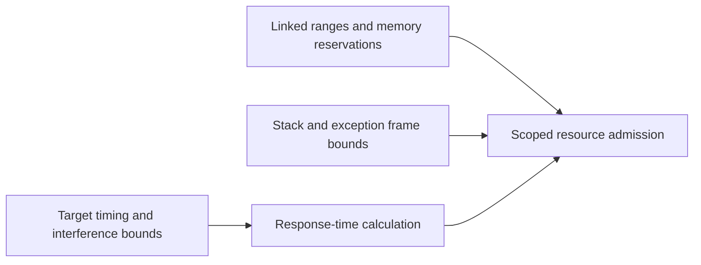

# RT-37 Embedded resource and deadline bounds

The pilot supports distinct claims for linked memory, stack use, interrupt interference and deadline admission. An ELF range shows which addresses the linked image reserves or uses. A UART trace shows functional order. A deadline claim also needs upper bounds for running time, interrupt delivery, masking and relevant interference on the selected target.

| Scope | Verified estimate or observation |
|---|---|
| STM32F103 linked image | Flash extent 1,040 B and SRAM extent 1,544 B |
| STM32F407 linked image | Flash extent 1,120 B, SRAM extent 1,544 B and no loaded CCM span |
| ESP32 linked image | Six exact load segments spanning separate mapped flash, instruction RAM, data RAM and RTC regions |
| Cortex-M3 stack | Scoped polling and SysTick traces observe 8 B, 32 B or 40 B. The fixed one-exception model admits a 40 B phase-independent bound under its assumptions. |
| Cortex-M3 nested exceptions | The measured handler entry displacement reaches 64 B when the second basic frame nests. Similar marker order can occur at 32 B. |
| FreeRTOS scheduling | Three separate ESP32/ESP32-C3 builds check worker affinity, notifications and guarded updates. |

Static extents use the highest virtual address covered from each named STM32 region start. They include linked reservation sections and exclude observed stack high-water. The ESP32 segment addresses remain separate to avoid treating mapped flash as physical SRAM. The checker reads the ELF program headers for the exact artifacts identified in the [cross-MCU pilot](RT-37-CROSS-MCU-GPIO-TIMER-UART-2026-11-25.md). The stack and scheduler evidence comes from independent scoped probes. [Cortex-M3 stack](RT-37-CORTEX-M3-STACK-BOUND-2026-11-24.md) · [Nested exceptions](RT-37-CORTEX-M3-NESTED-EXCEPTION-STACK-2026-11-25.md) · [ESP32 scheduling](RT-37-ESP32-SCHEDULING-AND-RADIO-2026-11-25.md)



## Conditional deadline model

A single lower-priority operation has declared cost C, at most B initial blocked ticks and interference from a synchronous periodic interrupt with period T and upper service cost H. Higher-priority work runs first after the initial blocking interval. When H is below T, the least response time satisfies `R = C + B + ceil(R/T)*H`. When H reaches or exceeds T, demand keeps the modelled operation from dispatching. Independent tick-by-tick dispatch matches all 1,200 parameter combinations.

Across 19,200 deadline checks, 4,955 meet their bound, 5,845 finish after the deadline and 8,400 model saturation without completion. Comparing only C with the deadline gives 11,845 false admissions. The maximum finite response is 63 logical ticks. Tick costs are synthetic assumptions, with no conversion to cycles or physical time.

Using this model on a device requires target-specific bounds for instructions, flash wait states, clocks, interrupt masking, priority and nesting, memory interference and RTOS service. DMA, SMP interference, periodic release jitter and measured physical latency are beyond the fixture. Selected boards and calibrated inputs remain human-gated.

Replay with CPython 3.12.14 using the committed program-header captures. Two hash seeds produced byte-identical [evidence](RESOURCE-AND-DEADLINE-01/evidence.json). Optional ELF arguments verify their artifact digests and recapture the headers with GNU readelf 2.44. A rebuilt ESP32 image with different build metadata requires a corresponding new artifact receipt. [F103 headers](RESOURCE-AND-DEADLINE-01/f1-program-headers.txt) · [F407 headers](RESOURCE-AND-DEADLINE-01/f4-program-headers.txt) · [ESP32 headers](RESOURCE-AND-DEADLINE-01/esp-program-headers.txt)

```sh
LC_ALL=C PYTHONHASHSEED=37 python -B research/runtime-and-systems/RT-37/RESOURCE-AND-DEADLINE-01/check.py
```
