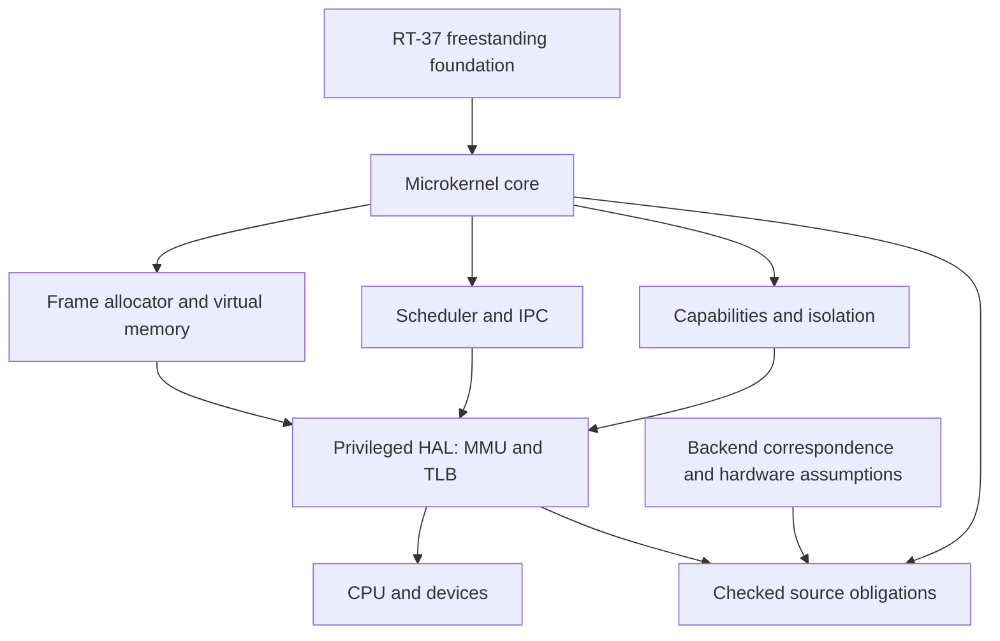
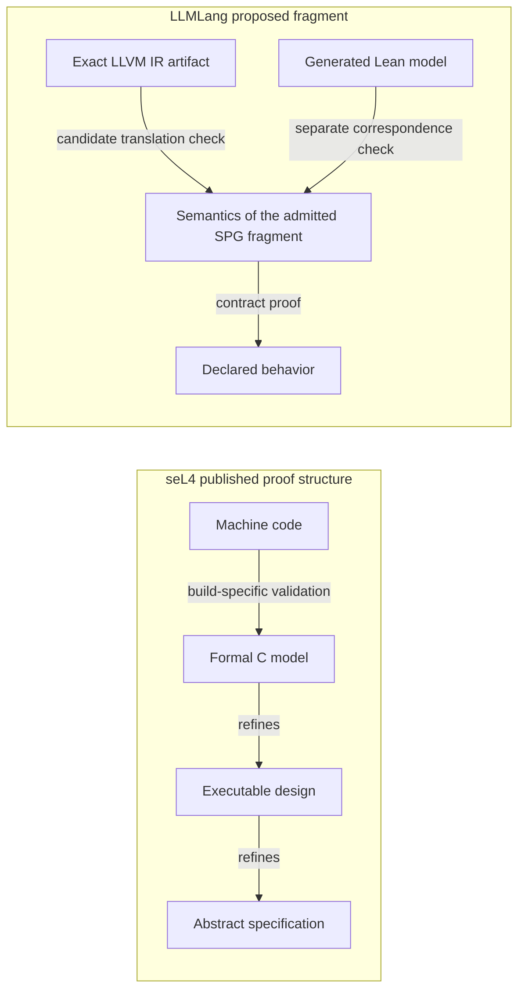
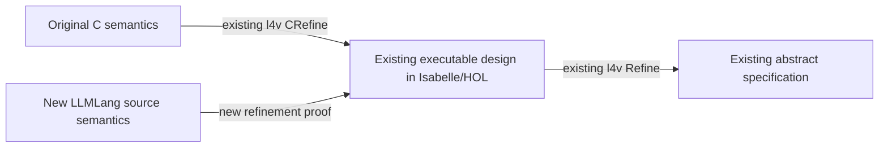

# RT-38 — Operating-system kernels and verified microkernel feasibility

**Status:** Bounded RV64 boot and trap isolation checked in QEMU. Broader kernel evidence remains open.

**Priority:** P1 feasibility; P0 prerequisite compatibility questions through RT-37.  
**Date:** 2026-11-24  
**Tracking:** [Issue #441](https://github.com/aivibeflow/LLMLang/issues/441)  
**Baseline:** `bd774c1af4496652169e8d939b6e3dd0b2e6eede`

## 1. Objective and hypotheses

Investigate whether LLMLang can express and compile an OS kernel, and whether a small capability-oriented microkernel can be verified compositionally down to an explicit hardware/translation trust boundary. Reuse [RT-37](../RT-37/README.md) for freestanding startup, layouts, pointers, MMIO, interrupts and runtime closure. Unlike [hosted POSIX](../RT-10/POSIX-RUNTIME-ARCHITECTURE.md), the kernel supplies OS services rather than consuming them.

H1: shared freestanding semantics plus privileged target capabilities suffice for a small kernel. H2: ownership, frame/effect contracts and typed capabilities can express memory isolation and IPC invariants. H3: separate source, translation and device premises permit honest modular proofs. Counterexamples include accepted double allocation, unauthorized mapping/IPC, interrupt reentrancy violating invariants or a hidden hosted dependency.

The initial kernel keeps drivers and services outside privileged code when practical. The hardware abstraction is an explicit trust boundary, not a proof by declaration.

## 2. Work packages

| ID | Question / deliverable |
|---|---|
| KRN-01 | Reuse RT-37 freestanding profile; identify kernel-specific privilege, initialization and runtime restrictions |
| KRN-02 | Physical frames, virtual addresses, pointer provenance, aliases, page alignment and memory-map contracts |
| KRN-03 | Privileged instructions, hardware interfaces, trap/syscall ABI, typed capabilities |
| KRN-04 | MMU/page-table updates, TLB invalidation, MMIO and memory barriers; distinguish hardware visibility from software state |
| KRN-05 | Interrupt, exception, preemption and reentrancy semantics; bounded critical sections |
| KRN-06 | Boot image, linker script, entry/stack setup, relocations, no hosted imports and explicit compiler support |
| KRN-07 | Verified frame allocator, ownership conservation, zeroing and failure rollback |
| KRN-08 | Virtual-memory mapping, permissions, address-space isolation, stale mappings and concurrency |
| KRN-09 | Scheduler/context switch, runnable-state invariants, fairness and blocking policies |
| KRN-10 | IPC, capability delegation/revocation, syscall validation, user/kernel boundary |
| KRN-11 | SPG-to-IR-to-binary semantic preservation; pinned compiler and hardware premises; distinguish checked/conditional/incomplete |
| KRN-12 | Reproducible bootable single-core microkernel in emulator, user-mode isolation and IPC demonstration |
| KRN-13 | SMP memory model, locks/atomics, interrupt routing, DMA/IOMMU and cross-core TLB shootdown |
| KRN-14 | Independent reference models; code size, latency, throughput, proof effort and change/reverification cost benchmarks |

## 3. Candidate architecture and contract discriminator

Compare monolithic versus minimal microkernel (smaller initial privileged proof scope, but IPC overhead); foreign assembly/HAL with scoped assumptions versus checked intrinsics and verified lowering; LLVM versus generated freestanding Rust. Do not require a production Linux-compatible kernel. Candidate first target: pinned RV64 QEMU, single hart, explicit boot firmware/privilege configuration. Firmware initialization is an assumption unless separately checked.

Illustrative page allocation: reserve a free frame, zero it, install mapping with appropriate rights, publish ownership and synchronize translation state. Success must preserve global frame conservation, non-overlapping ownership, kernel protection and user isolation; failures must restore modeled state or return an explicit residual obligation. Intermediate states require a lock/critical-section or other proved protocol. Zeroing, mapping and TLB behavior must be represented by checked implementations or scoped RT-36 premises. A source proof alone does not prove binary behavior.

Negative controls: double allocation, premature publication, stale TLB, wrong permission, unauthorized IPC/capability transfer, interrupt while holding incompatible lock, incorrect context-save/restore and hidden runtime imports. Include independent reference model, source/target trace comparison and rejected operations. Later SMP experiments must cover weak ordering and DMA outside CPU ownership assumptions.

## 4. Dependencies, evidence and gates

- RT-37 profile and pilot gate; [core](../../language-design/RT-03/CORE-LANGUAGE-SEMANTICS.md), [RT-04](../../language-design/RT-04/RT-04-TYPE-EFFECT-OWNERSHIP-AND-CAPABILITY-ALTERNATIVES.md), [memory model](../../language-design/RT-04/RESEARCH-SCENARIO-61-CONCURRENT-MUTABLE-STATE-AND-MEMORY-MODEL.md), [atomic lowering](../../compiler-and-translation/RT-13/RESEARCH-SCENARIO-116-ATOMIC-BACKEND-LOWERING-OBLIGATIONS.md), [layout/ABI](../../compiler-and-translation/RT-09/RT-09-STRUCTURAL-TYPE-IDENTITY-LAYOUT-AND-C-ABI-PROPOSAL.md), [LLVM](../../compiler-and-translation/RT-13/LLVM-BACKEND-ARCHITECTURE.md), [LLVM preservation](../../compiler-and-translation/RT-13/RESEARCH-SCENARIO-96-LLVM-UB-POISON-AND-SEMANTIC-PRESERVATION.md).
- [Public interfaces](../../semantic-representation/RT-05/PUBLIC-INTERFACES-AND-CONTRACT-REFINEMENT.md), [RT-34 resources](../../formal-verification/RT-34/RT-34-AUTOMATIC-COMPLEXITY-INFERENCE.md), [RT-36 assumptions](../../formal-verification/RT-36/RT-36-FORMAL-VERIFICATION-ASSUMPTIONS-AND-TRUST.md), RT-07/08/13/16/32/33: compositional proof, explicit authority and target evidence. Keep proof closure separate from policy admission.
- Pin exact target/emulator/firmware/ABI, linker/compiler, source/SPG, hardware models, checker, assumptions and commands. Archive binary/import/link-map and trace evidence, proof obligations, negative controls and failed/UNKNOWN cases.
- Exit: documented feasible or falsified profile with explicit gaps; reproducible bootable minimal kernel (or documented blocking discriminator), independently checked frame-allocation/isolation/IPC properties for the declared model, trust and translation boundaries explicit; no claim of complete kernel verification without corresponding evidence.

The [RV64 trap and isolation study](RT-38-RV64-PMP-SV39-TRAP-ISOLATION-2026-11-24.md) boots five freestanding images with identical user code and compares bare/PMP and Sv39 permissions. It checks U-mode syscall and fault recovery before scheduler and IPC research. The [Sv39 remap and revocation study](RT-38-SV39-REMAP-REVOKE-2026-11-24.md) separates PTE readback from translation visibility. Its wrong-address control exposes QEMU's whole-CPU flush behavior and requires a linked operand check. The [RV64 frame allocator comparison](RT-38-RV64-FRAME-ALLOCATOR-2026-11-24.md) checks zero-on-allocation and zero-on-release against independent ownership traces with three fault controls and U-mode probes. The [cooperative scheduling experiment](RT-38-RV64-COOPERATIVE-SCHEDULER-2026-11-24.md) compares two dispatch policies and checks linked integer context restoration against masked-interrupt QEMU traces.

## 5. seL4 precedent and a first translation check

**Evidence** · Published prior art and a proposed experiment, reviewed against LLMLang baseline fe229c3215c42d8bded531d77bbef47761ac5770 on 2026-11-24.

The seL4 kernel is implemented primarily in C, with assembly for some machine operations. Its 2009 proof used three representations in Isabelle/HOL. The abstract operational specification described kernel behavior with nondeterministic choices where implementation details could be left open. A detailed executable design came from a Haskell prototype translated into Isabelle/HOL. A C parser represented the implementation in C-SIMPL, a formal semantics for the C subset. Engineers proved two refinement theorems by relating states, establishing invariants and showing that concrete transitions simulate allowed specification behavior. Hoare triples express the preconditions and invariant preservation. Transitivity links the C implementation to the abstract specification. [SOSP 2009 paper](https://isabelle.in.tum.de/~kleing/papers/sosp09.pdf) · [Refinement proof framework](https://cgi.cse.unsw.edu.au/~kleing/papers/klein_sw_10.pdf)

The C-level result relied on assumptions about compilation, assembly, boot and hardware. Follow-up binary verification used translation validation for concrete builds. It derived a representation of the ARM machine code with a proof-producing decompiler, expressed the C and binary models as control-flow graphs, and used SMT queries in the refinement check. The supported properties and remaining assumptions depend on the configuration and theorem. [PLDI 2013 paper](https://www.sel4.systems/Research/pdfs/translation-validation-verified-os-kernel.pdf) · [Verified configurations](https://docs.sel4.systems/projects/sel4/verified-configurations.html) · [Proof assumptions](https://sel4.systems/Verification/assumptions.html)

The arrows run from each representation toward the semantics or contract it must satisfy. The LLMLang portion separates correspondence for the executable path from correspondence for the proof model.

Before attempting KRN-11 at kernel scale, reuse checked signed i32 addition from [Scenario 96A](../../compiler-and-translation/RT-13/RESEARCH-SCENARIO-96A-LLVM-INTEGER-PRESERVATION.md). Specify a loop-free profile with a conditional, a recoverable overflow and ordered effect payloads. The [RT-07 rewrite proof](../../formal-verification/RT-07/RT-07-OBSERVABLE-REWRITE-CORRECTNESS.md) already gives a model of observation preservation with mathematical integers. Scenario 96A gives bounded native comparisons of fixed-width arithmetic. A first formal translation check should relate a typed Semantic Program Graph (SPG), or an explicitly declared fixture representation if SPG binding is deferred, to one exact LLVM IR artifact. The proposed check would compare status, returned bits or absence of a value, and ordered effects across all admitted 32-bit inputs and both branch outcomes. Pin the source and IR identities, semantic profile, checker version and assumptions about the modeled emission primitive. The LLVM artifact is the initial endpoint. Native code and its ABI need their own correspondence evidence.

Use the existing well-formed IR mutant that silently succeeds on 2147483647 + 1 as a discriminator. A sound check for the declared semantics should reject its wrong outcome and extra effect. A second control can change event ordering while keeping the value unchanged. Unsupported operations or inconclusive solver results leave the corresponding claim open. Differential execution remains useful for finding concrete discrepancies. A general verified lowering could amortize the proof across artifacts once the source fragment and target semantics stabilize.

Reuse [RT-32](../../formal-verification/RT-32/RT-32-VERIFIED-SPG-TO-LEAN-PIPELINE.md) for source-to-Lean correspondence, [RT-33 evidence composition](../../formal-verification/PROOF-OBLIGATION-BENCHMARK/EVIDENCE-COMPOSITION.md) for exact artifact and premise binding, and [RT-36](../../formal-verification/RT-36/RT-36-FORMAL-VERIFICATION-ASSUMPTIONS-AND-TRUST.md) for scoped trusted premises. For the RT-38 allocator, apply the same structure to an independent abstract ownership model, an executable transition model and a concrete implementation. Start with frame conservation and exclusive ownership, including the modeled failure path, on the candidate single-core profile. Keep isolation, interrupt behavior and hardware assumptions separately identified. [PLAN §6.5](../../../PLAN.md#65-os-kernels-and-verified-microkernel-feasibility-rt-38)

The seL4 claims can be checked against the cited publications. The LLMLang experiment and proof boundaries are proposals. The open questions are the authoritative SPG observation model, the LLVM semantics admitted by the checker, and the validation cost across optimized artifacts.

## 6. Risks of a seL4-compatible port

**Status** · Source-based assessment for KRN-01, KRN-10, KRN-11 and KRN-14. The comparison below assumes one pinned upstream revision and target configuration, with compatibility for the existing user ABI. A kernel inspired by seL4 can choose its own ABI and must establish its own contract.

| Risk | Consequence and first check |
|---|---|
| Implementation proof attachment | Upstream Isabelle theories consume preprocessed C and relate its semantics to the design model. The models and some abstract lemmas may be reusable where the state relation and premises still hold. For native LLMLang output, prove a new link to the design or to the corresponding verified C operation. For a C-emitting path, check the generated C against the accepted parser subset and replay the proof against that exact C. Binary correspondence and security theorem applicability depend on the resulting proof chain and configuration. [l4v](https://github.com/seL4/l4v) · [Verified configurations](https://docs.sel4.systems/projects/sel4/verified-configurations.html) |
| Freestanding profile and ABI | Exact widths, alignment, packed layouts, syscall register conventions, IPC buffers, and kernel entry and return must agree across the language, assembler and linker. Audit final link symbols and dependencies for unexpected runtime helpers. Test layout against upstream fixtures and retain audited C or assembly for the first machine boundary with explicit contracts. [seL4 manual](https://sel4.systems/Info/Docs/seL4-manual-latest.pdf) · [RT-37](../RT-37/README.md) |
| Dynamic authority and memory reuse | Static ownership facts alone leave proof obligations about runtime capability derivation, copied rights, revocation and residual mappings. Model untyped memory, object lifetimes and aliases, including failure paths. Compare a trace where capabilities are derived and revoked and the memory is retyped again. [seL4 untyped tutorial](https://docs.sel4.systems/Tutorials/untyped.html) |
| Interrupts and hardware ordering | A language-level state transition may be interrupted between concrete updates. Track reachable intermediate states, page-table visibility and TLB maintenance. Record assumptions for boot, assembly and devices, including DMA where relevant. SMP adds cross-core visibility and synchronization obligations. [seL4 proof assumptions](https://sel4.systems/Verification/assumptions.html) |
| Cost of the IPC fast path | A port can preserve results while adding branches, stack use or runtime calls. Compare IPC cycle counts and stack usage on the same hardware and configuration with equivalent workloads. Establish real-time bounds separately where required. [sel4bench](https://docs.sel4.systems/projects/sel4bench/) |

After the RT-37 freestanding gate and the KRN-11 translation pilot, a candidate first port is one capability lookup or validation helper behind the existing C and assembly interfaces. Pin the baseline kernel, target and flags. Check the helper's result, error, and permitted state changes against the upstream C semantics for the admitted states. Then run the unchanged user-side test on both builds and verify the final link map. This isolates the translation and ABI risks before attempting object mutation, revocation or a scheduler port.

Direct native output tests the intended LLMLang backend and requires a new implementation correspondence. Generated C permits an earlier check with the existing proof frontend and makes the generated C and exact build part of the evidence. This comparison has no port or new theorem result. The open questions are whether the mixed ABI can be expressed by the proposed profiles and how much of the existing proof survives a change of representation.

## 7. Reuse l4v specifications with a trusted LLMLang compiler

**Status** · Proposed proof strategy for KRN-11. Assume that compilation preserves the LLMLang source semantics for the declared profile and its modeled machine interface.

Both implementations can refine the same design. The diagram shows the proof direction from each implementation to the design it must satisfy. For a fixed upstream revision and configuration, keep the executable design, abstract specification, applicable invariants and design-to-abstract theorem in Isabelle/HOL. Reuse the refinement method and proof rules. Replace the implementation-to-design link for the ported code and justify composition with any unchanged C or assembly. [l4v](https://github.com/seL4/l4v) · [Refinement framework](https://cgi.cse.unsw.edu.au/~kleing/papers/klein_sw_10.pdf)

The new proof needs a formal semantics for the LLMLang fragment and a relation from its state to the design state. From related admissible states, show that each concrete transition or matched sequence realizes an allowed design transition, preserves the relation, and respects the specified outcomes, failures and permitted state changes. Establish the initial relation and account for unexpected faults or divergence wherever the applicable l4v theorem requires it. If an independent exporter produces a proof model from LLMLang, justify correspondence with the actual source separately from compiler correctness. [RT-32](../../formal-verification/RT-32/RT-32-VERIFIED-SPG-TO-LEAN-PIPELINE.md)

Use a capability lookup such as lookupCapAndSlot as the first candidate. Fix the upstream version and input-state invariant. Compare the returned capability and slot on success, the lookup fault on failure, and the modeled state effects. A negative control can deliberately substitute a different lookup fault while preserving successful results. For a mixed-language system, include the caller boundary and the set of state locations the replacement can modify before composing its proof with unchanged code. [Executable design source](https://github.com/seL4/l4v/blob/master/spec/haskell/src/SEL4/Kernel/CSpace.lhs)

Refinement to a common specification allows implementation choices that the specification leaves open. Exact compatibility with a particular C behavior requires a direct comparison under a declared observation model. Integrity and confidentiality require the hypotheses of their specific l4v transfer theorems, including the observations and security policy. The seL4 information-flow proof addresses the risk that an implementation selects an otherwise permitted visible outcome using secret state. [Information-flow verification](https://www.sel4.systems/Research/pdfs/sel4-from-general-purpose-to-proof-information-flow-enforcement.pdf)

An alternative is to port the required specifications and proofs to Lean. That adds the obligation to establish that the Lean definitions express the same claims as the pinned Isabelle/HOL artifacts. Keeping Isabelle for the first slice avoids introducing that comparison before the LLMLang-to-design relation has been demonstrated. This section records a proof plan. The LLMLang semantic fragment, state relation and proof remain open.

## 8. Research plan for implementing against an existing specification

- **Status** · Planned investigation for KRN-11 and RT-07, with no adopted language or proof-backend decision.
- **LLMLang baseline** · `fe229c3215c42d8bded531d77bbef47761ac5770`.
- **Candidate upstream baseline** · seL4 17.0.0, single-core RISCV64 without MCS, l4v `12c300e75bb0ca0c82f76496fafacd7e614c0aba`, seL4 source `62e345c240a15671484530b4e6e069ce266c28d7` and Isabelle2025-2 from the release manifest. Record the resolved manifest revision, prover commit and exact build configuration at replay. [Release manifest](https://github.com/seL4/verification-manifest/blob/master/17.0.0.xml) · [Verified configurations](https://docs.sel4.systems/projects/sel4/verified-configurations.html)

### Research questions

- **H1 — Specification reuse.** A new LLMLang implementation can satisfy the original executable design contract by adding a proof in a separate Isabelle session. A required change to the upstream semantics, weakened inputs or observations, or an unproved new assumption defeats this claim for the declared scope.
- **H2 — Proof reuse.** The existing state relations, invariants, refinement rules or proof methods reduce the new proof work. Record exactly which of these the new proof uses and which require a new bridge. A successful proof that only imports the target definition supports H1 and provides weaker evidence for H2.
- **H3 — Tool suitability.** Isabelle/HOL can check the LLMLang fragment reproducibly, help find errors in its contracts and support a maintainable proof across a behavior-preserving implementation change. Evaluate each capability on the same fixture.

Treat the compiler as semantics-preserving for the declared LLMLang fragment. Define the source semantics used by the proof and identify the exact source artifact. If a generator or hand-written embedding supplies the Isabelle model, establish its correspondence to that artifact. An isolated model proof remains valuable evidence at model scope while that link is open. The first exercise runs at source level. Kernel build integration, hardware behavior, security theorem transfer and target timing require separate studies.

The released specification is fixed before the implementation is written. The implementation and its proof model have an explicit correspondence step. The last stage uses both the candidate and deliberately incorrect variants to assess the proof setup.

### Study stages and evidence

| Stage | Work | Evidence to retain |
|---|---|---|
| 1. Map seL4 verification | Read the refinement and comprehensive verification papers. Map abstract specification, executable design, invariants, CRefine, binary validation, integrity and information flow. Identify the inputs and assumptions of each link. Trace capability lookup through the design and relevant invariants and locate its refinement facts. | A map with exact theory names, statements, source revisions and which facts can be reused. [Proof framework](https://cgi.cse.unsw.edu.au/~kleing/papers/klein_sw_10.pdf) · [Comprehensive verification](https://www.sel4.systems/Research/pdfs/comprehensive-formal-verification-os-microkernel.pdf) |
| 2. Replay the reference | From the matched manifest, use the pinned l4v setup and start with `L4V_ARCH=RISCV64 ./run_tests ASpec ExecSpec Refine` from the l4v root. Confirm the session selection against that revision and record the invocation actually run. Reproduce the relevant local lemmas and identify their dependencies before adding the separate session. CRefine is a reference for comparison and may be replayed separately. | Resolved repository IDs, OS, Isabelle and Poly/ML versions, commands, exit codes, session logs and resource usage. [Pinned l4v build guide](https://github.com/seL4/l4v/blob/12c300e75bb0ca0c82f76496fafacd7e614c0aba/README.md) |
| 3. Implement from the contract | Freeze the target Isabelle definition and an input invariant before implementing. Start with `lookupCapAndSlot`. Specify success (capability and slot), lookup failure, permitted state effects and termination where the contract requires it. Define the relation between LLMLang state and the seL4 design state. Document the minimum fragment needed for word operations, reads, branching and failure propagation. | Contract-to-definition table, exact LLMLang source, formal source semantics or a checked embedding, relation and a theorem stating the admitted scope. [Pinned capability lookup design](https://github.com/seL4/l4v/blob/12c300e75bb0ca0c82f76496fafacd7e614c0aba/spec/haskell/src/SEL4/Kernel/CSpace.lhs#L45-L61) |
| 4. Check the positive and negative cases | Check the refinement theorem in a separate session without admitted proofs or unrecorded axioms. Try a wrong lookup failure, wrong returned slot and an extra write outside the permitted state. For each variant, construct a reachable witness or a checked refutation under the frozen precondition. A tactic timeout leaves the result inconclusive. Include a valid refactor and a witness that the precondition is satisfiable. | Clean proof session, proof assumptions and dependencies, exact mutations and refutations, results of finite checks and proof changes for the valid refactor. |
| 5. Assess transfer to ordinary LLMLang programs | Use a small, separately authored component against a pre-existing contract. Evaluate whether the same sequence of freezing rules, implementing, relating states and checking violations works without seL4-specific definitions. [Contract corpus](../../formal-verification/CONTRACT-FORMALIZATION-CORPUS/README.md) supplies candidate scope, including safe array lookup. | Identify reusable language semantics, proof machinery and workflow, plus work specific to seL4. A second case provides a comparison on its declared scope. |

If the full lookup requires LLMLang features outside the modeled fragment, identify the first missing feature and narrow the pilot to a named operation with its own original l4v definition. Preserve both targets in the report so the narrower result remains interpretable.

### Isabelle/HOL evaluation for formal verification in LLMLang

Use the same candidate theorem and adverse variants for tool evaluation. Record what works with stock Isabelle, what comes from l4v, and what is added for LLMLang. [Isabelle2025-2 official documentation](https://isabelle.in.tum.de/dist/library/Doc/index.html)

| Capability | Evaluation on the study fixture |
|---|---|
| **HOL modeling and Isar proofs** | Define fixed-width values, state, outcomes and the relation between language and design. Compare a direct functional encoding with a small semantics that represents the admitted LLMLang syntax explicitly. Use a locale, a named context with parameters and assumptions, if it makes the component's dependencies clearer. Record which representation supports source binding and proof inspection. |
| **Proof automation** | Compare structured Isar with `simp`, `auto`, induction and applicable l4v `wp` or correspondence rules. Try Sledgehammer on selected obligations and retain only proof steps that Isabelle can replay. Record solver dependencies, timeouts and reconstruction failures. [Sledgehammer manual](https://isabelle.in.tum.de/dist/Isabelle2025-2/doc/sledgehammer.pdf) |
| **Counterexample discovery** | Run Quickcheck and Nitpick on deliberate variants and an unsatisfiable premise. Record bounds and confirm candidate witnesses against the formal definitions. A search with no counterexample reports only its search outcome. [Quickcheck and Nitpick](https://isabelle.in.tum.de/~nipkow/pubs/frocos11.pdf) |
| **Execution of specifications** | Try evaluation or code generation only for executable model definitions. Compare model outputs to the selected examples and document any required executable equations or code mappings. Treat the generated artifact as a possible testing oracle within its stated scope. [Isabelle code generation documentation](https://isabelle.in.tum.de/dist/Isabelle2025-2/doc/codegen.pdf) |
| **Replay and maintenance** | Run a fresh session and an incremental rebuild after the valid refactor. Record installation dependencies, build time, peak memory, theorem assumptions and changed proof obligations. Compare with the existing Lean path in [RT-32](../../formal-verification/RT-32/RT-32-VERIFIED-SPG-TO-LEAN-PIPELINE.md) on a shared small obligation if both models can be justified. The seL4 case primarily measures direct reuse of Isabelle theories. |

**Decision and completion criteria.** A successful source-level pilot has a machine-checked theorem tied to the reviewed LLMLang source, the original fixed l4v contract and explicit premises. Each seeded violation has a confirmed witness or checked refutation. Publish the replay procedure, report what was reused and what had to be written, and give a scoped recommendation on using Isabelle/HOL for similar LLMLang work. Record bounded results and open obligations separately if the full theorem cannot be closed. The plan records no new experiment or proof and proposes no draft changes. [PLAN §6.5](../../../PLAN.md#65-os-kernels-and-verified-microkernel-feasibility-rt-38) · [RT-36 trust boundaries](../../formal-verification/RT-36/RT-36-FORMAL-VERIFICATION-ASSUMPTIONS-AND-TRUST.md)
