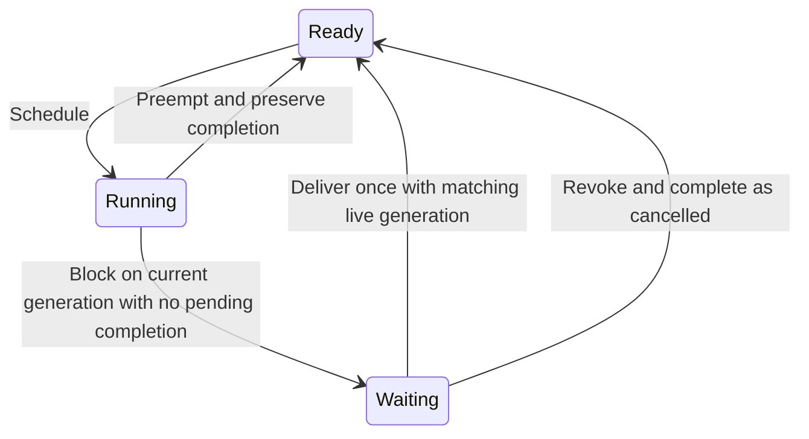

# RT-38 blocking receive and endpoint lifecycle

The integrated RV64 pilot uses cooperative scheduling and one generation-checked endpoint. This study adds blocking receiver state, completion delivery, preemption and endpoint replacement to a separate abstract model. It asks which state transitions a future linked implementation needs to realize atomically. The scope is one receiver and one endpoint with serialized transition effects. A send without a waiting receiver leaves state unchanged. [RV64 IPC pilot](RT-38-RV64-ISOLATED-IPC-PILOT-2026-11-24.md) · [Pinned target profile](RT-38-RV64-FREESTANDING-PROFILE-2026-11-25.md)



A blocked receiver is tied to the current live endpoint generation. Delivery atomically makes it runnable with a pending completion. Scheduling and preemption move that completion with the receiver until it consumes it. Revocation makes an existing waiter runnable with cancellation. Regrant increments the generation and leaves pending completions from previously linearized operations intact. A previously granted generation cannot deliver into a newly blocked receive.

## Checked results

Lean proves invariant preservation at every abstract step, refusal of sends for other generations, wakeup exactly once in the tested transition shape, and cancellation of a blocked receiver on revocation. The invariant proof depends on `propext` and `Quot.sound`. The other three depend on `propext`. Generations and message payloads are mathematical naturals in the proof. [Lean model](BLOCKING-ENDPOINT-01/Blocking.lean)

The finite checker explores 53 reachable abstract states and 462 transitions through depth eight using current, prior and future generation inputs. Its normalized waiting state stores the current generation implicitly. A separate transition oracle agrees on every explored edge. A targeted longer trace reuses the endpoint after cancellation, refuses a send from generation 1, delivers a send from generation 2, and preserves the resulting completion through preemption.

| Changed rule | Transitions that disagree with the oracle |
| --- | ---: |
| Send ignores generation | 6 |
| Revocation leaves the receiver waiting | 3 |
| Preemption drops an unconsumed completion | 10 |

The result identifies a future critical-section or linearization obligation covering waiter publication, admission, completion and the scheduler transition. Unbounded mathematical generations require an explicit wrap or retirement rule in a concrete machine profile. A native implementation still needs trap and interrupt ordering, publication under its memory model, queue capacity and progress, live address-space ownership, SMP and linked-code evidence. [Trace ledger](BLOCKING-ENDPOINT-01/evidence.json)

## Reproduction

Use Lean 4.36.0 at revision `611c117bfaf7b7ae1cfcf246ce6fba31e8f509e9` and CPython 3.12.14.

```sh
study=research/runtime-and-systems/RT-38/BLOCKING-ENDPOINT-01
build=$(mktemp -d)
for seed in 37 75; do
  LC_ALL=C PYTHONHASHSEED="$seed" python "$study/run.py" --lean /path/to/lean \
    --output "$build/result-$seed.json"
done
cmp "$build/result-37.json" "$build/result-75.json"
cmp "$build/result-37.json" "$study/evidence.json"
```

[Runner](BLOCKING-ENDPOINT-01/run.py)
