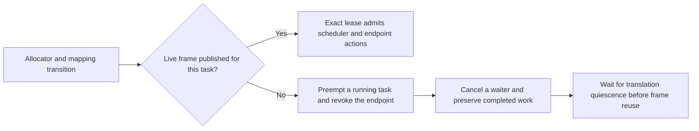

# RT-38 composing frame ownership, scheduling and IPC

Separate mapping and endpoint proofs leave an integration obligation. A scheduler or IPC completion can admit work using a valid endpoint while the task's stack mapping is already being removed. This study composes the previously checked frame and blocking receiver models. It requires exact, currently published mapping identity for endpoint transitions that could run or block the task. It also suspends task participation when the mapping becomes unavailable. [Frame lifecycle](RT-38-LIVE-FRAME-QUIESCENCE-2026-11-25.md) · [Blocking endpoint](RT-38-BLOCKING-ENDPOINT-LIFECYCLE-2026-11-25.md)



The joint invariant says that a running or waiting task has a currently published frame owned by that task. It also retains the endpoint's live-generation invariant. Endpoint dispatch accepts the exact frame lease, including its generation. A frame transition that leaves the task without a published mapping atomically applies preemption and endpoint revocation. An existing waiter becomes ready with cancellation. A completion already recorded by a prior operation remains attached to the worker. The task can run again only through a current mapping lease. Cached translations for the retiring frame belong to the separate quiescence boundary before reuse.

## Checked results

The replay wraps the exact previous Lean sources in separate namespaces and checks the combined proof in the same Lean process. Theorems prove preservation of the joint invariant by both classes of transitions, refusal of stale frame leases, and the combined detach-and-cancel effect. The receipt records the five exact dependency sets, which are drawn from `propext`, `Classical.choice` and `Quot.sound`. [Composition proof](COMPOSED-MAPPING-IPC-01/Compose.lean)

A finite search compares 254 states and 20,976 transitions through depth 10 with an oracle using the previous independent state tables. It exercises both owners, stale and current leases, and present or missing visibility and quiescence premises.

| Removed restriction | Transitions that diverge |
| --- | ---: |
| Frame generation check | 332 |
| Suspension and revocation on mapping loss | 52 |
| Mapping requirement when scheduling | 678 |

The model addresses one task, one frame and one endpoint with serialized joint transitions. A compiled implementation must establish the same atomic boundary around mapping loss and scheduler admission. For a multi-hart target, prove ordering of page-table writes and remote invalidations, identify which harts and translations are covered by each completion, and bind acknowledgments to the exact departing lease. For DMA, CPU translation quiescence is one prerequisite alongside outstanding device transactions, address translations and cache or ownership synchronization. Those are candidate hardware obligations. Concrete proof and measurement require the selected platform. [Scope and search ledger](COMPOSED-MAPPING-IPC-01/evidence.json) · [RV64 target profile](RT-38-RV64-FREESTANDING-PROFILE-2026-11-25.md)

## Reproduction

Use Lean 4.36.0 at revision `611c117bfaf7b7ae1cfcf246ce6fba31e8f509e9` and CPython 3.12.14.

```sh
study=research/runtime-and-systems/RT-38/COMPOSED-MAPPING-IPC-01
build=$(mktemp -d)
for seed in 37 75; do
  LC_ALL=C PYTHONHASHSEED="$seed" PYTHONDONTWRITEBYTECODE=1 \
    python "$study/run.py" --lean /path/to/lean --output "$build/result-$seed.json"
done
cmp "$build/result-37.json" "$build/result-75.json"
cmp "$build/result-37.json" "$study/evidence.json"
```

[Runner](COMPOSED-MAPPING-IPC-01/run.py)
