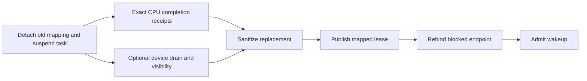

# RT-38 Frame reuse, mapping publication and scheduler wakeup

The candidate composes frame retirement with IPC and scheduler state. Detachment cancels the departing mapping's participation. The allocator waits for the completion receipts required by that exact lease. It can then sanitize and publish a replacement. A blocked endpoint may rebind after the new mapping is published, and the scheduler admits the wakeup under the resulting lease and endpoint generation.



## Evidence and hardware assumptions

| Obligation | Verified scope |
|---|---|
| Allocation and mapping constrain IPC and scheduler state | Lean checks joint preservation, stale lease refusal and combined detach/cancel. The archived model matches 20,976 transitions. [Composed mapping and IPC](RT-38-COMPOSED-MAPPING-AND-IPC-2026-11-25.md) |
| Same mapping identity and exact generation survive blocking, wakeup and live replacement | Four single-hart RV64 images keep the same user bytes. The valid route faults the peer under its own root, checks the new frame on resume and refuses the stale sender. Dirty and early publication paths diverge. [Live frame IPC](RT-38-RV64-LIVE-FRAME-IPC-2026-11-25.md) · [Preemptive IPC](RT-38-RV64-PREEMPTIVE-IPC-2026-11-25.md) |
| A frame can be reassigned only after exact lease- and epoch-bound hardware completion | Seven Lean results, 5,184 receipt combinations and 10,080 ordered schedules distinguish the CPU-only and device-visible modes. The platform supplies the participant set and completion evidence for local/remote translation quiescence, device drain and visibility. [Scoped SMP and DMA reuse](RT-38-SCOPED-SMP-DMA-REUSE-2026-11-25.md) |

The new matrix checks composition of these declared stages across all permutations of one detachment, one completion per modeled channel, one sanitization, one publication, one rebind and one wakeup. In the device profile, the independent chronological oracle requires drain before visibility. These events summarize exact receipts already covered by the underlying scoped models.

| Mode | Schedules | Eligible | Omitting remote completion | Omitting device visibility | Allowing wake before rebind |
|---|---:|---:|---:|---:|---:|
| CPU only | 5,040 | 2 | 4 | 0 | 10 |
| CPU and device | 362,880 | 12 | 12 | 44 | 84 |

The last three columns count false admissions. A future native implementation needs a refinement at each visibility boundary, including publication and runnable admission. The existing single-hart QEMU result validates its checked transaction only. Real remote CPU quiescence, in-flight DMA exclusion, IOMMU and cache completion, hardware timing and broader scheduling need the selected platform. This report specifies the obligations before SMP or DMA can be enabled for the candidate.

CPython 3.12.14 reproduced the [ledger](COMPOSED-WAKEUP-AND-REUSE-01/evidence.json) with two hash seeds. It records source evidence digests and ordered dispositions.

```sh
LC_ALL=C PYTHONHASHSEED=37 python -B research/runtime-and-systems/RT-38/COMPOSED-WAKEUP-AND-REUSE-01/check.py
```
