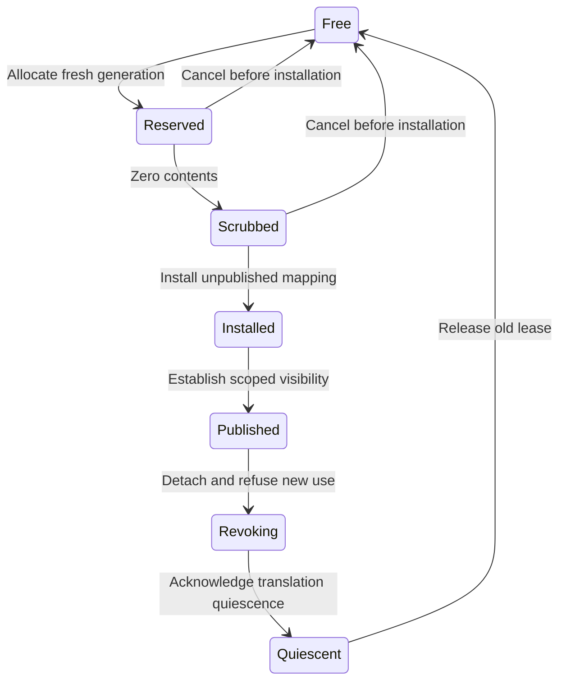

# RT-38 live frame publication and translation quiescence

A frame may remain reachable through cached translation state after software removes its mapping. Reassigning it at that point could let a prior owner reach memory already assigned to another tenant. This study adds a conditional ownership model between the earlier three-frame allocator and the local Sv39 invalidation experiment. Its acknowledgment parameter represents a trusted, scoped hardware premise for the departing lease. Production code must derive that premise from the actual translation protocol. [Frame allocator](RT-38-RV64-FRAME-ALLOCATOR-2026-11-24.md) · [Local remap and revocation](RT-38-SV39-REMAP-REVOKE-2026-11-24.md)



Before publication, the model requires reservation, zeroing, mapping installation and an explicit visibility premise. Detaching the mapping refuses new admissions. It retains the old lease while the prior cached translation may still be used. Reclaiming the frame requires a separate acknowledgment of translation quiescence. Reallocation advances the lease generation. The states represent distinct ownership and memory-visibility conditions, and a receipt for a different lease leaves the state unchanged.

## Checked results

Lean checks that absent visibility prevents publication, missing quiescence retains ownership, early release cannot lead to reallocation, detachment stops admission without discarding the old lease, and acknowledged reclamation advances the generation. All five theorems depend on `propext`. The proof covers one frame and serialized protocol steps. It assumes the visibility and quiescence premises supplied by the transition boundary. [Lean model](LIVE-FRAME-QUIESCENCE-01/Mapping.lean)

An independent state table agrees with all 5,400 transitions through depth 12. The exploration includes 67 reachable states, two owners, and stale, current and future lease generations.

| Changed rule | Transitions that disagree with the state table |
| --- | ---: |
| Publish without visibility | 10 |
| Acknowledge without the quiescence premise | 8 |
| Release directly from revoking | 16 |

This model separates mapping publication and detachment from authority to reuse the old frame. In the current single-hart RV64 profile the acknowledgment would need to bind the target translation root, addresses and ASID or a wider invalidation scope to the actual linked invalidation operation and completion condition. QEMU's broader invalidation behavior limits what its UART trace can establish. Live multi-frame allocation, preemption inside the protocol, failure recovery after installation, SMP shootdown, DMA, and a linked implementation proof remain open. [Pinned RV64 profile](RT-38-RV64-FREESTANDING-PROFILE-2026-11-25.md) · [Evidence](LIVE-FRAME-QUIESCENCE-01/evidence.json)

## Reproduction

Use Lean 4.36.0 at revision `611c117bfaf7b7ae1cfcf246ce6fba31e8f509e9` and CPython 3.12.14.

```sh
study=research/runtime-and-systems/RT-38/LIVE-FRAME-QUIESCENCE-01
build=$(mktemp -d)
for seed in 37 75; do
  LC_ALL=C PYTHONHASHSEED="$seed" python "$study/run.py" --lean /path/to/lean \
    --output "$build/result-$seed.json"
done
cmp "$build/result-37.json" "$build/result-75.json"
cmp "$build/result-37.json" "$study/evidence.json"
```

[Runner](LIVE-FRAME-QUIESCENCE-01/run.py)
