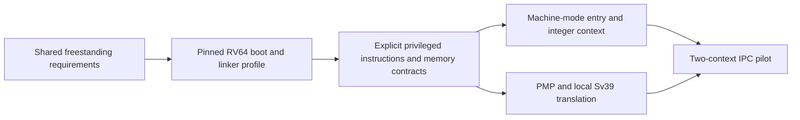

# RT-38 privileged RV64 freestanding profile

The current candidate is a bounded single-hart RV64 kernel profile running on QEMU `virt`, with a machine-mode kernel, integer user contexts and selected PMP and Sv39 configurations. The evidence combines exact executable inspections, recorded emulator observations and one separate allocator model. It inherits RT-37's closure and startup checks. Cortex-M startup, vector handling and timing evidence stay specific to that target. [RT-37 runtime closure](../RT-37/RT-37-CORTEX-M3-FREESTANDING-CLOSURE-2026-11-24.md)



| Boundary | Candidate scope | Existing evidence |
| --- | --- | --- |
| Target and entry | `riscv64-unknown-none-elf`, LP64 for freestanding C helpers, LLVM/LLD 19.1.7, QEMU 10.0.13 `virt` / `rv64`, one hart, 64 MiB RAM, `-bios none`, ELF entry `0x80000000` | The boot loader and reset environment are explicit premises. The representative trap runner checks ELF entry, load geometry, permissions, interpreter and dynamic headers and undefined symbols. [Trap and isolation](RT-38-RV64-PMP-SV39-TRAP-ISOLATION-2026-11-24.md) |
| Physical memory and I/O | Explicit page-aligned segments and physical frame ownership, private integer stacks, UART MMIO, no implicit guest hosted runtime | Three-frame zeroing and rollback have a separate ownership model and target observations. Allocation transactions in that fixture occur before translation enablement. [Frame allocator](RT-38-RV64-FRAME-ALLOCATOR-2026-11-24.md) |
| Privilege, MMU and TLB | M-mode controls PMP; U-mode uses bounded mappings. Sv39 uses 4 KiB pages and explicit `satp` and `sfence.vma` operations. Two static roots and shared or distinct ASIDs are exercised. | Local remap and shared-ASID tests show the need for linked inspection because QEMU's translation invalidation can be broader than the traced operand requirement. The RISC-V machine and supervisor chapters define the hardware-side assumptions. [Local remap](RT-38-SV39-REMAP-REVOKE-2026-11-24.md) · [ISA machine chapter](https://github.com/riscv/riscv-isa-manual/blob/facc5459c11526977f70f58acb82a0b25dc4e73f/src/priv/machine.adoc) · [ISA supervisor chapter](https://github.com/riscv/riscv-isa-manual/blob/facc5459c11526977f70f58acb82a0b25dc4e73f/src/priv/supervisor.adoc) |
| Trap and syscall ABI | U-mode `ecall` enters M-mode. The handler checks originating privilege, cause and saved PC. The pilot uses local call IDs and the integer ABI. | Linked handler checks and independent UART traces cover the bounded syscall and fault paths. A syscall's admitted PC and arguments belong to the specific pilot protocol. [Trap and isolation](RT-38-RV64-PMP-SV39-TRAP-ISOLATION-2026-11-24.md) |
| Context switch | `mscratch` stack exchange, x1–x31 and saved PC in a 256-byte record, `mepc` and `mret`, interrupts masked, cooperative dispatch | Checks compare integer frame restoration and scheduling order across two runnable contexts. [Cooperative scheduler](RT-38-RV64-COOPERATIVE-SCHEDULER-2026-11-24.md) |
| Isolated user IPC | Two Sv39 roots, shared RX code and separate RW stack frames at the same user virtual address, one generation-checked endpoint | Linked switch checks and independent UART traces cover the tested root and endpoint transitions. The integrated fixture reserves six page-table pages. [Isolated IPC pilot](RT-38-RV64-ISOLATED-IPC-PILOT-2026-11-24.md) |

## Verification and scope

The checker verifies seven archived ledgers and five pinned source files. The six RV64 ledgers identify 33 distinct ELF digests. It confirms the preset QEMU flags in the pinned runners, linked closure checks, trap mechanism, platform versions and the translation-fence discriminator. The integrated shared-ASID and omitted-fence images have the same UART trace. Their archived linked instructions are different. The checker also confirms that the local-remap evidence records QEMU ignoring the address operand and that both translation studies pin the same QEMU source revision. [Profile manifest](RV64-FREESTANDING-PROFILE-01/profile.json) · [Evidence](RV64-FREESTANDING-PROFILE-01/evidence.json)

Ten controls preserve distinctions among method reuse, executable closure, linked inspection, target observations and a separate proof model. The checker treats physical hardware, multiple harts, supervisor-kernel entry, preemption and full source-to-linked refinement as outside the current profile. Unknown linker evidence stays unknown. The archive check checks the ledger contents against their recorded hashes and checks their scope. Rebuilding and booting an ELF remain separate operations with commands in the original studies.

The profile leaves blocking/wakeup, live allocator and mapping integration, multiple-hart shootdown, DMA, ASID reuse, floating-point and vector context, physical timing, and linked code refinement open. These boundaries define the next feasible experiments and prevent transferring emulator observations to a production kernel profile. [RT-38 research brief](README.md)

## Reproduction

Use CPython 3.12.14. The runner validates the archived evidence and scope controls without launching an emulator.

```sh
study=research/runtime-and-systems/RT-38/RV64-FREESTANDING-PROFILE-01
build=$(mktemp -d)
for seed in 37 75; do
  LC_ALL=C PYTHONHASHSEED="$seed" python "$study/run.py" --output "$build/result-$seed.json"
done
cmp "$build/result-37.json" "$build/result-75.json"
cmp "$build/result-37.json" "$study/evidence.json"
```

[Runner](RV64-FREESTANDING-PROFILE-01/run.py)
