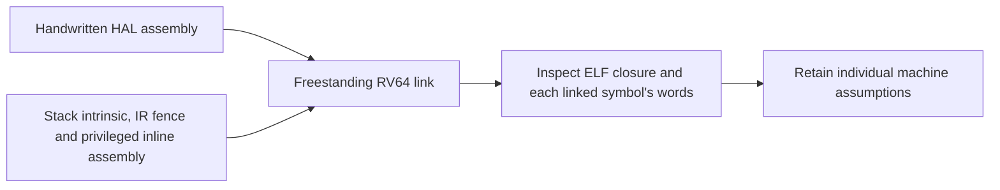

# RT-38 exact RV64 lowering for three HAL operations

A kernel can express some low-level operations in typed IR and use audited assembly for the remaining privileged operations. This study compares an assembly HAL with an LLVM route for reading the stack pointer, ordering CPU memory and synchronizing local address translation. It checks each symbol in a final freestanding RV64 ELF. The comparison is scoped to the exact fixture and toolchain. [Pinned RV64 profile](RT-38-RV64-FREESTANDING-PROFILE-2026-11-25.md)



The common startup initializes an explicit stack, calls each stand-alone leaf, and ends in a local loop. The two HAL sources bind the same symbols. The LLVM IR uses `llvm.read_register.i64` with `sp`, a sequentially consistent IR fence, and side-effecting target assembly with a memory clobber for the translation fence. The assembly code supplies the exact RISC-V instructions directly.

| Operation | LLVM route | First linked instruction and word |
| --- | --- | --- |
| Read current `sp` | `llvm.read_register.i64` with register metadata | `mv a0, sp`, `00010513` |
| Order memory | `fence seq_cst` | `fence rw, rw`, `0330000f` |
| Synchronize local address translation | Side-effecting `sfence.vma` assembly | `sfence.vma`, `12000073` |

Each leaf has the same return word `00008067`. Verified LLVM IR passes and code generation at O0, O2 and O3 match the assembly's two-word sequences in all 12 symbol inspections. The ELF checks confirm a closed RISC-V executable with entry `0x80000000`, an RX code segment, an RW stack segment, and absence of interpreter, dynamic headers, undefined symbols and final relocations. [HAL assembly](RV64-HAL-INTRINSICS-01/hal.s) · [LLVM IR](RV64-HAL-INTRINSICS-01/hal.ll) · [Linked evidence](RV64-HAL-INTRINSICS-01/evidence.json)

Two controls preserve link closure while changing a required instruction. One reads the stack pointer plus 16. The other substitutes a data fence in the translation leaf. A separate undefined host logging symbol causes the strict linker to refuse the build. Exact instruction checks and freestanding closure are independent gates.

The comparison shows how to keep a translation-maintenance operation explicit at the target boundary. The observed data fence and translation fence have different architectural obligations. The transition semantics and timing of these words rely on the RISC-V and platform premises. The experiment checks linked words without running this miniature ELF or proving whole-image semantics. Compiler transformations around an inlined privileged call, full LLMLang source-to-LLVM correspondence, options beyond the recorded profiles and target execution remain separate work. [Machine specification](https://github.com/riscv/riscv-isa-manual/blob/facc5459c11526977f70f58acb82a0b25dc4e73f/src/priv/machine.adoc) · [Supervisor specification](https://github.com/riscv/riscv-isa-manual/blob/facc5459c11526977f70f58acb82a0b25dc4e73f/src/priv/supervisor.adoc)

## Reproduction

Use Debian LLVM and LLD 19.1.7 and CPython 3.12.14. The target is `riscv64-unknown-none-elf` with Zicsr and Zifencei enabled. The runner includes exact tool commands and checks source hashes, ELF hashes and word sequences.

```sh
study=research/runtime-and-systems/RT-38/RV64-HAL-INTRINSICS-01
build=$(mktemp -d)
for seed in 37 75; do
  LC_ALL=C PYTHONHASHSEED="$seed" python "$study/run.py" --output "$build/result-$seed.json"
done
cmp "$build/result-37.json" "$build/result-75.json"
cmp "$build/result-37.json" "$study/evidence.json"
```

[Runner](RV64-HAL-INTRINSICS-01/run.py)
