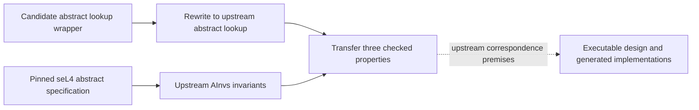

# RT-38 — Reuse seL4 abstract capability lookup invariants

**Evidence** — Successful upstream RISCV64 `AInvs` replay and four separately checked wrapper lemmas.

## Question and boundary

The earlier RT-38 study checked an Isabelle wrapper against seL4's executable design. Can the original abstract specification also serve as a direct proof target for the same delegated lookup shape? This follow-up completes a previously interrupted upstream proof session and imports its original invariant theorems into a separate theory. It keeps the two representation levels explicit. [Executable-design wrapper](RT-38-SEL4-CAPABILITY-LOOKUP-ISABELLE-2026-11-24.md)



The abstract wrapper invokes `lookup_slot_for_thread`, reads the resulting slot with `get_cap` and returns the capability paired with that slot. Its monad and state types are the unmodified upstream abstract forms. The lookup may fail. Its type includes the abstract lookup-failure result, and no precondition is added to the wrapper equality. The property theorems separately retain their upstream preconditions. [Abstract lookup definition](https://github.com/seL4/l4v/blob/12c300e75bb0ca0c82f76496fafacd7e614c0aba/spec/abstract/CSpace_A.thy#L216-L223)

## Checked propositions

| Property | Upstream premise and conclusion |
| --- | --- |
| `candidate_lookup_eq` | The entire abstract monadic computation equals `lookup_cap_and_slot`, including exceptional computation behavior. |
| `candidate_lookup_valid_cap` | Starting with `invs`, a returned capability is valid in the result state. |
| `candidate_lookup_existing_slot` | Starting with `valid_objs`, a returned slot has the required capability table entry predicate `cte_at`. |
| `candidate_lookup_valid_fault` | Starting with `valid_objs`, successful lookup preserves it and a lookup error satisfies the upstream capability-fault validity predicate. |

The wrapper equality follows by unfolding both definitions. Each property rewrites the wrapper and applies one imported theorem. This checks the fit of the wrapper's actual result type and preconditions with the original proof. The evidence covers a shallow abstract wrapper that delegates lookup and memory access. The separate executable-design experiment covers another wrapper with design-state primitives. Relating the two needs the upstream refinement relation and its side conditions. Transferring either to actual LLMLang source or a machine program requires evidence for that additional boundary. [Exact imported invariant source](https://github.com/seL4/l4v/blob/12c300e75bb0ca0c82f76496fafacd7e614c0aba/proof/invariant-abstract/Syscall_AI.thy)

## Upstream replay

Use seL4 17.0.0, l4v `12c300e75bb0ca0c82f76496fafacd7e614c0aba`, seL4 `62e345c240a15671484530b4e6e069ce266c28d7` and Isabelle2025-2 with Poly/ML 5.9.2 in the same verified bundle as the preceding study. The Linux x86-64 proof workbench built default non-MCS RISCV64. One proof thread, a timeout scale of four, Java `-Xmx1792m` and Poly/ML `--maxheap 5800` let the official runner complete `AInvs` after the earlier two-thread failure. The normal `AInvsToplevel_AI` theory completed. The conditional skip-proofs and quick-and-dirty variants were disabled. [Release and workbench setup](RT-38-SEL4-CAPABILITY-LOOKUP-ISABELLE-2026-11-24.md#upstream-replay-and-provenance)

| Session | Observed result |
| --- | --- |
| `ASpec` | Official runner passed in 7m 19s during this upstream replay. |
| `AInvs` | Official runner passed in 1h 4m 15s and reported peak memory as `13.34GB`. The heap SHA-256 is recorded. |
| `LLMLang_AbstractLookup` | Separate proof session passed with all four new propositions and skipped proofs disabled. |

The full upstream `Refine` chain continued to `BaseRefine`. This checkpoint establishes the abstract invariants and wrapper only. It leaves the design correspondence, the C link, reachable counterexample coverage and native implementation evidence as separate obligations. The [evidence ledger](SEL4-ABSTRACT-LOOKUP-01/evidence.json) preserves selected unmodified lines, the exact upstream log-prefix hash and the checked theory and heap hashes.

## Reproduction

Reuse the workbench instructions from the executable-design study, including the pinned checkouts, `L4V_ARCH=RISCV64`, Isabelle settings and pyfdt. Copy [SEL4-ABSTRACT-LOOKUP-01](SEL4-ABSTRACT-LOOKUP-01) into the container's writable scratch mount as `abstract-study`. From the pinned l4v checkout:

```sh
sh /proof/abstract-study/replay.sh /proof/abstract-study --rebuild-ainvs
```

Omit `--rebuild-ainvs` to reuse the matching checked upstream heap. The [replay script](SEL4-ABSTRACT-LOOKUP-01/replay.sh) checks source revisions, checked-proof settings and exact source file hashes, then rebuilds the wrapper session. Its `-c` clean selection targets the wrapper and does not rebuild the upstream heap. The [theory](SEL4-ABSTRACT-LOOKUP-01/AbstractLookup.thy) and [session root](SEL4-ABSTRACT-LOOKUP-01/ROOT) define the complete new proof input.
