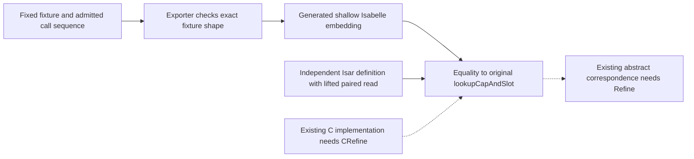

# RT-38 — Reusing the seL4 capability lookup design in Isabelle/HOL

- **Evidence** — Checked source-model equality for one wrapper and a behavior-preserving refactor. Partial replay of the upstream proof sessions.
- **LLMLang baseline** — `e7d5181f72601f6c5e446beeb3b397bc90241fbc`.
- **Tracking** — [RT-38](README.md#8-research-plan-for-implementing-against-an-existing-specification) · [Issue #441](https://github.com/aivibeflow/LLMLang/issues/441).

## Contract and choices

Can a separate theory prove that a small candidate LLMLang fragment preserves the original executable design of seL4 for RISCV64? This experiment takes `lookupCapAndSlot` as released, delegates slot resolution and capability reads to the original two operations, and implements their sequencing in a restricted source fixture. The candidate does not implement either delegated operation. It takes the upstream thread and capability pointer types and uses the upstream kernel state and nondeterministic exception monad directly. [Pinned executable design](https://github.com/seL4/l4v/blob/12c300e75bb0ca0c82f76496fafacd7e614c0aba/spec/haskell/src/SEL4/Kernel/CSpace.lhs#L45-L61)



The exporter accepts the one admitted source operation sequence. Its generated term and a manually refactored term are both checked against the unmodified executable design. The dashed links describe upstream correspondence obligations beyond the checked wrapper.

| Observation | Binding used in the checked theory |
| --- | --- |
| Success | Run upstream `lookupSlotForThread`, read through upstream `getSlotCap`, and return the capability paired with that same slot. |
| Lookup failure | The exception bind propagates the resolver's lookup failure before the capability read. |
| State and monad failure | The two sides are equal computations on the same state type. Their possible result and successor-state pairs and their failure flag agree. Equality permits only the effects already in the original computation. |
| State relation and precondition | Identical upstream design state on both sides. Wrapper equality adds no invariant beyond its Isabelle types. Checking reachable kernel states and transferring abstract safety properties require the upstream correspondence premises. |

The abstract-to-design link is expressed by `lookupCapAndSlot_corres` in `Ipc_R`. It relates a lookup-failure or capability/slot pair and assumes valid, aligned abstract objects and a thread, together with valid, distinct and aligned design objects and a thread. The RISCV64 design-to-C link has a separate C state and result relation, including `invs'` and `tcb_at'`. These two statements were inspected in the exact source. This study checks neither statement afresh. [Ipc_R](https://github.com/seL4/l4v/blob/12c300e75bb0ca0c82f76496fafacd7e614c0aba/proof/refine/Ipc_R.thy#L1471-L1488) · [RISCV64 CSpace_All](https://github.com/seL4/l4v/blob/12c300e75bb0ca0c82f76496fafacd7e614c0aba/proof/crefine/RISCV64/CSpace_All.thy#L81-L91)

## Checked results

The standalone `LLMLang_Lookup` session imported `ExecSpec.CSpace_H` with `skip_proofs=false`. It compiled the generated theory and all eight lemmas. Isabelle's simplifier with existing monad laws checked the original equation and a refactor which pairs the capability and slot before lifting the successful read into the exception monad. The refactor uses one auxiliary distribution lemma. No new axioms or admitted proofs were added. [Theory template](SEL4-LOOKUP-01/Lookup.thy.in) · [Exporter](SEL4-LOOKUP-01/export_lookup.py) · [Fixture](SEL4-LOOKUP-01/lookup.json) · [Checked session log](SEL4-LOOKUP-01/checked-session.log)

| Control | Exact checked counterexample | What the control establishes |
| --- | --- | --- |
| Wrong fault | Resolver throws `True`, replacement returns the exception `False`, starting from state `0`. | The outcome distinguishes lookup failures. |
| Wrong slot | Resolver succeeds at slot `1`, replacement returns slot `2`, at state `0`. | The success observation includes the slot as well as the capability. |
| Extra write | Resolver succeeds at slot `1` and the read keeps state `0`, while the replacement increments the state. | Observable equality includes the successor state even when the returned pair matches. |

These refutations use small, fully specified generic wrapper arguments. They do not exhibit violations reachable under the seL4 object-space invariants. This run used direct checked refutations. Quickcheck, Nitpick, Sledgehammer, executable code generation and comparison against a second LLMLang component remain research work.

| Proof implementation | Consequence |
| --- | --- |
| Reuse Isabelle/HOL with the shallow wrapper | The exact upstream design, its types and monad operations can be imported intact. The new proof is small for this delegated algorithm. The fixture exporter and binding to an eventual LLMLang semantics remain trusted. |
| Represent source syntax and its evaluator in Isabelle/HOL | A source-to-model theorem could justify more than one admitted AST. It would require explicit syntax, operational semantics, mapping of primitive reads and selection of inputs. No deep embedding was tested. |
| Port the relevant design to Lean | Could share more LLMLang proof infrastructure. It introduces a correspondence obligation for imported state and operations and for any reused Isabelle theorem. No paired Lean proof for this design was tested. |

The checked case favors direct Isabelle reuse for early work against a pinned Isabelle specification. For a candidate that replaces a delegated primitive, define its source semantics and state relation before claiming refinement. Replaying the upstream `Refine` and replacing the current fixture exporter with a checked source binding would resolve different obligations. The native backend, generated C and exact kernel build remain separate experiments.

## Upstream replay and provenance

| Artifact | Pinned input or observed result |
| --- | --- |
| Release manifest | seL4 17.0.0, verification-manifest commit `f412116c93f43eb4d0726e3ddc06a5b42f2bb952`, file SHA-256 `18d3c99282878462b2c863c79f1dad9bb5bb86666329d411f468deb3d7302f3a`. |
| l4v and seL4 | `12c300e75bb0ca0c82f76496fafacd7e614c0aba` and `62e345c240a15671484530b4e6e069ce266c28d7`. Default non-MCS RISCV64 via `L4V_ARCH=RISCV64`, with features and platform unset. |
| Isabelle/HOL | Isabelle2025-2 with Poly/ML 5.9.2 in the pinned Linux x86-64 container. The bundle's `src` files matched the seL4 Isabelle source tag at `e64f55a6b7d0e803f73f13e346e7630f3f021dc8`, with two additional generated bundle paths. Ubuntu 24.04.3, RISCV64 GCC 13.3.0, Python 3.12.3 and CMake 3.28.3 were observed. |
| `ASpec` | Official runner passed, including its prerequisites. The runner reported 192.8 s elapsed. |
| `ExecSpec` | Official runner passed, including its prerequisites. The runner reported 630.7 s elapsed. |
| `AInvs`, `BaseRefine` and `Refine` | In the first attempt, the two-thread Poly/ML child for `AInvs` was killed after 1,442 s. The runner reported 18.89 GB and a failed Isabelle build. The workspace cgroup limit was 16 GiB. `BaseRefine` and `Refine` were skipped. |
| Separate `LLMLang_Lookup` | Passed against the built `ExecSpec` heap with one proof thread and the lower Java and Poly/ML memory caps in the study settings. |

The times are recorded build observations. Reference runs used different heap and thread configurations. [Release manifest](https://github.com/seL4/verification-manifest/blob/f412116c93f43eb4d0726e3ddc06a5b42f2bb952/17.0.0.xml) · [ASpec and Refine attempt](SEL4-LOOKUP-01/upstream-aspec-refine.xml) · [ExecSpec result](SEL4-LOOKUP-01/upstream-execspec.xml)

### Reproduce the selected sessions

Prepare a writable scratch directory with sibling Git checkouts named `l4v` and `seL4` at the exact revisions above. Copy [SEL4-LOOKUP-01](SEL4-LOOKUP-01) into that directory as `study`. Build the [Dockerfile](SEL4-LOOKUP-01/Dockerfile) for Linux amd64. Its base digest fixes the Isabelle bundle. The package repository supplies the OS-level build dependencies.

Acquire the `pyfdt` 0.3 source archive, check its SHA-256 `61601c2005ff394a25a6c84c6da2088bbf888328038400d27e4eeb1b04b9f4f0`, and extract it into the scratch directory under `deps/pyfdt-0.3`. Create a writable `build-home/.isabelle/etc` under the same directory and copy [isabelle-settings](SEL4-LOOKUP-01/isabelle-settings) to `settings` there. The settings disable PDF document variants, preserving normal proof checking.

Mount the scratch directory as `/proof`. Make the image's Isabelle installation accessible to the unprivileged build user, put a symlink `/proof/l4v/isabelle` to `/home/isabelle/Isabelle`, and use `HOME` and `USER_HOME` set to `/proof/build-home` and `PYTHONPATH` set to `/proof/deps/pyfdt-0.3`. Use a `USER` value whose Isabelle temporary directory is writable by that user. Run the replay command from `/proof/l4v`.

```sh
sh /proof/study/replay.sh /proof/study
```

The procedure checks the pinned Git revisions, proof-checking mode, generated RISCV64 configuration, original Isabelle design and generated wrapper bytes. It repeats `ASpec` and `ExecSpec` before running the separate proof session. Use the same configuration and `./run_tests -j1 -f -v Refine` to retry the unfinished upstream chain.
