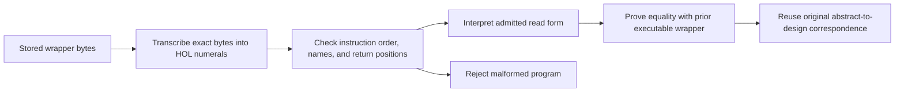

# RT-38 — Check the source bytes of a small seL4 lookup wrapper

Isabelle checks the complete accepted language of an eight-byte wrapper format and proves that any admitted program refines seL4's abstract capability lookup under the existing correspondence premises. Two exact input files use different local names and read compositions. Five malformed inputs are rejected by the same decoder.

## Method

The previous [refined lookup study](RT-38-SEL4-REFINED-LOOKUP-2026-11-24.md) relates candidate computations to seL4's original abstract and executable design. The earlier exporter recognized one JSON fixture and emitted a shallow Isabelle definition. This study moves wrapper admission and evaluation into Isabelle/HOL. The new input is a small research byte language with two local registers. It starts with a lookup and its slot register, uses one of two capability read instructions and its result register, then returns the capability followed by the same slot. A single line feed terminates the program. The decoder compares raw byte values in Isabelle and accepts exactly four encodings, the product of two local-name assignments and two read forms.

The direct read lifts the provider's state action before binding its result. The composed read binds the state action and constructs the return pair before lifting. Both delegate slot resolution and capability reads to the exact design primitives. The two forms keep the prior nondeterministic state, error result and value types.



The Python loader performs byte-to-numeral transcription. It has no lookup or admission semantics. Isabelle checks the result against every claimed proposition, including the allowed byte strings and result of each concrete control. The ledger records the source digests, literal bytes and generated theory digest so the transcription can be recomputed from the archived files.

## Results

| Result | Checked statement |
| --- | --- |
| `decoder_language_exact` | For any natural-number list, decoding succeeds exactly for the four enumerated encodings. |
| `evaluator_agrees` | For either read form, the computation equals the previous shallow wrapper for any resolve action and slot reader of the given types. |
| `admitted_source_matches_design` | Every computation returned for admitted bytes equals the previous executable-design wrapper. |
| `admitted_source_refines_abstract_lookup` | Every returned computation has the original correspondence with the abstract wrapper, retaining the pointer, state, capability, slot and failure relations. |
| Concrete byte controls | Admit the stored direct and renamed composed programs. Reject a swapped result, aliased registers, reordered instructions, an unsupported operation and a missing line feed. |

The two accepted source files spell `l0c1p10\n` and `l1m0p01\n`. The parser checks both the distinct binding names and their use in the result order. The proof includes the other two valid combinations through the complete decoder-language characterization. The proof rejects invalid source bytes at admission. Reachable counterexamples for implemented semantic mutations remain a separate problem.

## Implications for implementation choice

A checked decoder and typed evaluator offer an auditable binding for this fragment with direct reuse of the Isabelle design proof. The earlier shallow exporter remains a smaller reference point for one fixed wrapper. This work exercises lexical admission, the two read compositions and one exact refinement path. Using it for LLMLang requires an agreed source model, a checked frontend and correspondence to the target. The external byte loader, delegated primitives, Isabelle and the upstream seL4 proof remain part of the trust boundary. General LLMLang syntax, independent review, automatic counterexample search, C refinement and the kernel binary are outside the checked profile.

## Reproduce

Use the pinned [Refine workbench and proof heaps](RT-38-SEL4-REFINED-LOOKUP-2026-11-24.md#replay-and-implications). Copy `SEL4-LOOKUP-SOURCE-01` beside the three prior fixture directories. From the pinned l4v checkout:

```sh
sh /proof/study/SEL4-LOOKUP-SOURCE-01/replay.sh
```

The runner verifies the target revisions and proof options, loads the archived bytes, regenerates both required theories and clean-builds `LLMLang_LookupSource`. Compare the generated theory SHA-256 with the [evidence ledger](SEL4-LOOKUP-SOURCE-01/evidence.json). [Theory template](SEL4-LOOKUP-SOURCE-01/SourceLookup.thy.in) · [Byte loader](SEL4-LOOKUP-SOURCE-01/export_bytes.py)
