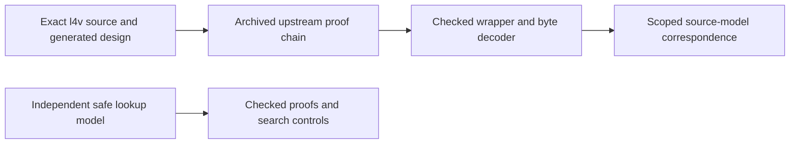

# RT-38 seL4 lookup proof transfer and counterexample controls

The scoped seL4 route reuses the original RISCV64 executable design and refinement theorem for a candidate wrapper with delegated lookup and capability reads. The archive checker confirms five upstream sessions across the stored runs and links the later Refine heap receipt to the exact source decoder run. A separate stock Isabelle/HOL session uses safe list lookup to test whether the same modeling and counterexample workflow transfers to a component without l4v dependencies.



## Upstream and source correspondence

The recorded RISCV64 non-MCS sessions ASpec, ExecSpec, AInvs, BaseRefine and Refine have passing receipts. The earlier AInvs attempt failed under its memory configuration. The later Refine JUnit has nine passing cases and the expected digest. All four pinned upstream inputs match, including the CSpace design theory regenerated with the l4v translator. The two local Isabelle theory generators produce the exact archived wrapper and source decoder bytes. Seven wrapper inputs, four decoder inputs and all seven stored source examples match their recorded hashes. [Upstream Refine replay](RT-38-SEL4-REFINED-LOOKUP-2026-11-24.md) · [Source decoder](RT-38-SEL4-LOOKUP-SOURCE-DECODER-2026-11-25.md)

The original `lookupCapAndSlot_corres` transfers after the abstract and design wrappers are rewritten to the upstream definitions. The bounded source decoder establishes which byte programs denote these wrappers and preserves the existing input, state, result and failure assumptions. This gives direct reuse of an upstream theorem. A checked general LLMLang frontend, native adapter proof, reachable l4v mutation witnesses and C/binary correspondence are separate obligations.

## Stock HOL transfer

The safe list lookup is an independent fixture. It freezes the bounds check, returned value and slot, absent result and state preservation. Isabelle proves the refactored candidate equivalent by simplification. The three intentionally changed implementations have checked concrete witnesses. Exhaustive Quickcheck at size four independently finds a counterexample for each.

| Variant | Witness |
|---|---|
| Wrong fault | Empty list at index zero returns the wrong failure variant |
| Wrong slot | A one-element list at index zero returns slot one |
| Extra state change | The same successful lookup flips the initial Boolean state |

Nitpick independently meets its genuine-counterexample expectation for the extra-write variant. The list states and access conditions are those of the safe-lookup fixture. The controls establish the tool workflow without claiming reachability under seL4's object-space invariants.

## Replay

Use CPython 3.12.14 and the l4v checkout at `12c300e75bb0ca0c82f76496fafacd7e614c0aba`. The transcript audit checks proof outcomes and identities. Two hash seeds yield the same [archive ledger](SEL4-TRANSFER-CONTROLS-01/archive-evidence.json). Two clean stock sessions passed with Isabelle2025-2 and Poly/ML 5.9.2 from the same Docker base image used by the original experiment. [Stock proof ledger](SEL4-TRANSFER-CONTROLS-01/stock-evidence.json)

```sh
p=research/runtime-and-systems/RT-38/SEL4-TRANSFER-CONTROLS-01
L4V_ARCH=RISCV64 make -C /path/to/l4v/spec/design design
LC_ALL=C PYTHONHASHSEED=37 python -B "$p/check.py" --l4v /path/to/l4v
image=makarius/isabelle@sha256:9bd33b183c399327c5d554fc8cde27c29b5d2b20cdc6fe7a604caa3f951018fc
tar -c -C "$p" ROOT LookupControls.thy |
  docker run --rm -i --network none --entrypoint /bin/sh -e USER_HOME=/tmp "$image" -c \
  'mkdir -p /tmp/study && tar -x -C /tmp/study && /home/isabelle/Isabelle/bin/isabelle build -v -o threads=1 -o skip_proofs=false -o quick_and_dirty=false -j1 -D /tmp/study'
```
