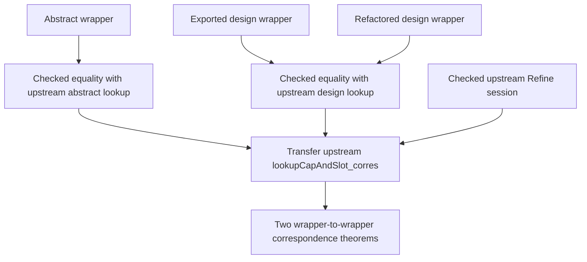

# RT-38 — Relate abstract and executable seL4 capability lookup wrappers

The official RISCV64 proof runner completed `Refine` and its eight prerequisites. In a separate proof session, Isabelle checked that both the exported executable-design lookup and its refactor correspond to the candidate abstract lookup under the original seL4 premises.

## What the proof relates

The [abstract wrapper](RT-38-SEL4-ABSTRACT-LOOKUP-INVARIANTS-2026-11-24.md) uses the upstream abstract capability lookup and state. The [executable-design wrapper](RT-38-SEL4-CAPABILITY-LOOKUP-ISABELLE-2026-11-24.md) uses the corresponding design primitives. Earlier checks established equality with the upstream computation at each level. This study imports the original `lookupCapAndSlot_corres` from the pinned Isabelle theory and rewrites both computations by those equalities. The separate proof session consumes the actual generated design theory.



The input premise equates the abstract capability-pointer bit list `cptr` with `to_bl cptr'` for the design word. The abstract initial state must satisfy `valid_objs`, `pspace_aligned` and `tcb_at thread`. The design initial state keeps `valid_objs'`, `pspace_distinct'`, `pspace_aligned'` and `tcb_at' thread`. The `corres` judgment carries the upstream state relation. Successful outcomes relate the paired capabilities by `cap_relation` and require the design capability-table entry to equal `cte_map` of the abstract slot. Lookup failures use the original relation `lfr`. [Exact upstream theorem](https://github.com/seL4/l4v/blob/12c300e75bb0ca0c82f76496fafacd7e614c0aba/proof/refine/Ipc_R.thy#L1471-L1489)

| Checked proposition | Executable-design side |
| --- | --- |
| `exported_lookup_corresponds` | The exported `llmlang_lookup` computation. |
| `refactored_lookup_corresponds` | The separate `llmlang_lookup_refactored` computation. |

The transfer takes one application of the upstream theorem after rewriting. Both clean wrapper builds ran with proof skipping and quick-and-dirty mode disabled. The [ledger](SEL4-REFINED-LOOKUP-01/evidence.json) records the completed original theories, native runner output and exact source and artifact hashes.

## Replay and implications

Use the pinned seL4 17.0.0 release, l4v `12c300e75bb0ca0c82f76496fafacd7e614c0aba`, seL4 `62e345c240a15671484530b4e6e069ce266c28d7` and Isabelle2025-2 with Poly/ML 5.9.2. The proof was built on Linux x86-64 for default non-MCS RISCV64. The settings used one proof thread, timeout scale four, a Java `-Xmx1792m` limit and a Poly/ML `--maxheap 5800` limit. Conditional proof skipping was disabled. The official runner reported `Refine` passed in 2h 8m 55s with its reported memory metric of 13.52 GB. The [original JUnit summary](SEL4-REFINED-LOOKUP-01/upstream-refine.xml) contains nine successful targets, including `BaseRefine` and `Refine`.

Direct Isabelle reuse now has checked abstract-to-design correspondence evidence for this delegated lookup. Relating an LLMLang implementation to the wrapper still requires checked language semantics and source-to-model translation. Replacing the delegated lookup primitives would add their own state and outcome proof obligations. C refinement, kernel binary correspondence, automatic counterexample search and reachability of the earlier generic negative controls remain open. A port to another proof assistant would need a separate correspondence argument.

Set up the [existing workbench](RT-38-SEL4-CAPABILITY-LOOKUP-ISABELLE-2026-11-24.md#upstream-replay-and-provenance). Copy `SEL4-LOOKUP-01`, `SEL4-ABSTRACT-LOOKUP-01` and `SEL4-REFINED-LOOKUP-01` into the same directory under the mounted scratch path. From the pinned l4v checkout, run:

```sh
sh /proof/study/SEL4-REFINED-LOOKUP-01/replay.sh /proof/refine-replay.xml
```

Omit the XML path to reuse the checked upstream heaps and rebuild only the separate wrapper session. The script checks the upstream revisions, Isabelle version, checked-proof options and source hashes, then regenerates the design theory and verifies its exact bytes. [Replay script](SEL4-REFINED-LOOKUP-01/replay.sh) · [Theory](SEL4-REFINED-LOOKUP-01/RefinedLookup.thy) · [Session root](SEL4-REFINED-LOOKUP-01/ROOT)
